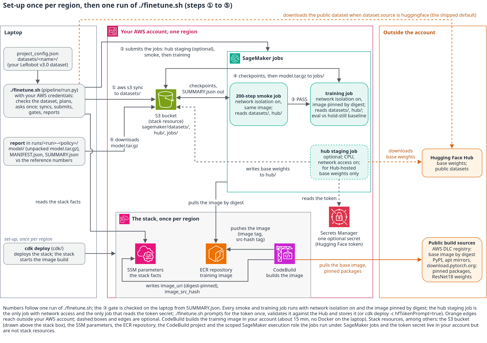

# Fine-tune Hugging Face LeRobot policies on Amazon SageMaker

Train a [LeRobot](https://github.com/huggingface/lerobot) policy on your own robot recordings as an Amazon SageMaker training
job, with one command. Put a LeRobot v3.0 dataset under `datasets/`, choose the policy in `project_config.json` and run
`./finetune.sh`. The pipeline checks the dataset, uploads it, runs a short 200-step test job, trains, evaluates on held-out
episodes and downloads the checkpoint with its licence notice. Your machine needs Python, the AWS CLI and Node 22 for the
CDK deploy (or the committed CloudFormation template without Node): no GPU, no Docker, no model weights. The repository
holds nothing that is specific to an AWS account.

<!-- BEGIN GENERATED licence-disclaimer: edit pipeline/policies_doc.py or trainer/policies/*.yaml, then run python3 -m pipeline.policies_doc -->
> ⚠️ **Model licences.** This repository distributes no model weights and no datasets. For every policy that fine-tunes
> a published checkpoint, the training job downloads the base weights from the Hugging Face Hub into your account, under
> the publisher's terms. Several of those bases are not open-source or carry conditions:
>
> - Apache-2.0 Hub tag; terms apply (pretraining data includes a CC BY-NC-SA corpus): `xvla`
> - Gemma Terms of Use: `pi0`, `pi05`, `pi0_fast`
> - Qwen Research Licence (non-commercial): `eo1`
> - NVIDIA Open Model License: `groot`
> - research only (Ai2 Responsible Use): `molmoact2`
> - no licence position established for the base weights: `multi_task_dit`, `evo1`, `fastwam`, `fastwam_lora`,
>   `lingbot_va` (an Apache-2.0 Hub tag without licence text, no licence declared, or conflicting statements; the
>   per-policy notice in docs/POLICIES.md records what was found, and the publisher's terms for the weights and their
>   training data have not been confirmed)
>
> Production or commercial use of any of these needs your own legal review. The job refuses to start until
> `accept_licence: true` (and `approval_ref` where the table shows it) is set for the policy in `project_config.json`,
> and it writes `LICENCE_NOTICE.md` next to every output. Read the linked terms before enabling a policy so you can make
> an informed decision. This note concerns the model weights only: the code in this repository is MIT-0.
<!-- END GENERATED licence-disclaimer -->

## What this asset supports

**16 of the 19 policy types in lerobot 0.6.1 are offered**: 13 ran end to end as SageMaker jobs, and the three 80 GB types
(`pi0_fast`, `eo1`, `fastwam`, plus the `fastwam_lora` recipe) passed their smoke on EC2 H100 hosts with the same container
([docs/RESULTS.md](docs/RESULTS.md)). Every policy type has a registry entry
(`trainer/policies/<name>.yaml`), and one type has two: `fastwam_lora` is a second recipe for `fastwam` (LoRA on the video
expert, see [docs/POLICIES.md](docs/POLICIES.md), LoRA recipes). The 16 policy types below are listed in `project_config.json`,
each with the public dataset it was validated, trained or smoke-tested on. The `policies.fastwam_lora` entry takes the same keys as `policies.fastwam`. The other three (`gaussian_actor`, `vla_jepa`, `wall_x`) are registered but not offered: `gaussian_actor` is
a reinforcement-learning actor that `lerobot-train` cannot train; `vla_jepa` was trained on data whose licence limits any
result to research use; `wall_x` fine-tunes weights that declare no licence at all.

<!-- BEGIN GENERATED capability-matrix: edit pipeline/policies_doc.py or trainer/policies/*.yaml, then run python3 -m pipeline.policies_doc -->
| policy | what it is | inputs | action space | GPU and default instance | licence of the base weights | status |
|---|---|---|---|---|---|---|
| `act` | Action Chunking Transformer, trained from scratch | several cameras, state, no language | dataset width, chunk 24 | 16 GB · `ml.g6e.4xlarge` | [Apache-2.0](https://github.com/huggingface/lerobot/blob/v0.6.1/LICENSE) | validated |
| `diffusion` | Diffusion Policy (U-Net, DDPM), trained from scratch | several cameras (2 frames each), state, no language | dataset width, chunk 24 | 24 GB · `ml.g6e.4xlarge` | [Apache-2.0](https://github.com/huggingface/lerobot/blob/v0.6.1/LICENSE) | smoke-tested |
| `tdmpc` | TD-MPC latent world model with CEM planning, trained from scratch | one camera (square), state, reward labels, no language | dataset width, chunk 5 | 16 GB · `ml.g6e.4xlarge` | [Apache-2.0](https://github.com/huggingface/lerobot/blob/v0.6.1/LICENSE) | smoke-tested |
| `vqbet` | VQ-BeT behaviour transformer, trained from scratch | one camera (5 frames), state, no language | dataset width, chunk 5 | 16 GB · `ml.g6e.4xlarge` | [Apache-2.0](https://github.com/huggingface/lerobot/blob/v0.6.1/LICENSE) | smoke-tested |
| `smolvla` | SmolVLA: an action expert trained from scratch on a frozen SmolVLM2-500M backbone | several cameras, state, language | up to 32 dims, chunk 50 | 24 GB · `ml.g6e.4xlarge` | [Apache-2.0](https://huggingface.co/HuggingFaceTB/SmolVLM2-500M-Video-Instruct) | trained |
| `xvla` | X-VLA 0.9B | several cameras, state, language | up to 20 dims, chunk 24 | 48 GB · `ml.g6e.4xlarge` | [Apache-2.0 Hub tag; terms apply (pretraining data includes a CC BY-NC-SA corpus)](https://huggingface.co/lerobot/xvla-base) · `accept_licence` | trained |
| `multi_task_dit` | Multi-Task DiT with CLIP conditioning | several cameras (2 frames each), state, language | dataset width, chunk 24 | 24 GB · `ml.g6e.4xlarge` | [none declared (CLIP encoder)](https://huggingface.co/openai/clip-vit-base-patch16) · `accept_licence` | smoke-tested |
| `pi0` | pi0 (PaliGemma-3B + flow-matching expert) | several cameras, state, language | up to 32 dims, chunk 50 | 48 GB · `ml.g6e.4xlarge` | [Gemma Terms of Use](https://ai.google.dev/gemma/terms) · `accept_licence` | trained |
| `pi05` | pi0.5 (PaliGemma-3B + flow-matching expert, state as prompt tokens) | several cameras, state, language | up to 32 dims, chunk 50 | 48 GB · `ml.g6e.4xlarge` | [Gemma Terms of Use](https://ai.google.dev/gemma/terms) · `accept_licence` | trained |
| `eo1` | EO-1 (Qwen2.5-VL-3B + flow-matching head) | several cameras, state, language | up to 32 dims, chunk 8 | 80 GB · `ml.p5.4xlarge` (untested) | [Qwen Research Licence (non-commercial)](https://huggingface.co/Qwen/Qwen2.5-VL-3B-Instruct/blob/main/LICENSE) · `accept_licence` + `approval_ref` | smoke-tested |
| `evo1` | EVO-1 (InternVL3-1B + flow-matching head) | several cameras, state, language | up to 24 dims, chunk 50 | 24 GB · `ml.g6e.4xlarge` | [unclear: MIT or Qwen (InternVL3-1B)](https://huggingface.co/OpenGVLab/InternVL3-1B-hf) · `accept_licence` | smoke-tested |
| `fastwam` | FastWAM (Wan2.2 world-action model) | several cameras, state, language | dataset width, chunk 32 | 80 GB · `ml.p5.4xlarge` (untested) | [unresolved (Apache-2.0 Hub tag, no licence text)](https://huggingface.co/lerobot/fastwam_base) · `accept_licence` + `approval_ref` | smoke-tested |
| `fastwam_lora` | FastWAM, second recipe: LoRA on the video expert, action expert in full training; publishes an adapter and a merged checkpoint | several cameras, state, language | dataset width, chunk 32 | 80 GB · `ml.p5.4xlarge` (untested) | [unresolved (Apache-2.0 Hub tag, no licence text)](https://huggingface.co/lerobot/fastwam_base) · `accept_licence` + `approval_ref` | smoke-tested |
| `groot` | NVIDIA GR00T N1.7 3B | several cameras, state, language | up to 132 dims, chunk 24 | 48 GB · `ml.g6e.4xlarge` | [NVIDIA Open Model License](https://www.nvidia.com/en-us/agreements/enterprise-software/nvidia-open-model-license/) · `accept_licence` + `approval_ref` | smoke-tested |
| `lingbot_va` | LingBot-VA video-action world model (LoRA fine-tune) | several cameras (mapping required, 16 frames each), state, language | up to 30 dims, chunk 16 | 48 GB · `ml.g6e.4xlarge` | [unresolved (Apache-2.0 Hub tag, no licence text)](https://huggingface.co/robbyant/lingbot-va-base) · `accept_licence` + `approval_ref` | smoke-tested |
| `molmoact2` | MolmoAct2 (Molmo2-4B + action expert) | several cameras, state, language | up to 32 dims, chunk 30 | 48 GB · `ml.g6e.4xlarge` | [research only (Ai2 Responsible Use)](https://allenai.org/responsible-use) · `accept_licence` + `approval_ref` | smoke-tested |
| `pi0_fast` | pi0-FAST (autoregressive action tokens) | several cameras, state, language | up to 32 dims, chunk 10 | 80 GB · `ml.p5.4xlarge` (untested) | [Gemma Terms of Use](https://ai.google.dev/gemma/terms) · `accept_licence` | smoke-tested |
<!-- END GENERATED capability-matrix -->

The table is generated from the registry (`trainer/policies/*.yaml`). How to read it:

- **Inputs**: how many camera streams the entry takes (one, several, or several mapped onto the base checkpoint's camera
  slots), frames per camera when more than one, joint state (every entry), whether the dataset task string conditions the
  policy (`language`; a single-task dataset makes it a constant), and `reward labels` where the loss needs `next.reward`.
- **Action space**: `up to N dims` where the policy pads actions to N and refuses wider datasets, otherwise the dataset's
  width; `chunk` is the default action chunk.
- **GPU and default instance**: the smallest GPU memory class the entry accepts and the instance the shipped
  `project_config.json` gives it. `(untested)` marks a type whose GPU count and memory in
  `pipeline/instance_table.py` were not checked against the instance-type page (`verified=False`); it says nothing about
  whether a run used the type, which [docs/RESULTS.md](docs/RESULTS.md) records. The instance types per memory class, with quota names and prices, are under
  [Quotas](#instance-types-per-gpu-memory-class).
- **Licence**: that of the base weights the policy fine-tunes (the lerobot code itself is Apache-2.0), linked to the terms,
  followed by the switch `project_config.json` must carry before the job starts. *unresolved* (registry class `unknown`)
  means the Hub repository carries an Apache-2.0 tag but no licence text and no statement about the robot data the weights
  were trained on; *terms apply* means a named licence or usage condition may bind fine-tunes.
- **Status**: `validated`, `trained` or `smoke-tested`, as defined in [docs/POLICIES.md](docs/POLICIES.md), which also has
  the full licence notice, base checkpoint, measured GPU memory, default budget and an estimated run time and cost per
  entry. `pi0_fast`, `eo1`, `fastwam` and `fastwam_lora` passed their smoke tests on EC2 H100 hosts with the same container;
  the other entries ran as SageMaker jobs.

### Which policy for which situation

<!-- BEGIN GENERATED scenario-fit: edit pipeline/policies_doc.py or trainer/policies/*.yaml, then run python3 -m pipeline.policies_doc -->
| situation | recommended | alternatives | why |
|---|---|---|---|
| Single-task imitation from your own recordings, 48 GB GPU | `act` | `diffusion`, `vqbet` | trained from scratch, no base weights to license, the only validated entry and the shipped default |
| Language-conditioned, several tasks in one dataset | `smolvla` | `pi05`, `pi0`, `xvla`, `groot`, `molmoact2` | SmolVLA is licence-clean and was trained end to end here; of the three chunk-50 VLAs (pi0, pi0.5, SmolVLA) pi0.5 had the lowest ratio to the hold-still baseline and X-VLA (chunk 24) the lowest absolute joints error (docs/RESULTS.md); pi0.5 inherits the Gemma terms |
| An 80 GB GPU is available | `pi05` | `pi0_fast`, `eo1`, `fastwam`, `fastwam_lora` | the four alternatives need 80 GB and are smoke-tested only (on EC2 H100 hosts); pi0.5 is a trained entry that also lists `ml.p5.4xlarge` |
| Reward-labelled data (`next.reward` in the dataset) | `tdmpc` | none | the only offered policy that learns from rewards; recorded demonstrations carry none, so it is not deliverable |
| One camera only | `act` | `vqbet`, `diffusion` | every entry accepts a single camera; VQ-BeT and TD-MPC accept nothing else, so one camera is no restriction here |
| Lowest-cost first run | `act` | `vqbet`, `diffusion` | the measured 100k-step ACT run cost about $10 on `ml.g6e.4xlarge`; ACT and VQ-BeT also run on the 24 GB and 16 GB classes, and the smoke job alone costs under $1 |
| Licence-clean bases only (nothing to accept) | `act` | `diffusion`, `vqbet`, `smolvla`, `tdmpc` | registry class `clean`, no `accept_licence`; act, diffusion and vqbet are also deliverable |
| Actions wider than 32 dimensions (bimanual, mobile base) | `act` | `diffusion`, `vqbet`, `groot` | pi0, pi0.5, pi0-FAST, SmolVLA, EO-1 and MolmoAct2 pad actions to 32 dimensions and refuse wider datasets (`max_action_dim`); act, diffusion and vqbet read the width from the dataset and groot pads to 132 |
| World-model or video-conditioned policy | `fastwam` | `fastwam_lora`, `lingbot_va` | Wan2.2-based world-action models that predict video and actions together; lingbot_va fits 48 GB with LoRA but trains slowly; all three have an unresolved licence and need `approval_ref` |
<!-- END GENERATED scenario-fit -->

Only `act`, `diffusion` and `vqbet` are marked *deliverable*: trained from scratch, licence-clean, safe to ship as your own
model. `tdmpc` and `smolvla` are also licence-clean and need no `accept_licence`, but are not marked deliverable (TD-MPC
needs reward-labelled data; SmolVLA is an opt-in research option). Every other entry inherits the licence of its base weights.
`approval_ref` is a free-text field for your own sign-off note, such as a ticket number (see
[Licence gate](#fine-tune-other-policies)).

ACT is the default policy. In the one head-to-head recorded before this repository (ACT against X-VLA on a private
80-episode single-task dataset not distributed with this repository), ACT reached a 16 % lower held-out joint error at a
fraction of the cost, and it carries no upstream weights to license. On the public dataset the VLA runs are not directly
comparable with ACT's because their chunk lengths differ ([docs/WHY_NOT_VLA.md](docs/WHY_NOT_VLA.md)).

> **Reproducible result.** On the shipped public dataset, 100k ACT steps bring the joint prediction error on held-out
> episodes down to 0.42 times that of the "hold still" baseline, with every action dimension beating that baseline. The hold
> still baseline is a policy that predicts the arm stays in its current pose for the whole action chunk; below 1.0 means the
> policy learned something. The run took 1 h 54 m and cost about $10 on `ml.g6e.4xlarge`. Every number in this README marked
> *measured* comes from a job recorded in [docs/RESULTS.md](docs/RESULTS.md).

## How it works



*The circled numbers ① to ⑤ in the diagram are one run of `./finetune.sh`; the steps below follow them.
Orange arrows reach outside your AWS account; dashed boxes and arrows are optional. Editable source:
[docs/architecture.drawio](docs/architecture.drawio).*

**Set-up, once per region.** `cdk deploy` creates an ECR repository, an S3 bucket, a scoped SageMaker execution role
that every job runs under, a CodeBuild project and the SSM parameters that record those stack facts, then starts the
image build. CodeBuild builds the training image **in your account** (about 15 minutes; no Docker on your machine, no 13
GB image upload), pushes it to ECR and writes the digest-pinned `image_uri` and the image's source hash to two more SSM
parameters. Everything downstream reads those parameters. The SageMaker jobs and the token secret live in your account
too, but the stack does not create them: `./finetune.sh` submits the jobs at run time, and the secret is created in
Secrets Manager the first time a token is stored (with the shipped default, `cdk destroy` still deletes the
default-named secret; see [Teardown](#teardown)).

Data flow of one run:

- **① Laptop to S3.** `./finetune.sh` checks the dataset against the enabled policies, reads the stack facts from SSM, waits
   for a running image build if there is one, prints one plan and asks once. Then `aws s3 sync` uploads what is missing of
   the dataset to `sagemaker/datasets/` in the bucket.
- **② Submit the jobs.** For each enabled policy: a CPU hub staging job when the base weights live on the Hugging Face
   Hub (the only job with network access and the only one that reads the token secret; it writes the weights to `hub/`),
   then a 200-step smoke job, then the training job. Before a staging job for gated weights, `./finetune.sh` checks the
   stored Hugging Face token against the Hub and asks for one, with hidden input, only when it is missing or rejected;
   it stores the token in Secrets Manager (`cdk deploy -c hfTokenPrompt=true` does this at deploy time instead). Every
   smoke and training job pulls the image from ECR by digest, reads `datasets/` and `hub/` from the bucket, and runs
   with network isolation on.
- **③ The gate.** The smoke job writes its checkpoints and `SUMMARY.json` back to the bucket. The laptop reads that summary
   and submits the training job only when the gate passes: the job completed, the weights moved, no trainable parameter is
   stored in bf16, the evaluation is finite and the reload check succeeded. The smoke's step rate sizes the training job's
   runtime cap and the hours estimate printed before it is submitted.
- **④ Inside the training job.** `trainer/sagemaker/train_entrypoint.sh` downscales the videos if needed and hands over
   to `trainer/train_policy.sh`, which checks the dataset again, renders the `lerobot-train` flags from the registry
   entry, trains, and evaluates on held-out episodes against the hold-still baseline. Checkpoints are mirrored to
   `jobs/` as they are written; at the end the newest checkpoint, the evaluation, a licence notice and `SUMMARY.json`
   are published as `model.tar.gz` under `jobs/`.
- **⑤ Back on the laptop.** The report stage downloads `model.tar.gz` into `runs/<run>-<policy>/model/`, compares
   `SUMMARY.json` with the reference numbers and writes `MANIFEST.json`. `inference/predict.py` shows how to load the
   checkpoint offline and predict one action chunk.

Details: [docs/ARCHITECTURE.md](docs/ARCHITECTURE.md).

## Prerequisites

| | |
|---|---|
| AWS account | permissions to deploy a CDK stack (CloudFormation, IAM, S3, ECR, CodeBuild, Lambda, CloudWatch Logs, SSM, Secrets Manager). The identity that runs `finetune.sh` needs to create, describe and stop SageMaker training jobs, `iam:PassRole` on the stack's execution role, read and write on the stack bucket, `ssm:GetParameters` on the stack's parameters and Secrets Manager read and write on the token secret, plus the read-only ECR, Service Quotas and STS calls of the preflight and the read-only CodeBuild calls that follow a running image build |
| SageMaker quota | `ml.g6e.4xlarge for training job usage` of at least 1 in your region. New accounts start at 0 for every GPU type; the request command is under [Quotas](#quotas). ACT also runs on `ml.g5.4xlarge` (half the speed) and `ml.g4dn.2xlarge` (a sixth of the speed) |
| Laptop | Python 3.10 or newer, the [AWS CLI v2](https://docs.aws.amazon.com/cli/), Node 22 with `npm i -g aws-cdk`. No Docker, no GPU. Without Node, deploy the committed plain CloudFormation template instead ([cdk/template/README.md](cdk/template/README.md)) |
| Dataset | a LeRobot **v3.0** dataset folder, or nothing: the shipped configuration downloads a small public one ([datasets/README.md](datasets/README.md)) |

## Quick start

The shipped `project_config.json` trains ACT for 100k steps on the public dataset `lerobot/svla_so101_pickplace` (86 MB,
SO-101 arm, 50 episodes). The measured run took about 2 h 20 min and $11 in total.

**1. Install**

```bash
git clone https://github.com/aws-samples/sample-lerobot-policy-finetuning-on-sagemaker
cd sample-lerobot-policy-finetuning-on-sagemaker
python3 -m venv .venv && . .venv/bin/activate
pip install -r requirements.txt -r cdk/requirements.txt
```

Every later command assumes this virtualenv is active (`./finetune.sh` uses the interpreter on your PATH, or the one in
`PYTHON=<interpreter>`).

**2. Deploy the stack** (once per region). It starts the training-image build in CodeBuild and returns; the build takes
about 15 minutes and you do not have to wait for it. No Hugging Face token is needed here: `./finetune.sh` asks for one
later, and only when a policy with gated base weights is enabled. To store the token at deploy time instead, run
`cdk deploy -c hfTokenPrompt=true`; the prompt is hidden and the token goes straight to Secrets Manager.

```bash
export AWS_REGION=us-east-1 AWS_DEFAULT_REGION=us-east-1
cd cdk
cdk bootstrap
cdk deploy
cd ..
```

**3. Run**

```bash
./finetune.sh --dry-run      # checks the dataset, waits for the image build if needed, prints the plan; submits nothing
./finetune.sh                # the same, then asks once and submits the smoke job and the training job
```

`./finetune.sh` checks the dataset against the enabled policies first, then waits for a running image build if there is
one, checks quotas, prints the plan (instance, steps, estimated hours and dollars) and asks once. It stays attached until
training has finished and leaves the checkpoint in `runs/<run>-act/model/pretrained_model/` next to `SUMMARY.json`, `eval/`
and `LICENCE_NOTICE.md`; `--no-wait` returns right after submission instead, and `--no-download` reports from the mirrored
`SUMMARY.json` without fetching the model archive (about 8.5 GB for the pi0 family). A lost terminal does not stop the job:
`./finetune.sh --train-job <job-name>` reattaches; `--resume-from <job-name>` continues an interrupted job from its last
checkpoint, and `--resume-from <job-name> --extend-steps <n>` trains a finished run on to a total of n steps. `--compat` prints which policies can train on the
dataset without any AWS call; `--plan` stops after the plan table.

**4. Train on your own data.** Copy your LeRobot v3.0 dataset to `datasets/<name>/`, set `dataset.name` to that folder and
`dataset.source` to `local` in `project_config.json`, and run step 3 again. [datasets/README.md](datasets/README.md) covers
the other sources (S3, your own Hub repository) and converting older LeRobot exports.

## What a run costs

`ml.g6e.4xlarge` on-demand list prices for Asia Pacific (Tokyo), September 2026, the region the runs in
[docs/RESULTS.md](docs/RESULTS.md) were recorded in. The quick start uses us-east-1, where the list price differs.
Compute cost grows in proportion to `steps`.

| step | wall clock | cost |
|---|---|---|
| `cdk deploy` + image build (once per region) | ~15 min | ~$0.50 (CodeBuild) + ECR storage ~$1.5/month |
| smoke job (200 steps, the gate) | ~8 min | < $1 |
| hub staging job (per policy with base weights on the Hub; re-run when a repo or revision changes) | 8-10 min | < $1 |
| ACT, 100k steps, the shipped public dataset (*measured*) | 1 h 54 m | ~$10 (about $5 on managed Spot, *measured*) |
| SmolVLA, 20k steps, batch 16, the shipped public dataset (*measured*) | 1 h 23 m | ~$7 |
| X-VLA, 30k steps, batch 16, the shipped public dataset (*measured*) | 3 h 51 m | ~$20 |
| pi0, 20k steps, batch 8, the shipped public dataset (*measured*) | 4 h 51 m | ~$26 |
| pi0.5, 20k steps, batch 8, the shipped public dataset (*measured*) | 6 h 22 m | ~$34 |
| storage: 3 ACT checkpoints + dataset copy | | ~$0.10/month |
| storage: 3 pi0 or pi0.5 checkpoints (about 19 GB each: fp32 weights + optimizer state) | | ~$1.3/month per run |

A training job's runtime cap is 15 min of start-up plus 20 min for evaluation plus `steps / step rate` times
`compute.runtime_multiplier` (default 3.0). The step rate is the smoke job's measurement (or the registry table's value for
that GPU with `--skip-smoke`), so a slower instance gets a longer cap instead of being stopped mid-run. The smoke job's cap
is 1 h unless the registry entry raises it (`smoke.max_minutes`: 2 h for `groot` and `pi0_fast`, 2.5 h for `molmoact2`,
`lingbot_va`, `fastwam` and `fastwam_lora`, where loading the base weights takes most of the time). The hub staging job has a fixed 2 h cap.
The ACT run above saved 51 % on managed Spot (`compute.spot: true` or `--spot`; interruptions resume from the mirrored
checkpoints). `compute.keep_checkpoints` (default 3) bounds what a run leaves in S3.

## project_config.json

The only file you edit. It is checked against `pipeline/project_config.schema.json`; unknown keys and overrides of flags the pipeline
owns are refused.

| block | what it holds |
|---|---|
| `project` | the stack name prefix. Region and credentials come from the environment (`AWS_DEFAULT_REGION` / `AWS_REGION`, `AWS_PROFILE`) or the `--region` / `--profile` flags, not from this file |
| `dataset` | the shared dataset: `name` (folder under `datasets/`), `source` (`local`, `huggingface` or `s3`), `hf_repo_id` + `hf_revision` or `s3_uri`, `downscale_height` (every camera whose height differs from this is re-encoded to that height inside the job, aspect ratio kept; `null` keeps the source resolution) |
| `policies` | one entry per policy type, keyed by the registry file name: `enabled`, `steps`, `batch_size`, `horizon_seconds` or `chunk`, `save_freq`, `seed`, `overrides`, `instance_type`, `spot`, `accept_licence`, `approval_ref`, `camera` / `cameras`, `keep_checkpoints` (per-policy override of `compute.keep_checkpoints`), free-text `notes`, and an optional per-policy `dataset` block that overrides any key of the shared one. Fields left out fall back to the registry entry's `defaults` |
| `compute` | `instance_type` (`ml.<family>.<size>`, or `auto`: per policy, the first type of the registry's `hardware.instance_types` list that the instance rules accept and whose quota is above 0 in your region), `spot`, `fallback_instance_types` (tried in order when SageMaker refuses the first type at submit time), `volume_gb` (`null` = derived from the dataset and the policy's checkpoint size), `runtime_multiplier`, `keep_checkpoints` (default 3: older checkpoints are deleted as training proceeds and the S3 mirror follows; `0` keeps all), `training_plan_arn` (a SageMaker training plan, see [Quotas](#quotas)) |
| `smoke` | `enabled`, `steps` (200), `reuse` (skip the smoke when an identical one already passed) |
| `evaluation` | `heldout` (`auto` holds out about 10 % of the episodes, or a list of episode ids), `stride` (1 scores every held-out frame), `checkpoints` |
| `secrets` | name of the Secrets Manager secret holding a Hugging Face token (`null` = `<project>/hf_token`); needed only for gated base weights |
| `image` | the ECR tag the deploy-time build pushes; jobs always pin the image by digest |
| `extra_job_tags` | extra `key: value` tags added to every SageMaker job this project submits, next to `project`, `policy` and `kind` |
| `solution` | the AWS Solution id, name and version behind the [anonymous usage metrics](#anonymous-usage-metrics); release metadata, not a per-run setting |

Registry facts per policy (training flags, tier, GPU memory, licence class) live in `trainer/policies/*.yaml` and are
maintained with the repository, not edited per project. Command-line flags of `./finetune.sh` override the file for one run
(`--policy`, `--instance-type` (a type or `auto`), `--spot`, `--config <file>` for an alternative configuration file).

## Fine-tune other policies

Flip `enabled` in `project_config.json`, or select on the command line without editing anything:

```bash
./finetune.sh --policy smolvla --policy pi0    # these two, whether enabled or not
./finetune.sh                                  # every enabled policy
```

Several policies are submitted **in parallel** after the single confirmation. Each policy gets its own child process, which
submits that policy's jobs (the smoke job, then the training job, plus a staging job when the base weights live on the Hub)
and writes its log to `runs/<run>-<policy>.log`. Your instance-type quota decides how many policies run at once;
`--sequential` runs them one after another instead. A policy whose licence switch, instance type or dataset does not fit is
refused in the plan, before anything costs money.

- **Licence gate.** Entries whose registry `licence.class` is not `clean` need `accept_licence: true`; read the linked
  terms first. Entries with `requires_approval`, and every `research_only` entry, also need an `approval_ref` (your own
  sign-off note, such as a ticket number). `blocked` entries cannot run at all. The gate runs on your laptop before any job
  is submitted and again inside the job. Both values are recorded in `runs/<run>-<policy>/MANIFEST.json` and in the
  published `LICENCE_NOTICE.md`. Accepting grants nothing the publisher has not granted. The full rules are in
  [docs/POLICIES.md](docs/POLICIES.md).
- **Gated base weights and the Hugging Face token.** `pi0`, `pi05` and `pi0_fast` fetch the gated
  `google/paligemma-3b-pt-224` tokenizer, and `groot` fetches the gated `nvidia/Cosmos-Reason2-2B` processor. The token is
  never written into the repository. `./finetune.sh` prompts for it with a hidden input right before the staging job that
  needs it, checks it against the Hub and stores it in the Secrets Manager secret `<project>/hf_token` (or the name in
  `secrets.hf_token`). The account behind the token must have accepted the gated repositories' terms. Only the staging job
  reads the secret; training runs isolated.
- **Base weights are staged, not downloaded during training.** A CPU staging job (`ml.m5.4xlarge`, the only job with
  network access) downloads each `hub_artifacts` repository into your bucket at the revision the registry entry pins and
  records the resolved commit in `_STAGED.json`. Training jobs mount that prefix offline. An unchanged request skips the
  staging job. Mechanism: [docs/ARCHITECTURE.md](docs/ARCHITECTURE.md).
- **Which dataset.** Every enabled policy trains on the shared `dataset` block unless it has its own
  `policies.<name>.dataset`. The shipped file already gives each policy the public dataset it was recorded on
  ([docs/DATASETS.md](docs/DATASETS.md)); each distinct dataset is checked and staged once per run.
- **One-camera policies.** VQ-BeT and TD-MPC accept a single image feature: `camera` names it (default: the first camera in
  sorted order) and the job derives a one-camera view. `cameras` restricts any policy to a subset of the cameras.
- **80 GB policies.** `pi0_fast`, `eo1`, `fastwam` and `fastwam_lora` need `ml.p5.4xlarge` (`pi0_fast` and `eo1` also accept
  `ml.g7e.4xlarge`, untested); quota names and the instance types per memory class are under
[Quotas](#instance-types-per-gpu-memory-class).
  `examples/project_config.80gb.json` configures `pi0_fast`,
  `eo1` and `fastwam`; fill in your own `approval_ref` for `eo1` and `fastwam` (and for `fastwam_lora` if you add it) before running, the plan
  refuses them while it is empty. The shipped `fastwam_lora` budget (20k steps at batch 1) completes the pipeline but ends at
  about 2 x the hold-still error on the shipped dataset; 60k steps reached 1.26 x ([docs/RESULTS.md](docs/RESULTS.md)).

One extra policy next to ACT, with its own dataset (SmolVLA's class is `clean`, so no `accept_licence`):

```json
"policies": {
  "act": { "enabled": true, "steps": 100000 },
  "smolvla": {
    "enabled": true,
    "steps": 20000,
    "dataset": { "name": "my_so101_recording", "source": "local", "downscale_height": 360 }
  }
}
```

`examples/project_config.vla.json` runs SmolVLA, X-VLA, pi0 and pi0.5 on the public dataset, one `ml.g6e.4xlarge` job each,
as recorded in [docs/RESULTS.md](docs/RESULTS.md). [examples/README.md](examples/README.md) explains how to use the example
files, including `./finetune.sh --config <file>`.

## Quotas

SageMaker training jobs need a per-region quota for the instance type: `ml.g6e.4xlarge for training job usage` for the
shipped configuration, `... for spot training job usage` instead when Spot is on, and `ml.m5.4xlarge for training job usage`
for the base-weight staging job of Hub-backed policies. `./finetune.sh` checks every candidate type before submitting and
prints `FAIL ... request an increase` with the exact quota name when one is 0. To request one:

```bash
QUOTA="ml.g6e.4xlarge for training job usage"
CODE=$(aws service-quotas list-service-quotas --service-code sagemaker --region us-east-1 \
  --query "Quotas[?QuotaName=='$QUOTA'].QuotaCode" --output text)
aws service-quotas request-service-quota-increase --service-code sagemaker --quota-code "$CODE" \
  --desired-value 1 --region us-east-1
```

If `CODE` comes back empty, the quota is still at its default: read the code from `list-aws-default-service-quotas` instead.
An increase takes hours to a few days. `--instance-type auto` keys on quota and returns the same type while it has quota; to run
on another type, pass `--instance-type <type>`.

### Instance types per GPU memory class

One table per GPU memory class: every instance type a registry entry names, grouped by the GPU memory of the type, with
its quota name and price. `./finetune.sh --instance-type auto` does not walk these tables: per policy it walks that
entry's own `hardware.instance_types` list in the order the registry gives it (the `instances:` line of the entry in
[docs/POLICIES.md](docs/POLICIES.md)), which may cross memory classes (`groot`, `molmoact2` and `lingbot_va` try
`ml.p5.4xlarge` before `ml.g6e.4xlarge` when the account has p5 quota), and takes the first type the instance rules accept
with a non-zero quota. `compute.fallback_instance_types` names the types to try when SageMaker refuses the first one at
submit time. A policy
accepts any class at or above the GPU memory in its matrix row; its registry entry lists the exact types, and
`./finetune.sh --plan` refuses a type that is too small before anything is submitted. Multi-GPU types need
`--allow-multigpu` and bill the idle GPUs: this trainer is one process on one GPU. With Spot on, the quota name reads
`... for spot training job usage`. Prices are approximate (ap-northeast-1 on-demand list prices, 2026-09, the same table
`./finetune.sh --plan` uses); your region may differ. `n/a` means the type has no entry in `pipeline/plan.py`'s price table, so
`./finetune.sh --plan` prints `?` for its cost until you add one.

<!-- BEGIN GENERATED instance-fallback: edit pipeline/policies_doc.py or trainer/policies/*.yaml, then run python3 -m pipeline.policies_doc -->
**16 GB GPUs**

| # | instance type | GPU | approx. USD/h | quota name (on-demand) | notes |
|---|---|---|---|---|---|
| 1 | `ml.g4dn.2xlarge` | 1 x T4 | 1.1 | `ml.g4dn.2xlarge for training job usage` |  |

**24 GB GPUs**

| # | instance type | GPU | approx. USD/h | quota name (on-demand) | notes |
|---|---|---|---|---|---|
| 1 | `ml.g6.4xlarge` | 1 x L4 | 1.9 | `ml.g6.4xlarge for training job usage` |  |
| 2 | `ml.g5.4xlarge` | 1 x A10G | 2.6 | `ml.g5.4xlarge for training job usage` |  |
| 3 | `ml.g5.2xlarge` | 1 x A10G | 1.9 | `ml.g5.2xlarge for training job usage` |  |

**48 GB GPUs**

| # | instance type | GPU | approx. USD/h | quota name (on-demand) | notes |
|---|---|---|---|---|---|
| 1 | `ml.g6e.4xlarge` | 1 x L40S | 5.3 | `ml.g6e.4xlarge for training job usage` |  |
| 2 | `ml.g6e.2xlarge` | 1 x L40S | 3.0 | `ml.g6e.2xlarge for training job usage` |  |
| 3 | `ml.g6e.xlarge` | 1 x L40S | 2.5 | `ml.g6e.xlarge for training job usage` |  |
| 4 | `ml.g6e.8xlarge` | 1 x L40S | 8.2 | `ml.g6e.8xlarge for training job usage` |  |

**80 GB GPUs**

| # | instance type | GPU | approx. USD/h | quota name (on-demand) | notes |
|---|---|---|---|---|---|
| 1 | `ml.p5.4xlarge` | 1 x H100 | 8.5 | `ml.p5.4xlarge for training job usage` | (untested) |
| 2 | `ml.p4de.24xlarge` | 8 x A100 | n/a | `ml.p4de.24xlarge for training job usage` | 8 GPUs: needs `--allow-multigpu`, 7 GPUs bill idle |
| 3 | `ml.p5.48xlarge` | 8 x H100 | 68.0 | `ml.p5.48xlarge for training job usage` | 8 GPUs: needs `--allow-multigpu`, 7 GPUs bill idle |

**96 GB GPUs**

| # | instance type | GPU | approx. USD/h | quota name (on-demand) | notes |
|---|---|---|---|---|---|
| 1 | `ml.g7e.4xlarge` | 1 x RTX PRO 6000 | 9.0 | `ml.g7e.4xlarge for training job usage` | (untested) |
<!-- END GENERATED instance-fallback -->

**Reserved capacity.** A [SageMaker training plan](https://docs.aws.amazon.com/sagemaker/latest/dg/reserve-capacity-with-training-plans.html)
reserves the GPU instance for a fixed period, paid up front. Set `compute.training_plan_arn` (or pass `--training-plan <arn>`):
the smoke and training jobs then run on the plan, Spot is switched off, and preflight checks the plan's status and instance
type instead of the on-demand quota. Create one with `aws sagemaker create-training-plan` from an offering returned by
`aws sagemaker search-training-plan-offerings --instance-type ml.p5.4xlarge --target-resources training-job`.

## Documentation

| document | what it answers |
|---|---|
| [docs/POLICIES.md](docs/POLICIES.md) | every registry entry: status, base checkpoint, licence class and notice, inputs, action space, GPU memory, default budget and estimated cost; which policy fits which situation |
| [docs/DATASETS.md](docs/DATASETS.md) | which public dataset each policy was validated or smoke-tested on |
| [docs/RESULTS.md](docs/RESULTS.md) | the measured runs behind every number in this README |
| [docs/ARCHITECTURE.md](docs/ARCHITECTURE.md) | stages, exit codes, what happens inside the job, the stack |
| [docs/architecture.drawio](docs/architecture.drawio) | the architecture diagram on one page, editable in draw.io; [docs/architecture.png](docs/architecture.png) is its export |
| [docs/SECURITY.md](docs/SECURITY.md) and [docs/THREAT_MODEL.md](docs/THREAT_MODEL.md) | what the stack hardens, what is left to you, the STRIDE threat model |
| [docs/TESTING.md](docs/TESTING.md) | how to verify a checkout: laptop tests, the annotated quick start |
| [docs/TRAPS.md](docs/TRAPS.md) | the failure modes this pipeline guards against, and the test that proves each catch |
| [docs/RECORDER_CHECK.md](docs/RECORDER_CHECK.md) | check a recording on the robot PC before copying it anywhere |
| [docs/WHY_NOT_VLA.md](docs/WHY_NOT_VLA.md) | the evidence behind ACT as the default and the VLAs as opt-in |

## Related samples

| repository | what it does | how it relates |
|---|---|---|
| [sample-lerobot-data-collection-on-aws-iot-greengrass](https://github.com/aws-samples/sample-lerobot-data-collection-on-aws-iot-greengrass) | records LeRobot v3.0 datasets from a robot to S3 | produces this repository's input |
| [sample-vla-finetuning](https://github.com/aws-samples/sample-vla-finetuning) | multi-backend (Batch, SageMaker, HyperPod) VLA fine-tuning platform | a broader platform; this repository covers only SageMaker training jobs, end to end, with recorded runs |
| [sample-dreamzero-finetuning-on-sagemaker](https://github.com/aws-samples/sample-dreamzero-finetuning-on-sagemaker) | DreamZero world-action model fine-tuning | an earlier sample with the same structure (CDK stack, CodeBuild-built training image, SageMaker training job) that this repository is modelled on |
| [sample-the-physical-ai-toolchain-on-aws](https://github.com/aws-samples/sample-the-physical-ai-toolchain-on-aws) | NVIDIA GR00T and Isaac stack on AWS | GR00T on SageMaker with NVIDIA containers |
| [sample-vla-hub-on-aws](https://github.com/aws-samples/sample-vla-hub-on-aws), [sample-vla-simulator-on-aws](https://github.com/aws-samples/sample-vla-simulator-on-aws) | serving and simulation | consume the checkpoints this repository produces |

## Security

Read [docs/SECURITY.md](docs/SECURITY.md) before deploying outside a sandbox account. Training jobs run with network
isolation, the image is pinned by digest and every package by a lock file, and the SageMaker role is scoped to this stack's
bucket and repository. This repository ships no model weights and no account-specific values; `scripts/scrub_check.sh` runs
in CI to keep it that way. `scripts/audit_image_lock.py` reports the known advisories of the pinned image. The advisories
open at release time, and why they do not reach a training job, are listed in [docs/SECURITY.md](docs/SECURITY.md). To report
a vulnerability, follow [CONTRIBUTING.md](CONTRIBUTING.md#security-issue-notifications); do not open a public issue.

## Teardown

`cdk destroy` removes everything `cdk deploy` created, **including the S3 bucket with your datasets, checkpoints and
published models, and the image repository**. This is the shipped default (`retainData` unset). Copy
anything you want to keep out of the bucket first, for example with `aws s3 sync s3://<bucket>/sagemaker/jobs/ <dir>/`.

```bash
cd cdk
cdk destroy lerobot-finetune-infra
cd ..
```

Deleted with the stack: the bucket and every object in it, the ECR repository and its images, the SageMaker execution
role, the CodeBuild project and its logs, the `/<project>/*` SSM parameters (including the two the image build wrote),
the Hugging Face token secret `<project>/hf_token`, and the two helper Lambdas with their logs. A secret with a custom
name in `secrets.hf_token` is yours and is never deleted by the stack. Two things are outside the stack and stay:

- the CloudWatch log group `/aws/sagemaker/TrainingJobs`, shared with every SageMaker job in the account. It has no
  retention period by default; `aws logs put-retention-policy --log-group-name /aws/sagemaker/TrainingJobs --retention-in-days 30`
  sets one, or delete it if nothing else uses it;
- the CDK bootstrap stack `CDKToolkit` and its assets bucket, which `cdk bootstrap` created for every CDK app in the
  account and region.

**To keep your data past the stack**, deploy with `cdk deploy -c retainData=true` (the setting is read at deploy time,
so redeploy once with it before destroying). `cdk destroy` then keeps the bucket, the repository and the token secret. When you later want
them gone, run `scripts/destroy.sh --region <region> [--profile <profile>] [--delete-secret]` **instead of** `cdk destroy`
while the stack still exists: it lists what it will delete, asks you to type the bucket name, then empties and deletes the
bucket, deletes the repository, runs `cdk destroy` for that region and removes the `/<project>/*` SSM parameters.
`--dry-run` only lists. If the stack is already gone, pass `--bucket <name>` and the script removes the retained bucket and
repository. A retained repository keeps the fixed name `<project>-sagemaker-training`, so a later `cdk deploy` with the
same `project` fails with "already exists" until you delete it or change `project`.

## Anonymous usage metrics

`project_config.json` carries a `solution` block (id, name, version). It is release metadata, not a per-run setting.
`pipeline/solution.py` is its only reader and puts the values in two places:

- the CloudFormation stack `Description`, `(<id>) - <name>. Version <version>`, so a deployment can be counted. `cdk deploy`
  and the plain template in `cdk/template/` carry the same description;
- a suffix on the `User-Agent` header of the AWS SDK calls this repository makes, `AWSSOLUTION/<id>/<version>`, so the API
  usage it drives can be attributed.

Neither carries anything about you, your account or your data. The id and the version are the same constants for every
user of this repository, and no resource tags are involved. To opt out, delete the `solution` block. SDK calls then go out
unlabelled, and `cdk synth` or `cdk deploy` stops with an error until you pass your own `description=` in `cdk/app.py`,
rather than deploying a stack that is silently never counted. The committed plain template keeps the description it was
exported with; edit its `Description` field if you opt out on that path.

Coverage is partial by construction. The suffix rides on botocore's `Config(user_agent_extra=...)`, which exists only
for SDK clients. The AWS CLI has no equivalent hook (no environment variable, no shared-config key), so these calls are
not attributed: the `aws s3 sync` that uploads a dataset (`pipeline/run.py`), the `aws ecr`, `aws s3` and `aws ssm`
commands in the CodeBuild image build (`cdk/lerobot_finetune/stack.py`), and the CLI calls in
`trainer/sagemaker/build_and_push.sh` and `scripts/destroy.sh`. Two more sources are outside the repository's control:
the calls the two CDK helper Lambdas make (the build kickoff and the delete-time cleanups run aws-cdk-lib's own code),
and the S3 traffic SageMaker itself generates for channels, checkpoints and outputs. Training jobs run with network
isolation and make no AWS calls of their own. Of the jobs this repository submits, only the base-weight staging job
calls an AWS API (Secrets Manager, from `trainer/hub_stage.py`). It gets the solution's user-agent suffix through the
`USER_AGENT_STRING` environment variable that `pipeline/hub.py` sets on the job, because there is no repository checkout
inside the image.

## Licence

The code is released under the MIT-0 licence ([LICENSE](LICENSE)). Third-party components of the training image and the
datasets this repository references are listed in [THIRD-PARTY-LICENSES](THIRD-PARTY-LICENSES). Base weights of policies
that fine-tune a published checkpoint stay under their publisher's licence ([docs/POLICIES.md](docs/POLICIES.md)). See
[CONTRIBUTING.md](CONTRIBUTING.md) and [CODE_OF_CONDUCT.md](CODE_OF_CONDUCT.md) for how to contribute.
