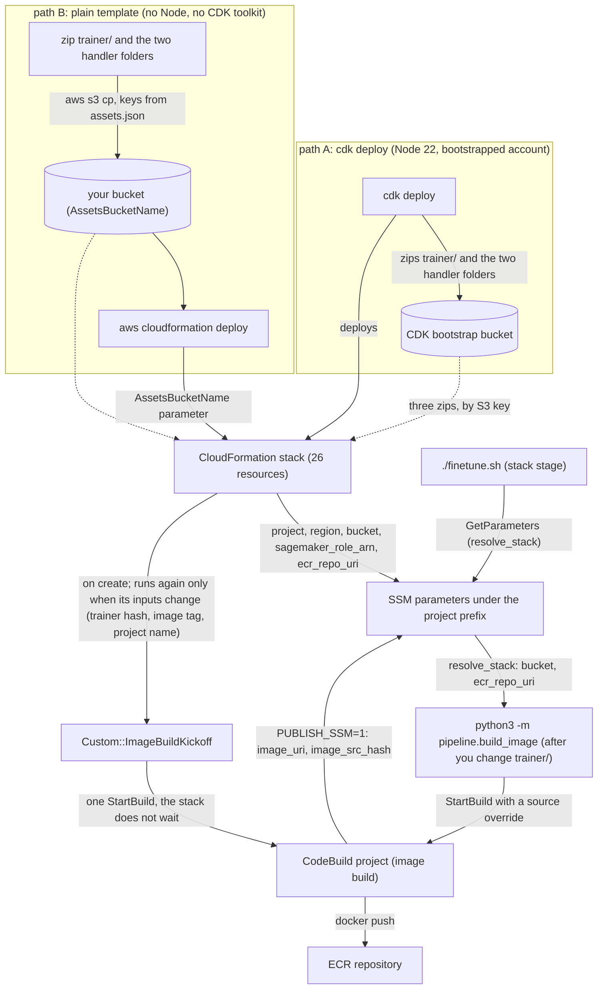

# Plain CloudFormation template (no Node, no CDK toolkit)

`lerobot-finetune-infra.template.json` is the CDK stack in `cdk/lerobot_finetune/stack.py`, exported as a plain
CloudFormation template. It creates the same 26 resources as `cdk deploy`, with the same cdk-nag suppressions and the
same outputs (`cdk deploy` adds only its own `AWS::CDK::Metadata` record) and the same stack `Description`, the
`(<id>) - <name>. Version <version>` string from the `solution` block of `project_config.json` that deployment counting
reads (README, [Anonymous usage metrics](../../README.md#anonymous-usage-metrics)). Use it when the machine that deploys has the
AWS CLI but no Node 22, or when your account forbids the `cdk bootstrap` roles. Everything that runs later
(`./finetune.sh`, `python3 -m pipeline.build_image`) finds the stack through its SSM parameters, small named values
under `/<project>/` in AWS Systems Manager Parameter Store. So it does not matter which path created the stack. If you
can run `cdk deploy`, prefer it: it does the asset upload below for you.

Both paths create the same stack. Once it exists, the image build, the SSM parameters and `./finetune.sh` behave the
same on both, and `python3 -m pipeline.build_image` can start further image builds on either path.



## What `cdk deploy` does that you must do by hand

| `cdk deploy` | plain template |
|---|---|
| zips `trainer/` and the code of the two helper Lambdas, uploads all three to the CDK bootstrap bucket | you upload three zips to a bucket you name (`AssetsBucketName` parameter) |
| checks the bootstrap stack version (`CheckBootstrapVersion` rule) | no rule, no bootstrap stack needed |
| takes the region from `-c region=` or the ambient `AWS_REGION` / profile | works in any region: pass `--region` on the deploy command |
| passes `CAPABILITY_IAM` | you pass `--capabilities CAPABILITY_IAM` |

The `project` tag is already on every taggable resource in the template, exactly as `cdk deploy` applies it. `--tags`
on the deploy command is optional. CloudFormation copies stack tags to every resource that supports them, so pass your
account's own tags there, or add them in `cdk/app.py` next to the `project` tag.

## Deploy

1. Pick a bucket in the target region. Either the CDK bootstrap bucket `cdk-hnb659fds-assets-<account-id>-<region>`
   (if the account was ever bootstrapped) or any bucket you own. The CodeBuild role may read only the trainer zip's key
   in that bucket and list the bucket's object names (`s3:GetObject*` on that one key, `s3:GetBucket*` and `s3:List*`
   on the bucket itself). It cannot read other objects, so a shared bucket is acceptable. A fresh bucket
   (`aws s3 mb`) is simplest.
2. Build and upload the three assets: the `trainer/` build context and the code of the two helper Lambdas
   (`cdk/template/assets/kickoff-handler/`, which starts the image build, and `cdk/template/assets/s3-auto-delete-handler/`,
   which empties the bucket when the stack is deleted). `assets.json` lists the S3 key of each one (`s3_key`). Each zip
   holds the directory's contents at the zip root, with no top-level folder.

   ```bash
   BUCKET=<assets-bucket>
   python3 -c 'import json; [print(a["path"], a["s3_key"]) for a in json.load(open("cdk/template/assets.json"))["assets"]]' |
   while read -r SRC KEY; do
     pushd "$SRC" >/dev/null
     zip -qr /tmp/asset.zip . -x '*__pycache__*' '*.pyc' '*.pytest_cache*' '*.egg-info*' 'README*' '*/README*'
     popd >/dev/null
     aws s3 cp /tmp/asset.zip "s3://$BUCKET/$KEY" --region <region> && rm /tmp/asset.zip
   done
   ```

   Each key is the sha256 hash of the directory as it was at export time. Only the key has to match. CodeBuild
   downloads whatever object sits at that key and nothing checks its content, so you may edit `trainer/` before
   zipping. `assets.json` lists what the export left out of the `trainer/` zip (`excluded_from_zip`).
3. Deploy. The template is larger than the 51,200-byte limit for an inline template, so `--s3-bucket` is required: the CLI
   uploads the template to that bucket first (the assets bucket from step 1 works). The IAM roles have no fixed names, so
   `CAPABILITY_IAM` is enough.

   ```bash
   aws cloudformation deploy \
     --region <region> \
     --stack-name lerobot-finetune-infra \
     --template-file cdk/template/lerobot-finetune-infra.template.json \
     --s3-bucket $BUCKET \
     --parameter-overrides AssetsBucketName=$BUCKET \
     --capabilities CAPABILITY_IAM \
     --tags project=lerobot-finetune   # optional: copied to every taggable resource
   ```

   Stack creation starts one CodeBuild build of the image. The `Custom::ImageBuildKickoff` resource, a small Lambda
   function, makes that one `StartBuild` call. The build takes about 15 minutes and the stack does not wait for it: the
   stack reaches `CREATE_COMPLETE` as soon as CodeBuild accepts the call. A missing or malformed trainer zip fails the
   build, not the stack.
4. Export the region you deployed in (`AWS_DEFAULT_REGION`), or pass `--region` to every command, and run
   `./finetune.sh --dry-run`. It checks the dataset, then follows the running image build to the end (the CodeBuild
   project has the same name as on the CDK path) before it reads `/<project>/image_uri`.

## After you change `trainer/`

The image build reads the trainer zip from the fixed key above. The kickoff resource runs again only when its own
inputs change: the trainer hash `DOCKER_SRC_HASH`, the image tag or the project name. With this template that means
only after a re-export. Redeploying the same file, or editing other parts of it, starts no build.

To rebuild, run the same command as on the CDK path: `python3 -m pipeline.build_image --region <region> --tag v1
--publish-ssm` (see [CONTRIBUTING.md](../../CONTRIBUTING.md), "Contributing via Pull Requests"). It needs no Node. `--publish-ssm` refuses
the default `dev-<gitsha>` tag, and `v1` is `image.tag` in `project_config.json`.

`DOCKER_SRC_HASH` and the SSM parameter `/<project>/image_src_hash` from the kickoff build record the hash of
`trainer/` at export time. The pipeline reads that value together with the other stack facts and never compares it
with anything. Treat it as a label.

## Limits

- One stack per account, region and project name. The ECR repository, the CodeBuild project and the SSM prefix are
  named after `<project>` (the IAM roles have no fixed names). A second stack in the same region needs a second project
  name. On the CDK path, pass `-c project=<new-project>`. On the plain-template path the name is a literal string in
  the file, so:
  1. Copy the template with the name replaced:
     `sed 's/lerobot-finetune/<new-project>/g' cdk/template/lerobot-finetune-infra.template.json > /tmp/<new-project>-infra.template.json`.
     Keep the copy outside `cdk/template/`: the next `export_template.py` run deletes any other
     `*-infra.template.json` in that directory as a leftover of a project rename.
  2. Deploy that copy with `--stack-name <new-project>-infra`.
  3. Set `project` to the same value in `project_config.json`.

  Maintainers can instead regenerate the export with a different `project` (see Regenerating below).
- `cdk/template/assets/kickoff-handler/index.js` is the runtime of the CDK `AwsCustomResource` construct (the build
  kickoff and the two delete-time cleanups), and `cdk/template/assets/s3-auto-delete-handler/index.js` is CDK's S3
  auto-delete provider. Both are generated by aws-cdk-lib (Apache-2.0, minified). They cannot be produced without Node,
  which is why they are committed. They change only when aws-cdk-lib changes.
- Teardown: `aws cloudformation delete-stack --stack-name lerobot-finetune-infra --region <region>` removes everything
  the template created, including the bucket contents, the images, the Hub token secret and the SSM image parameters
  (the export was made with the default: retainData unset). What stays: the shared log group
  `/aws/sagemaker/TrainingJobs`, the asset zips and the uploaded template copy in your own bucket, and the local
  `datasets/`, `runs/` and `.finetune/` folders. For a template that keeps the bucket and the repository, regenerate the
  export with `-c retainData=true` (Regenerating below).
- The template is a snapshot. `cdk deploy` always reflects the current `stack.py`. `lerobot-finetune-infra.template.json`
  reflects the last export.
- Gated Hugging Face bases (base models whose weights need an accepted licence on the Hub). The exported execution
  role already grants `secretsmanager:GetSecretValue` on
  `arn:<partition>:secretsmanager:<region>:<account>:secret:lerobot-finetune/hf_token*` (the `HubTokenSecret`
  statement). `lerobot-finetune/hf_token` is the default secret name, used when `secrets.hf_token` is null. You do not
  need to create the secret by hand: `finetune.sh` prompts for the token before the first staging job (the small
  SageMaker job that copies base weights from the Hub to S3) and stores it under that name in the deployment region.
  Only a custom `secrets.hf_token` name needs extra work. Either regenerate the export with that value (needs Node, see
  Regenerating below), or attach an inline policy that grants `secretsmanager:GetSecretValue` on
  `...:secret:<your secret name>*` to the deployed execution role. Without one of these, the staging job is submitted,
  billed, and fails with `AccessDeniedException`.

## Regenerating (maintainers: Node 22, the `cdk` CLI, and a virtualenv with `cdk/requirements.txt` installed)

```bash
cd cdk
python export_template.py                       # the committed export
python export_template.py -c retainData=true    # a template that keeps bucket and repository
cd ..
```

The script synthesises the stack with `-c plainTemplate=1` (see `cdk/app.py`); any extra arguments go to `cdk synth`. The
second command overwrites the committed files with the retain variant (21 resources, two assets), which the tests reject:
copy `cdk/template/` somewhere else after running it, then restore the committed export with `git checkout cdk/template`
or by re-running the first command. A bare `cdk synth -c plainTemplate=1`
produces the same stack but does not write the committed files. The script rewrites the template, `assets.json` and
the two handler directories. It removes a stale `<old-project>-infra.template.json` after a project rename, warns if the template
crosses the 51,200-byte inline limit, and prints what changed. It compares the zipped `trainer/` against
`git ls-files`: git-ignored files (`__pycache__`) never appear in `assets.json`, and untracked files stop the export, so
commit or remove them first.

`tests/test_cdk_template.py` (`test_plain_template_matches_committed_export`) is the drift test. It fails when the
committed template no longer matches a fresh synth, after normalising asset hashes and CDK metadata. So editing
`trainer/` does not break CI, but changing the stack without re-exporting does. The failure message prints the
regeneration command above.

`cdk/requirements.txt` pins `aws-cdk-lib` and `cdk-nag` to exactly the versions the export was made with
(`generated_with` in `assets.json` records them), and CI installs those pins. An upstream release therefore cannot turn
the drift test red on its own. With the pins installed, `test_committed_handlers_match_synth` compares both handler
directories (`kickoff-handler/`, `s3-auto-delete-handler/`) byte for byte. It skips only when a different aws-cdk-lib is installed locally. To bump the versions: edit
both pins, re-run `export_template.py`, and commit the refreshed template, `assets.json`, the handler directories and
`cdk/requirements.txt` together in one change.
