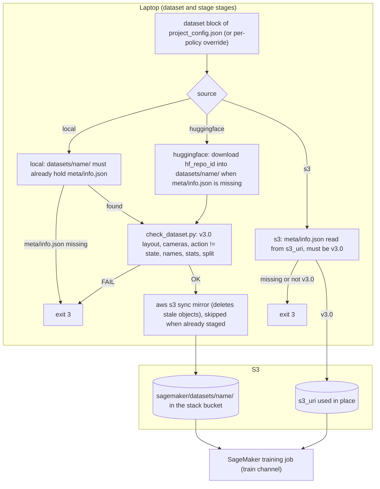
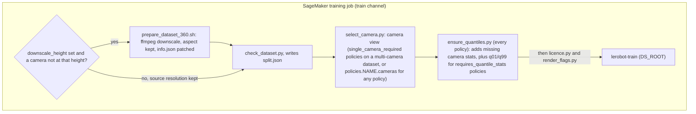

# datasets/: the datasets this repository trains on

Every dataset lives in its own sub-folder here, in the LeRobot **v3.0** layout. The folder name is the dataset name that
`project_config.json` uses (`dataset.name`, or `policies.<name>.dataset.name`). Everything in this folder except this
README is git-ignored, so nothing you put here can end up in a commit.

```text
datasets/
  <name>/                 the folder name is the dataset name in project_config.json
    meta/
      info.json           codebase_version must be "v3.0"
      stats.json
      tasks.parquet
      episodes/chunk-000/file-000.parquet
    data/chunk-000/file-000.parquet
    videos/observation.images.<camera>/chunk-000/file-000.mp4
```

## The public datasets the 16 policy types (17 recipes: `fastwam` has two) were tested on

All 17 recipes (16 lerobot policy types; `fastwam_lora` is a second recipe for `fastwam`) ran end to end on one of three public datasets from the Hugging Face Hub. Each policy's status (validated,
trained or smoke-tested, as defined in [docs/POLICIES.md](../docs/POLICIES.md)) is listed in that file. The shipped
`project_config.json` already names all three datasets, in the shared `dataset` block and in the per-policy `dataset`
overrides, each pinned to the exact revision that was used. The revisions were checked on 2026-09-16: each one resolves, and its `meta/info.json` says `codebase_version: v3.0`.

| folder under `datasets/` | Hugging Face dataset @ revision | licence | what it is | used by |
|---|---|---|---|---|
| `svla_so101_pickplace` | [`lerobot/svla_so101_pickplace`](https://huggingface.co/datasets/lerobot/svla_so101_pickplace) @ `v3.0` (commit `f641879e`) | Apache-2.0 | SO-101 arm, pick-and-place, 50 episodes, 2 cameras 480x640, 30 fps, 6 joints, one task; about 86 MB | `act`, `smolvla`, `xvla`, `pi0`, `pi05`, `diffusion`, `vqbet`, `multi_task_dit`, `groot` |
| `so101-4tasks-100eps` | [`hjkso1406/so101-4tasks-100eps`](https://huggingface.co/datasets/hjkso1406/so101-4tasks-100eps) @ `52df842eec7e9425a87040528f94ab20732e42fb` | Apache-2.0 as a Hub card tag only, no LICENSE file, community uploader: accept that licence yourself | SO-101 arm, four task strings x 100 episodes, 2 cameras (`top`, `wrist`), 30 fps, 6 joints; about 3.3 GB | `evo1`, `molmoact2`, `lingbot_va`, `pi0_fast`, `eo1`, `fastwam`, `fastwam_lora` (the policies that read the task text) |
| `xarm_lift_medium` | [`lerobot/xarm_lift_medium`](https://huggingface.co/datasets/lerobot/xarm_lift_medium) @ `79efb0e3cef0e530ddec4b8569b190966ab45808` | MIT | simulated xArm lift, 800 episodes, one 84x84 camera, 15 fps, 4-dim actions, with `next.reward`; about 20 MB | `tdmpc`, the only policy here that needs reward-labelled data |

For `so101-4tasks-100eps`, always use the full commit hash: the repository's `v3.0` tag points at a different, older upload.
Which policy ran on which dataset, and what the smoke tests measured, is in [docs/DATASETS.md](../docs/DATASETS.md).

Dataset licences are yours to accept. The pipeline's licence check (the preflight step that refuses a policy until you
accept the terms of its base weights, see [docs/POLICIES.md](../docs/POLICIES.md)) covers the policy weights, not the
dataset.

### Option A: let the pipeline download them

With `"source": "huggingface"` (the shipped setting), `./finetune.sh` downloads `hf_repo_id` at `hf_revision` into
`datasets/<name>/` the first time it finds no `meta/info.json` there. It then checks the dataset like any other. The
download uses the `huggingface_hub` package from `requirements.txt`. No Hugging Face account is needed for these three
public datasets. A dataset is only downloaded for the policies you run: the shipped config downloads `svla_so101_pickplace`
for ACT, and the other two only when you enable a policy that uses them. An existing folder is never downloaded again. To
fetch a dataset afresh (for example after changing `hf_revision`), delete its folder first. The download leaves a
`.cache/huggingface/` sub-folder inside the dataset folder. It is harmless and stays local.

### Option B: download them yourself

The same three downloads with the `hf` command-line tool (huggingface_hub 0.34 or newer, installed by `requirements.txt`).
Older releases spell it `huggingface-cli download` with the same arguments, and `huggingface-cli login` instead of
`hf auth login`:

```bash
pip install -r requirements.txt     # installs huggingface_hub

hf download lerobot/svla_so101_pickplace --repo-type dataset --revision v3.0 \
   --local-dir datasets/svla_so101_pickplace

hf download hjkso1406/so101-4tasks-100eps --repo-type dataset \
   --revision 52df842eec7e9425a87040528f94ab20732e42fb --local-dir datasets/so101-4tasks-100eps

hf download lerobot/xarm_lift_medium --repo-type dataset \
   --revision 79efb0e3cef0e530ddec4b8569b190966ab45808 --local-dir datasets/xarm_lift_medium
```

Or from Python, which is exactly what the pipeline runs:

```python
from huggingface_hub import snapshot_download
snapshot_download("lerobot/svla_so101_pickplace", repo_type="dataset", revision="v3.0",
                  local_dir="datasets/svla_so101_pickplace")
```

Keep the folder names as above so they match `dataset.name` in `project_config.json`. Check a download with:

```bash
python3 trainer/check_dataset.py datasets/svla_so101_pickplace     # the same check the pipeline and the training job run
./finetune.sh --compat                                             # which of the 17 recipes can train on it (no AWS calls)
```

## Using your own dataset

1. Record or export a LeRobot **v3.0** dataset and copy the folder to `datasets/<name>/` (layout above).
2. In `project_config.json` set **both** `"source": "local"` **and** `"name": "<name>"` in the `dataset` block. If you
   change `name` alone while `source` stays `huggingface`, the pipeline silently downloads the public dataset into a
   folder of that name. With `local`, a wrong name stops with exit 3 instead.
3. Run `./finetune.sh --compat` to see which policies fit your data, then `./finetune.sh --dry-run`.

Any camera resolution and any action dimension are accepted. The job downscales videos to `downscale_height` and keeps the
aspect ratio. The evaluation scores every action dimension against a "hold" baseline: a predictor that repeats the current
joint positions for every future step it is asked to predict. A model only counts as learning if it beats that baseline
(the metric is defined in [docs/RESULTS.md](../docs/RESULTS.md)). For 16-dimensional actions the evaluator assumes a
two-arm layout (dims 0-7 left arm, 8-15 right arm, grippers at 7 and 15) and adds a gripper-timing metric. Other widths
get per-dimension scores only. To check a recording on the machine that recorded it, before copying anything, see
[docs/RECORDER_CHECK.md](../docs/RECORDER_CHECK.md).

Other sources:

- **A dataset already in S3** (`"source": "s3"`, `"s3_uri": "s3://<bucket>/<prefix>/"`): the pipeline reads
  `meta/info.json` from that prefix and requires v3.0. The training job mounts the prefix directly, so nothing is uploaded
  from your machine. The full dataset check then runs only inside the job, and `./finetune.sh --compat` needs a copy of
  the dataset's `meta/` folder under `datasets/<name>/`. The bucket must be in the stack's region (SageMaker reads training
  input only from its own region). The pipeline does not check this for `s3_uri`, so a bucket in another region fails
  only after the job is submitted.
- **Your own Hugging Face dataset** (`"source": "huggingface"` with your `hf_repo_id` and `hf_revision`): private or
  gated repositories need a logged-in Hub client on your machine (`hf auth login`). The pipeline passes no token of its own.
- **Older LeRobot exports** (`codebase_version` v2.0 or v2.1) are refused. Convert a v2.1 dataset with LeRobot's converter:
  `python -m lerobot.scripts.convert_dataset_v21_to_v30 --repo-id <id> --root <dataset dir> --push-to-hub=false`.
  Run it on a machine with lerobot 0.6.1 installed (`pip install lerobot==0.6.1`, it is not in `requirements.txt`).
  `--repo-id` is any `owner/name` label for the local folder. The converter accepts only v2.1 input, writes the v3.0
  dataset in place and renames the original folder to `<dataset dir>_old`. If it stops with
  `non monotonically increasing dts` on per-episode H.264 videos, re-encode them at a constant frame rate first
  (`ffmpeg -c:v libx264 -g 2 -pix_fmt yuv420p`). [docs/TRAPS.md](../docs/TRAPS.md) has the full story.
  `lerobot-edit-dataset` edits v3.0 datasets (delete episodes, split, merge, remove a feature, modify tasks, recompute
  stats, re-encode videos, image-to-video, info) and has no version-conversion operation.

## How the pipeline handles a dataset

This is how `./finetune.sh` reads the `dataset` block and gets the dataset into S3 (the `dataset` and `stage` stages of
`pipeline/run.py`):



What the training job does with its `train` channel (the SageMaker input folder that holds the dataset) before
`lerobot-train` starts:


