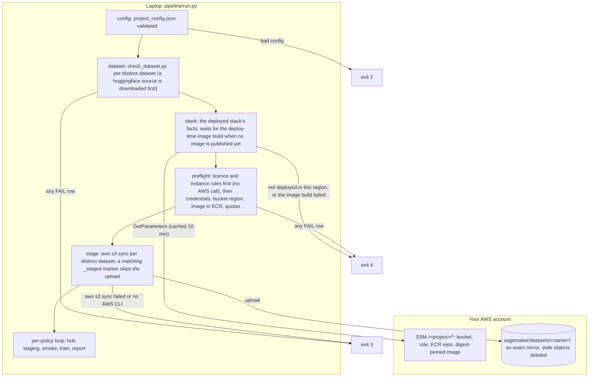
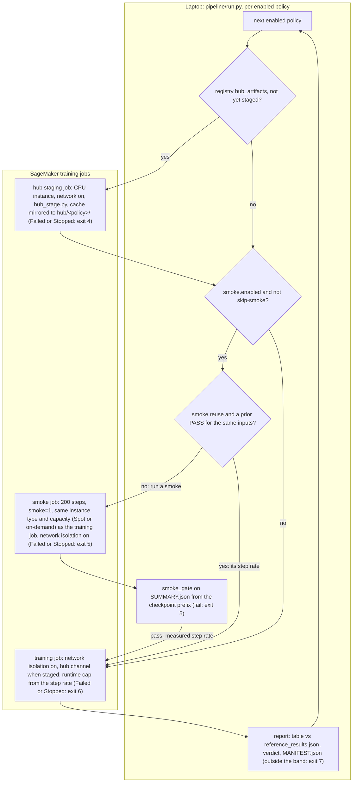
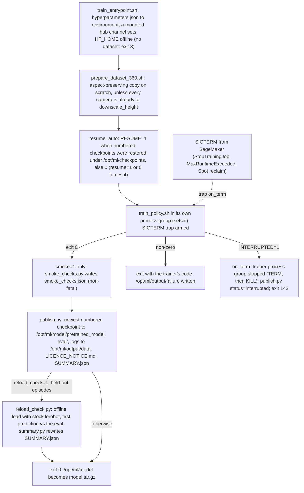
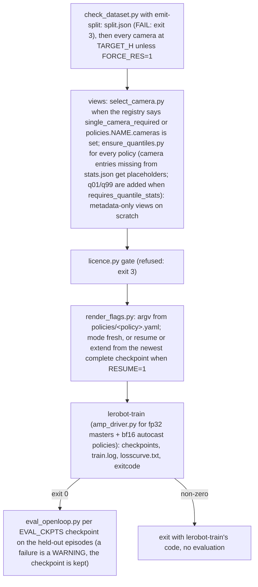
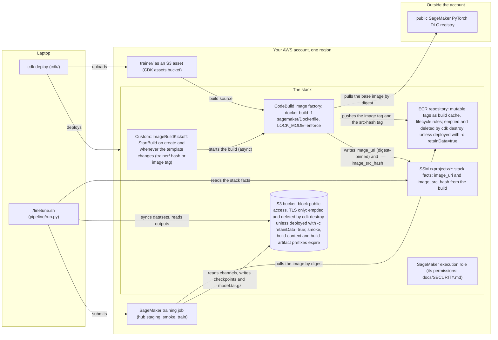

# Architecture

## Stages of `./finetune.sh` (pipeline/run.py)

What `./finetune.sh` does on your laptop before any job is submitted, which AWS calls each step makes, and the exit code
each failure returns. Two special cases: a dataset with `source: s3` is read in place from its `meta/info.json` and never
uploaded. Declining the confirmation prompt exits 130.



| stage | where | what | fails when |
|---|---|---|---|
| config | laptop | load `project_config.json` and check it against `pipeline/project_config.schema.json` | unknown or duplicate keys; an `overrides` entry that sets a flag the pipeline renders itself (`--steps`, `--batch_size`, `--output_dir`, and the rest of the `OWNED_FLAGS` list in `pipeline/config.py`) or a forbidden flag; `smoke.steps` larger than a policy's `steps`; an enabled policy without a registry file (exit 2) |
| dataset | laptop | `trainer/check_dataset.py` on `datasets/<name>/`: v3.0 layout and meta files present; cameras are video, not PNG frames; the action column differs from the state column in every data file (a recording of nothing is refused); `action.names` matches the action width; `stats.json` has mean and std; the train/held-out split is valid | any FAIL row (exit 3) |
| compatibility | laptop | `pipeline/compat.py` compares dataset facts (action width, cameras, number of task strings, flat action names, q01/q99 stats, reward column) with each registry entry's `requires_*` keys. For the 16 offered policies it prints which can train now, which are compatible but not yet runnable (`status: stub`, need `--allow-stubs`) and which cannot and why. The 3 entries marked `out_of_scope` are listed on one line. `./finetune.sh --compat` runs only this step | an enabled policy is blocked by the dataset (exit 3) |
| stack | laptop | read the deployed stack's facts from SSM `/<project>/*`: bucket, role, ECR repository, and the digest-pinned image. When no image is published yet, follow the newest build of the `<project>-image-build` CodeBuild project (the one `cdk deploy` started) to the end, then read the parameters again | the stack is not deployed in this region; there is no image build, or it failed (exit 4) |
| instance | laptop | the instance type of each policy: `--instance-type`, then `policies.<name>.instance_type`, then `compute.instance_type`. The value `auto` walks the registry entry's `hardware.instance_types` in order and takes the first type that the instance rules accept (a multi-GPU type needs `--allow-multigpu`; a type missing from `pipeline/instance_table.py` is skipped with a warning) and whose service quota, in the capacity the policy runs (Spot or on-demand), is above 0. One line per policy names the choice, its quota and the skipped types, so preflight and the plan see the resolved type and price. When the quotas cannot be read (for example `AccessDenied`), the first accepted type is taken and the run says so | no type with quota for a policy: the message lists each type, its quota value and the quota name to request (exit 4); `auto` together with a training plan, which reserves one named type (exit 2) |
| preflight | laptop | the licence gate and the instance rules first (no AWS call), then credentials, bucket region equals job region, image published and present in ECR, and the service quota of each candidate instance type in the capacity the run uses (Spot or on-demand); with `compute.training_plan_arn` (or `--training-plan`), the plan's status (`Scheduled` or `Active`), region and reserved instance type replace the GPU quota check | any FAIL row: a licence switch missing, an instance the registry refuses, the bucket or the image in another region, the image digest missing from ECR, a quota of 0 (exit 4) |
| plan | laptop | `pipeline/plan.py`: one table with a row per selected policy (dataset, whether `accept_licence` and `approval_ref` are set as the licence class requires, the instance's GPU memory against the registry minimum, steps, steps per second from the registry `hardware.step_rate` table, estimated hours and approximate dollars), a total line and the pending uploads. One confirmation covers uploads and jobs (`--plan` stops here, `--yes` skips the question) | `accept_licence` or `approval_ref` is missing where the licence class requires it, or the instance is too small (exit 4) |
| stage | laptop to S3 | `aws s3 sync --delete` to `s3://<bucket>/sagemaker/datasets/<name>/`, so S3 becomes an exact mirror of `datasets/<name>/` (the number of stale objects the mirror deletes is printed). Then it writes `sagemaker/datasets/_staged/<name>.json`, a small marker holding the dataset fingerprint (a sha256 over `meta/info.json` and every file's path and size). A later run with the same fingerprint skips the upload; deleting the marker forces one | the AWS CLI v2 is missing or `aws s3 sync` exits non-zero (exit 3) |
| fan-out | laptop | with several policies, one child process per policy (`--sequential` runs them in order in one process); each child logs to `runs/<run>-<policy>.log` | a child exits non-zero (the parent returns the highest code; a child killed by a signal counts as 128 + the signal number) |
| smoke | SageMaker | the training job's spec with 200 steps (`smoke.steps`), `smoke=1`, the registry's `smoke.log_freq`, evaluation stride 60, no checkpoint pruning and a fixed runtime cap of `smoke.max_minutes` (60 by default). Gate on the job's SUMMARY.json: the trainer exited 0, the held-out joint error (mean absolute error) is a finite number, at least half of the trainable tensors changed from their initial values, no trainable parameter is stored in bfloat16, and the published checkpoint reloads offline with stock lerobot. The smoke also measures the steps-per-second rate that sizes the training job's runtime cap | the gate fails (exit 5) |
| train | SageMaker | one job per enabled policy; runtime cap = 15 min for image pull, downscale and warm-up + 20 min for evaluation + steps / step rate × `compute.runtime_multiplier`; network isolation on; checkpoints mirrored to S3. If SageMaker refuses the submit with `ResourceLimitExceeded`, each `compute.fallback_instance_types` entry is tried in turn with its own cap | the job ends Failed or Stopped (exit 6) |
| report | laptop | download `model.tar.gz`, print the table against `pipeline/reference_results.json`, write `MANIFEST.json`, give the verdict | the verdict is REPEAT or FAIL (exit 7): the held-out error falls outside the acceptance band in `pipeline/reference_results.json`. A band exists only for the policy and dataset pairs listed there; any other dataset gets `n/a` and exit 0 |

A policy can carry its own `dataset` block (`policies.<name>.dataset`; see [README.md](../README.md), "Which dataset").
Each distinct dataset is checked and staged once per run. Two dataset mismatches are repaired inside the job as
metadata-only views: a copy of the dataset folder in which the data and video files are symlinks and only `meta/` is
rewritten. Single-camera policies and `policies.<name>.cameras` subsets train on a reduced camera view
(`select_camera.py`). Policies that normalise inputs with quantiles (registry `requires_quantile_stats`: pi0.5, MolmoAct2)
get the missing q01/q99 values computed from the data (`ensure_quantiles.py`). The diagram of these in-job steps is in
[datasets/README.md](../datasets/README.md), "How the pipeline handles a dataset".

After the shared stages, run.py handles each enabled policy in turn. It first looks in `runs/*.json` for an earlier smoke
of this policy that passed with the same image digest, dataset fingerprint, hyperparameters and instance type. If one
exists (and `smoke.reuse` is true) the smoke is skipped and its measured step rate is used. Otherwise the step rate comes
from the registry `hardware.step_rate` table until the new smoke measures it. The step rate sizes the training job's
runtime cap.

A policy whose registry entry lists gated base weights needs a Hugging Face token. Before the staging job, run.py checks
that the Secrets Manager secret (`secrets.hf_token`, default `<project>/hf_token`) holds a token the Hub accepts. If not,
it prompts once with a hidden input, checks the token against the Hub and stores it. Without a terminal (`CI=1` or
`HF_TOKEN_PROMPT=0`) and without a stored token it exits 4.



## Inside the job (trainer/)

```
/opt/ml/input/data/train      the dataset (S3 channel "train")
/opt/ml/input/config/hyperparameters.json
/opt/ml/checkpoints/<policy>/ train/checkpoints/<step>/{pretrained_model,training_state}, eval/, train.log, losscurve.txt,
                              split.json, exitcode, dataset_root.txt, smoke_checks.json, reload_check.json, SUMMARY.json
                              (synced to S3 while running; SUMMARY.json and eval/ are what the laptop reads without model.tar.gz)
/opt/ml/model/                pretrained_model/, eval/, SUMMARY.json, LICENCE_NOTICE.md  -> model.tar.gz
/opt/ml/output/data/          train.log, losscurve.txt, split.json, exitcode -> output.tar.gz
```

`trainer/sagemaker/train_entrypoint.sh` is the container's entry point. The diagram below shows its control flow,
including the SIGTERM path that still ships the newest checkpoint. Two details the diagram does not show:
`prepare_dataset_360.sh` re-encodes the videos with parallel ffmpeg, keeps the aspect ratio and checks that every frame
count matches the source; `publish.py` copies the newest numbered checkpoint, never the `last` symlink.



`train_policy.sh` runs inside the job in this order (exit codes in the boxes). Between the views and the licence gate
three small steps also run: `dataset_env.py` exports dataset-derived values for the registry argv (camera keys, action
and state widths), `patch_base_config.py` applies a registry `base_config_patch` to the staged base checkpoint when a hub
channel is mounted, and `local_repo_args.py` appends `train.local_repo_args` flags to OVERRIDES.



### Hyperparameters to environment variables (train_entrypoint.sh, then train_policy.sh)

| hyperparameter | env | default | note |
|---|---|---|---|
| policy | POLICY | act | registry entry |
| steps, batch_size, chunk, save_freq, log_freq, num_workers, seed | STEPS BATCH CHUNK SAVE_FREQ LOG_FREQ NUM_WORKERS SEED | steps 100000, batch_size 8, chunk 24, save_freq 10000, log_freq 200, num_workers = vCPUs minus 4 (at least 2, at most 16), seed 1000 | `chunk` is derived from `horizon_seconds` × dataset fps unless set explicitly |
| heldout / episodes | HELDOUT / EPISODES | auto: about 10 % of the episodes held out | checked against the dataset |
| eval_ckpts, eval_stride, device | EVAL_CKPTS EVAL_STRIDE DEVICE | eval_ckpts last, eval_stride 1, device cuda | a failed evaluation is a warning, not an error |
| downscale, downscale_height | DOWNSCALE TARGET_H | downscale auto, downscale_height 360 | |
| resume, extend_steps | RESUME EXTEND_STEPS | resume auto | on resume the argv is only `--config_path=<checkpoint>/train_config.json --resume=true`, because lerobot 0.6.1 crashes when a `--policy.*` flag accompanies `--resume`; any `--policy.*` override from the config is dropped with a note on stderr (lerobot reads those values back from `train_config.json`) |
| overrides | OVERRIDES | | appended last; forbidden flags are refused |
| accept_licence, approval_ref | ACCEPT_LICENCE APPROVAL_REF | 0 | licence gate inputs |
| keep_checkpoints | KEEP_CHECKPOINTS | 0 in the container (keep all); pipeline/run.py sends `policies.<name>.keep_checkpoints` when set, else `compute.keep_checkpoints` (default 3), and nothing for smoke runs | `prune_checkpoints.py` keeps the newest K complete checkpoints during training (the S3 mirror follows); 0 keeps all |
| camera | CAMERA | first camera (sorted) | single-camera policies only (registry `single_camera_required`): `select_camera.py` derives a one-camera view of the dataset |
| cameras | CAMERAS | all cameras | any policy: `policies.<name>.cameras` names the subset to train on; `select_camera.py` derives the view (FastWAM needs a camera count that divides 448) |
| force_res, force_action_eq_state, force_small, require_flat_names | FORCE_RES FORCE_ACTION_EQ_STATE FORCE_SMALL REQUIRE_FLAT_NAMES | 0 | each one becomes the `check_dataset.py` flag of the same name |
| smoke, reload_check | SMOKE (reload_check is read directly) | 0 1 | `smoke=1` enables the smoke-only checks; `reload_check=1` runs the offline reload check after publish |
| image_digest, dataset_fingerprint | IMAGE_DIGEST DATASET_FINGERPRINT | | recorded in SUMMARY.json |

## Image (trainer/sagemaker/Dockerfile)

The image starts from the SageMaker PyTorch Deep Learning Container (DLC; torch 2.8.0+cu129, Python 3.12), pinned by
digest. It adds ffmpeg, then installs `lerobot[training,diffusion,smolvla,pi,xvla,peft]==0.6.1` plus GR00T's own
dependencies against `constraints.txt` and the full `requirements.lock` (the freeze of the validated build). The build
fails if pip resolves anything else. torchcodec is then removed (PyAV decodes the videos). `image_asserts.py` checks that
the expected modules and policy classes import and that torchcodec and decord do not. The ResNet18 ImageNet weights ACT
needs are downloaded into the image, so no job reaches the internet for them. One image serves every supported policy
family. The stack's CodeBuild project builds it and publishes its digest to SSM.

## Infrastructure (cdk/)

What the stack creates and how the image reaches a job. Only the hub staging job has network access; it is also the only
job that reads the Hugging Face token secret. Who may read and write what at run time, with which credentials: the two
diagrams in [docs/SECURITY.md](SECURITY.md).



Hardening of each resource, and what is left to you: the table at the top of [docs/SECURITY.md](SECURITY.md).
