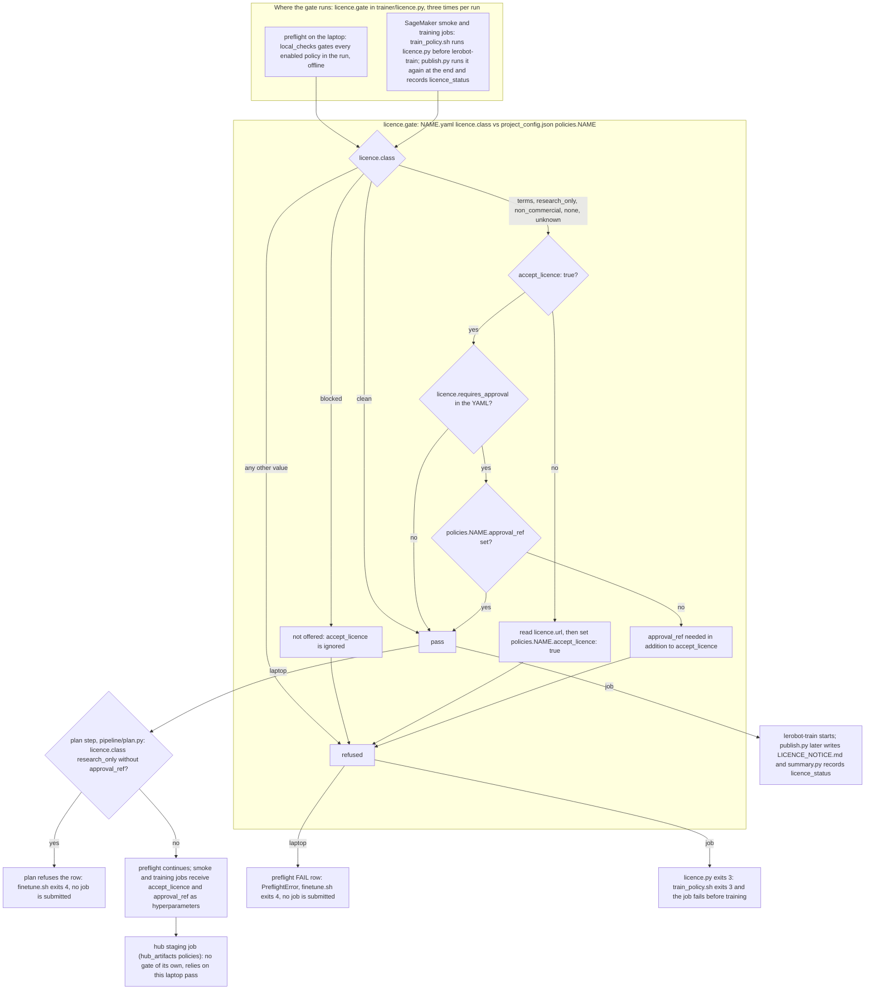

# Policies: tiers, status and licences

Generated by `python3 -m pipeline.policies_doc` (CI runs `--check`). The tables and the per-policy notes come from
`trainer/policies/*.yaml`. The text around the tables lives in `pipeline/policies_doc.py`. Edit those files, not this one.

> ⚠️ **Model licences.** This repository distributes no model weights and no datasets. For every policy that fine-tunes
> a published checkpoint, the training job downloads the base weights from the Hugging Face Hub into your account, under
> the publisher's terms. Several of those bases are not open-source or carry conditions:
>
> - Apache-2.0 Hub tag; terms apply (pretraining data includes a CC BY-NC-SA corpus): `xvla`
> - Gemma Terms of Use: `pi0`, `pi05`, `pi0_fast`
> - Qwen Research Licence (non-commercial): `eo1`
> - NVIDIA Open Model License: `groot`
> - research only (Ai2 Responsible Use): `molmoact2`
> - no licence position established for the base weights: `multi_task_dit`, `evo1`, `fastwam`, `fastwam_lora`,
>   `lingbot_va` (an Apache-2.0 Hub tag without licence text, no licence declared, or conflicting statements; the
>   per-policy notice in docs/POLICIES.md records what was found, and the publisher's terms for the weights and their
>   training data have not been confirmed)
>
> Production or commercial use of any of these needs your own legal review. The job refuses to start until
> `accept_licence: true` (and `approval_ref` where the table shows it) is set for the policy in `project_config.json`,
> and it writes `LICENCE_NOTICE.md` next to every output. Read the linked terms before enabling a policy so you can make
> an informed decision. This note concerns the model weights only: the code in this repository is MIT-0.

**Status** says what has been run through this pipeline:

- `validated`: a full run reproduced the reference numbers recorded for the same recipe in [docs/RESULTS.md](RESULTS.md),
  inside the acceptance band of `pipeline/reference_results.json`. The reference is an earlier run of ours, not a paper result.
- `trained`: a full fine-tune at the entry's `defaults` (steps, batch, chunk) finished on the public dataset. Its metrics are
  in [docs/RESULTS.md](RESULTS.md) and `pipeline/reference_results.json`. No claim beyond that.
- `smoke-tested`: a 200-step GPU job on a public dataset trained, evaluated, published and reloaded. Most ran on SageMaker.
  `pi0_fast`, `eo1`, `fastwam` and `fastwam_lora` ran on an EC2 H100 host with the same container image, input channels and
  environment variables as a SageMaker job, because no 80 GB SageMaker quota was available ([docs/RESULTS.md](RESULTS.md)).
  The first `fastwam_lora` smoke ran on a private dataset and continued from an earlier `fastwam` fine-tune (advanced flow).
  The shipped default (`lerobot/fastwam_base` on `hjkso1406/so101-4tasks-100eps`) then passed its own 200-step smoke on an
  EC2 H100 host on 2026-09-22, with the adapter merge and an exact reload of the merged copy ([docs/RESULTS.md](RESULTS.md)).
- `stub`: the entry renders its flags, but preflight refuses it for the reason in the notes column
  (`./finetune.sh --allow-stubs` turns the refusal into a warning). The three stubs below are also marked
  `out_of_scope: true`, so they are not offered at all: the compatibility step refuses them even with `--allow-stubs`.

**Deliverable** (column): the checkpoint is entirely your own work. It was trained from scratch on your recordings and
inherits no licence, so you can ship it as your model. `tdmpc` and `gaussian_actor` are licence-clean but learn from
reward labels, which recorded demonstrations do not have, so they are not deliverable.

**Tier** groups entries by what you take on, not by how far they have been tested. Tier 0 trains from scratch under a
clean licence. Tier 1 entries are opt-in research policies that fit the default 48 GB GPU. Tier 2 entries need a large
GPU, a base with restrictive or unresolved publisher terms, or both. Any tier can hold any status: a tier-2 entry can
be `trained`.

**Licence class of the base weights**: `clean` (no inherited weights, or Apache/MIT/BSD weights), `terms` (usable after
you accept the publisher's terms), `research_only` / `non_commercial` (no commercial use), `none` (the publisher declared
no licence, so all rights are reserved by default), `unknown`, `blocked` (not offered). Every class except `clean` and
`blocked` needs `accept_licence: true` under `policies.NAME` in `project_config.json`. Accepting a licence there grants
nothing the publisher has not granted, and a fine-tune inherits the restrictions of its base.

**Commercial use** (column): `yes` means the weights add no restriction. `terms` means allowed only within the publisher's
terms, so get legal sign-off. `no` means research or non-commercial use only. `unknown` means nobody has established the
publisher's position.

**Inputs** (column): how many camera streams the entry takes (`one camera`, `several cameras`, or `several cameras
(mapping required)` when the dataset cameras must be mapped onto the base checkpoint's slots), the number of frames per
camera when the policy reads more than one, joint state (every entry), `language` when the dataset task string conditions
the policy (a single-task dataset makes that input a constant), `reward labels` when the loss needs `next.reward`.

**Action space** (column): `up to N dims` when the registry caps the action width (`max_action_dim`: the policy pads to N
and refuses wider datasets), otherwise `dataset width`; `chunk` is the default action chunk from `defaults.chunk`
(informational for `tdmpc`, whose horizon is fixed by the recipe).

**VRAM** (column): peak GPU memory at the entry's default batch size, from the registry's `hardware.vram_gb`. It is a
measured value for `act`, `xvla`, `pi0_fast`, `eo1`, `fastwam` and `fastwam_lora` and an estimate for the others; every smoke test confirmed
that the policy fits its listed instance type. **GPU and default instance**: the smallest GPU memory class the entry
accepts (`hardware.min_gpu_memory_gb`) and the instance the shipped `project_config.json` resolves to for it;
`(untested)` marks a type whose GPU facts in `pipeline/instance_table.py` are unverified. The instance types per memory class, with quota names and prices, are in the README under Quotas.

**Default budget and estimate** (columns): `defaults.steps` x `defaults.batch_size`, and the hours and dollars
`./finetune.sh --plan` would print for that budget on the default instance from the registry's step rate for that GPU,
including the 200-step smoke job and the fixed start-up and evaluation overhead (`pipeline/plan.py`). Prices are
approximate ap-northeast-1 on-demand list prices, 2026-09; your region may differ. The estimate is for planning and errs long: the recorded
runs in [docs/RESULTS.md](RESULTS.md) finished faster than the registry step rate predicts.

**Precision** (per-policy notes): `fp32` trains entirely in 32-bit floats. `fp32_masters_bf16_autocast` keeps the weights
and optimizer state in fp32 and runs the forward pass in bfloat16 through `trainer/amp_driver.py` (the bf16 trap it avoids
is in [docs/TRAPS.md](TRAPS.md)).

This repository ships no weights. A staging job downloads the base into your account and records the exact commit in
`_STAGED.json` ([docs/SECURITY.md](SECURITY.md)).

**LoRA recipes.** A registry entry is a recipe, and one lerobot policy type can have more than one. `fastwam_lora` is a
second recipe for the `fastwam` type: it adapts the 5B video expert with LoRA (rank 16 on the attention projections) while
the action expert and the proprio encoder train in full, with the video loss on. `fastwam` itself freezes the video expert.
`lingbot_va` also trains with LoRA, because its full fine-tune does not fit a 48 GB GPU. A LoRA run publishes an adapter
(`adapter_model.safetensors` plus `adapter_config.json`), which needs the base weights at load time. Recipes that set
`publish.merge_adapter: true` (today `fastwam_lora`) also publish the adapter merged into full weights under
`pretrained_model_merged/`, which a server loads like a plain checkpoint without peft. `fastwam_lora` has its own hub prefix,
so enabling it next to `fastwam` stages the same 46 GB of base weights a second time. Advanced flow, continuing from your
own earlier checkpoint instead of the published base: copy that checkpoint's `pretrained_model/` directory into the
policy's hub prefix in your bucket (`sagemaker/hub/<policy>/<dir>/pretrained_model/`, which the job mounts at
`/opt/ml/input/data/hub/<dir>/pretrained_model`), then add `--policy.pretrained_path=/opt/ml/input/data/hub/<dir>/pretrained_model`
to `policies.<policy>.overrides` in `project_config.json`. Copy it after the staging job has run: a re-stage deletes
everything under that prefix. Evaluation and reload still merge the adapter onto the registry's `base_checkpoint`, which
is exact when your earlier checkpoint kept the video expert frozen (the `fastwam` recipe).

> **Non-clean rows below are research entries.** Read the licence text linked in the table before enabling them, and
> consult your legal team before shipping anything derived from them.

## How the gate decides and where it runs

The same `licence.gate` function (`trainer/licence.py`) runs three times. First on your laptop during `preflight`: a
refusal submits nothing. Then inside every smoke and training job, in `train_policy.sh` before `lerobot-train` starts.
Finally in `publish.py` at the end of the job, which records the outcome as `licence_status` in SUMMARY.json and
LICENCE_NOTICE.md. The hub staging job has no gate of its own. It runs only after the laptop gate has passed.

An `approval_ref` (your ticket or sign-off reference) under `policies.NAME` is required in two cases:

1. The YAML sets `licence.requires_approval`. The gate checks this on the laptop and in the job.
2. `licence.class` is `research_only`. The plan step (`pipeline/plan.py`) checks this on the laptop before anything is
   submitted, even when the YAML says `requires_approval: false` (today `eo1` and `molmoact2`).

## Every registry entry

| policy | tier | status | deliverable | base checkpoint | weights licence | commercial use | inputs | action space | VRAM | GPU and default instance | default budget (steps x batch) | est. time / cost | notes |
|---|---|---|---|---|---|---|---|---|---|---|---|---|---|
| `act` | 0 | validated | yes | none (from scratch) | [clean](https://github.com/huggingface/lerobot/blob/v0.6.1/LICENSE) · Apache-2.0 | yes | several cameras, state, no language | dataset width, chunk 24 | 4.3 GB | 16 GB · `ml.g6e.4xlarge` | 100000 x 8 | ~3.4 h / ~$18 |  |
| `diffusion` | 0 | smoke-tested | yes | none (from scratch) | [clean](https://github.com/huggingface/lerobot/blob/v0.6.1/LICENSE) · Apache-2.0 | yes | several cameras (2 frames each), state, no language | dataset width, chunk 24 | 20 GB | 24 GB · `ml.g6e.4xlarge` | 100000 x 16 | ~5.0 h / ~$27 |  |
| `tdmpc` | 0 | smoke-tested | no | none (from scratch) | [clean](https://github.com/huggingface/lerobot/blob/v0.6.1/LICENSE) · Apache-2.0 | yes | one camera (square), state, reward labels, no language | dataset width, chunk 5 | 2 GB | 16 GB · `ml.g6e.4xlarge` | 100000 x 256 | ~10.0 h / ~$53 |  |
| `vqbet` | 0 | smoke-tested | yes | none (from scratch) | [clean](https://github.com/huggingface/lerobot/blob/v0.6.1/LICENSE) · Apache-2.0 | yes | one camera (5 frames), state, no language | dataset width, chunk 5 | 11 GB | 16 GB · `ml.g6e.4xlarge` | 100000 x 16 | ~5.7 h / ~$30 |  |
| `gaussian_actor` | 0 | stub | no | none (from scratch) | [clean](https://github.com/huggingface/lerobot/blob/v0.6.1/LICENSE) · Apache-2.0 | yes | several cameras, state, reward labels, no language | dataset width, chunk 1 | 1 GB | 16 GB · `ml.g6e.4xlarge` | 100000 x 256 | - | Reinforcement-learning actor, not an imitation policy. lerobot trains it with the separate lerobot.rl learner and actor processes against a live simulator, not with lerobot-train on a recorded dataset, so this pipeline cannot compute a loss for it. It also emits one action at a time (predict_action_chunk raises NotImplementedError), so the open-loop chunk evaluator cannot score it. Registered for completeness. No SageMaker recipe in v1.0. |
| `smolvla` | 1 | trained | no | none (from scratch) | [clean](https://huggingface.co/HuggingFaceTB/SmolVLM2-500M-Video-Instruct) · Apache-2.0 | yes | several cameras, state, language | up to 32 dims, chunk 50 | 12 GB | 24 GB · `ml.g6e.4xlarge` | 20000 x 16 | ~1.8 h / ~$9 |  |
| `xvla` | 1 | trained | no | lerobot/xvla-base | [terms](https://huggingface.co/lerobot/xvla-base) · Apache-2.0 · `accept_licence` | terms | several cameras, state, language | up to 20 dims, chunk 24 | 24.1 GB | 48 GB · `ml.g6e.4xlarge` | 30000 x 16 | ~4.3 h / ~$23 |  |
| `multi_task_dit` | 1 | smoke-tested | no | none (from scratch) | [unknown](https://huggingface.co/openai/clip-vit-base-patch16) · `accept_licence` | unknown | several cameras (2 frames each), state, language | dataset width, chunk 24 | 12 GB | 24 GB · `ml.g6e.4xlarge` | 100000 x 8 | ~4.5 h / ~$24 |  |
| `pi0` | 2 | trained | no | lerobot/pi0_base | [terms](https://ai.google.dev/gemma/terms) · `accept_licence` | terms | several cameras, state, language | up to 32 dims, chunk 50 | 30 GB | 48 GB · `ml.g6e.4xlarge` | 20000 x 8 | ~5.0 h / ~$27 |  |
| `pi05` | 2 | trained | no | lerobot/pi05_base | [terms](https://ai.google.dev/gemma/terms) · `accept_licence` | terms | several cameras, state, language | up to 32 dims, chunk 50 | 30 GB | 48 GB · `ml.g6e.4xlarge` | 20000 x 8 | ~6.4 h / ~$34 |  |
| `eo1` | 2 | smoke-tested | no | Qwen/Qwen2.5-VL-3B-Instruct | [research_only](https://huggingface.co/Qwen/Qwen2.5-VL-3B-Instruct/blob/main/LICENSE) · `accept_licence` + `approval_ref` | no | several cameras, state, language | up to 32 dims, chunk 8 | 74 GB | 80 GB · `ml.p5.4xlarge` (untested) | 30000 x 4 | ~15.8 h / ~$134 |  |
| `evo1` | 2 | smoke-tested | no | OpenGVLab/InternVL3-1B-hf | [unknown](https://huggingface.co/OpenGVLab/InternVL3-1B-hf) · `accept_licence` | unknown | several cameras, state, language | up to 24 dims, chunk 50 | 16 GB | 24 GB · `ml.g6e.4xlarge` | 5000 x 8 | ~1.6 h / ~$9 |  |
| `fastwam` | 2 | smoke-tested | no | lerobot/fastwam_base | [unknown](https://huggingface.co/lerobot/fastwam_base) · Apache-2.0 · `accept_licence` + `approval_ref` | unknown | several cameras, state, language | dataset width, chunk 32 | 73 GB | 80 GB · `ml.p5.4xlarge` (untested) | 20000 x 1 | ~3.1 h / ~$26 |  |
| `fastwam_lora` | 2 | smoke-tested | no | lerobot/fastwam_base | [unknown](https://huggingface.co/lerobot/fastwam_base) · Apache-2.0 · `accept_licence` + `approval_ref` | unknown | several cameras, state, language | dataset width, chunk 32 | 79 GB | 80 GB · `ml.p5.4xlarge` (untested) | 20000 x 1 | ~6.4 h / ~$55 |  |
| `groot` | 2 | smoke-tested | no | nvidia/GR00T-N1.7-3B | [terms](https://www.nvidia.com/en-us/agreements/enterprise-software/nvidia-open-model-license/) · LicenseRef-NVIDIA-Open-Model-License · `accept_licence` + `approval_ref` | terms | several cameras, state, language | up to 132 dims, chunk 24 | 40 GB | 48 GB · `ml.g6e.4xlarge` | 20000 x 8 | ~3.2 h / ~$17 |  |
| `lingbot_va` | 2 | smoke-tested | no | lerobot/lingbot_va_base | [unknown](https://huggingface.co/robbyant/lingbot-va-base) · Apache-2.0 · `accept_licence` + `approval_ref` | unknown | several cameras (mapping required, 16 frames each), state, language | up to 30 dims, chunk 16 | 48 GB | 48 GB · `ml.g6e.4xlarge` | 20000 x 1 | ~51.1 h / ~$271 |  |
| `molmoact2` | 2 | smoke-tested | no | allenai/MolmoAct2 | [research_only](https://allenai.org/responsible-use) · `accept_licence` + `approval_ref` | no | several cameras, state, language | up to 32 dims, chunk 30 | 40 GB | 48 GB · `ml.g6e.4xlarge` | 10000 x 8 | ~9.3 h / ~$49 |  |
| `pi0_fast` | 2 | smoke-tested | no | lerobot/pi0fast-base | [terms](https://ai.google.dev/gemma/terms) · `accept_licence` | terms | several cameras, state, language | up to 32 dims, chunk 10 | 68 GB | 80 GB · `ml.p5.4xlarge` (untested) | 3000 x 4 | ~1.1 h / ~$9 |  |
| `vla_jepa` | 2 | stub | no | lerobot/VLA-JEPA-Pretrain | [blocked](https://www.qualcomm.com/content/dam/qcomm-martech/dm-assets/documents/jester_something_something_exercise_research_license_final_qti_28jul2022.pdf) · Apache-2.0 | no | several cameras (mapping required, 8 frames each), state, language | dataset width, chunk 7 | 48 GB | 48 GB · `ml.g6e.4xlarge` | 20000 x 8 | - | Licence class blocked (see the licence notice): the gate refuses it whatever accept_licence says. Also: no single-GPU memory figure has been published (the paper trained on 8 A100s at batch 32 each), the training image does not install the qwen-vl-utils package this policy imports, and the action chunk is fixed at 7 steps by the checkpoint. |
| `wall_x` | 2 | stub | no | x-square-robot/wall-oss-flow | [blocked](https://huggingface.co/Qwen/Qwen2.5-VL-3B-Instruct/blob/main/LICENSE) | no | several cameras, state, language | dataset width, chunk 32 | 34 GB | 80 GB · `ml.p5.4xlarge` (untested) | 3000 x 8 | - | Licence class blocked (see the licence notice): the gate refuses it whatever accept_licence says. Also: the code forces every weight to bf16 with no way to keep fp32 copies (the precision trap in docs/TRAPS.md) and only supports the slowest attention implementation, so this repository's precision rule cannot be met for a 4.2 B-parameter model. |

## Which policy for which situation

The same table as in the README. Every policy named is offered; the rows are data in `pipeline/policies_doc.py` and
tests check them against the registry (licence class, GPU memory, action width).

| situation | recommended | alternatives | why |
|---|---|---|---|
| Single-task imitation from your own recordings, 48 GB GPU | `act` | `diffusion`, `vqbet` | trained from scratch, no base weights to license, the only validated entry and the shipped default |
| Language-conditioned, several tasks in one dataset | `smolvla` | `pi05`, `pi0`, `xvla`, `groot`, `molmoact2` | SmolVLA is licence-clean and was trained end to end here; of the three chunk-50 VLAs (pi0, pi0.5, SmolVLA) pi0.5 had the lowest ratio to the hold-still baseline and X-VLA (chunk 24) the lowest absolute joints error (docs/RESULTS.md); pi0.5 inherits the Gemma terms |
| An 80 GB GPU is available | `pi05` | `pi0_fast`, `eo1`, `fastwam`, `fastwam_lora` | the four alternatives need 80 GB and are smoke-tested only (on EC2 H100 hosts); pi0.5 is a trained entry that also lists `ml.p5.4xlarge` |
| Reward-labelled data (`next.reward` in the dataset) | `tdmpc` | none | the only offered policy that learns from rewards; recorded demonstrations carry none, so it is not deliverable |
| One camera only | `act` | `vqbet`, `diffusion` | every entry accepts a single camera; VQ-BeT and TD-MPC accept nothing else, so one camera is no restriction here |
| Lowest-cost first run | `act` | `vqbet`, `diffusion` | the measured 100k-step ACT run cost about $10 on `ml.g6e.4xlarge`; ACT and VQ-BeT also run on the 24 GB and 16 GB classes, and the smoke job alone costs under $1 |
| Licence-clean bases only (nothing to accept) | `act` | `diffusion`, `vqbet`, `smolvla`, `tdmpc` | registry class `clean`, no `accept_licence`; act, diffusion and vqbet are also deliverable |
| Actions wider than 32 dimensions (bimanual, mobile base) | `act` | `diffusion`, `vqbet`, `groot` | pi0, pi0.5, pi0-FAST, SmolVLA, EO-1 and MolmoAct2 pad actions to 32 dimensions and refuse wider datasets (`max_action_dim`); act, diffusion and vqbet read the width from the dataset and groot pads to 132 |
| World-model or video-conditioned policy | `fastwam` | `fastwam_lora`, `lingbot_va` | Wan2.2-based world-action models that predict video and actions together; lingbot_va fits 48 GB with LoRA but trains slowly; all three have an unresolved licence and need `approval_ref` |

## Per-policy notes

### `act`: ACT (Action Chunking Transformer)

- lerobot type `act`, precision `fp32`, tier 0 · from scratch
- licence: Trained from scratch on your dataset with lerobot 0.6.1 (Apache-2.0). The upstream ACT code is MIT (Tony Z. Zhao, 2023). The only inherited weights are torchvision's ResNet18 ImageNet-1k initialisation (BSD-3-Clause code). (class verified 2026-09-10)
- instances: ml.g6e.4xlarge, ml.g6e.2xlarge, ml.g6e.xlarge, ml.g6.4xlarge, ml.g5.4xlarge, ml.g5.2xlarge, ml.g4dn.2xlarge
- held-out evaluation: `eval_openloop.py --policy act`, 1 action draw(s) averaged per frame, 1 observation frame(s) in the input window
- serving: No language input. One observation in, a chunk of n_action_steps actions out.

### `diffusion`: Diffusion Policy (U-Net, DDPM)

- lerobot type `diffusion`, precision `fp32`, tier 0 · from scratch
- licence: Trained from scratch on your dataset with lerobot 0.6.1 (Apache-2.0). The upstream Diffusion Policy code is MIT (Columbia AI and Robotics Lab, 2023) and the noise schedulers come from Hugging Face diffusers (Apache-2.0). The only inherited weights are torchvision's ResNet18 ImageNet-1k initialisation (BSD-3-Clause code), one encoder per camera by default. (class verified 2026-09-10)
- instances: ml.g6e.4xlarge, ml.g6e.2xlarge, ml.g6e.xlarge, ml.g6.4xlarge, ml.g5.4xlarge
- held-out evaluation: `eval_openloop.py --policy diffusion`, 5 action draw(s) averaged per frame, 2 observation frame(s) in the input window
- serving: No language input. Two stacked observations in, n_action_steps actions out. Default inference is 100 DDPM steps (num_inference_steps=null means num_train_timesteps). For real-time control set --policy.noise_scheduler_type=DDIM --policy.num_inference_steps=10 at training time, so the saved config carries it.

### `tdmpc`: TD-MPC (latent world model + CEM planning)

- lerobot type `tdmpc`, precision `fp32`, tier 0 · from scratch
- licence: Trained from scratch with lerobot 0.6.1 (Apache-2.0). The lerobot LICENSE appends MIT notices for the upstream FOWM (TD-MPC fine-tuning) and simxarm code this policy derives from. No pretrained weights of any kind are loaded. (class verified 2026-09-10)
- instances: ml.g6e.4xlarge, ml.g6e.2xlarge, ml.g6e.xlarge, ml.g6.4xlarge, ml.g5.4xlarge, ml.g5.2xlarge, ml.g4dn.2xlarge
- held-out evaluation: `eval_openloop.py --policy tdmpc`, 5 action draw(s) averaged per frame, 1 observation frame(s) in the input window
- serving: Model-based reinforcement-learning policy. Each inference runs cem_iterations=6 rounds of CEM planning in latent space, so it is not a drop-in for the ACT server.

### `vqbet`: VQ-BeT (Vector-Quantized Behavior Transformer)

- lerobot type `vqbet`, precision `fp32`, tier 0 · from scratch
- licence: Trained from scratch on your dataset with lerobot 0.6.1 (Apache-2.0). Upstream code: VQ-BeT MIT (Seungjae Lee, 2024), the vendored vector-quantize-pytorch MIT (lucidrains), and a GPT block after nanoGPT MIT (Andrej Karpathy). The only inherited weights are torchvision's ResNet18 ImageNet-1k initialisation (BSD-3-Clause code). (class verified 2026-09-10)
- instances: ml.g6e.4xlarge, ml.g6e.2xlarge, ml.g6e.xlarge, ml.g6.4xlarge, ml.g5.4xlarge, ml.g5.2xlarge, ml.g4dn.2xlarge
- held-out evaluation: `eval_openloop.py --policy vqbet`, 5 action draw(s) averaged per frame, 5 observation frame(s) in the input window
- serving: No language input. One camera only. 5 stacked observations in, action_chunk_size=5 actions out per inference.

### `gaussian_actor`: Gaussian actor (SAC / HIL-SERL, tanh-squashed diagonal Gaussian)

- lerobot type `gaussian_actor`, precision `fp32`, tier 0 · from scratch
- licence: Trained from scratch with lerobot 0.6.1 (Apache-2.0), a port of the HIL-SERL actor (rail-berkeley/hil-serl). The optional frozen encoder lerobot/resnet10 (https://huggingface.co/lerobot/resnet10, apache-2.0, not gated, a JAX-to-PyTorch conversion of the HIL-SERL ResNet-10) is not loaded by the default recipe. Enabling it adds a Hub download at run time. (class verified 2026-09-10)
- instances: ml.g6e.4xlarge, ml.g6e.2xlarge, ml.g6e.xlarge, ml.g6.4xlarge, ml.g5.4xlarge, ml.g5.2xlarge, ml.g4dn.2xlarge
- held-out evaluation: `eval_openloop.py --policy gaussian_actor`, 5 action draw(s) averaged per frame, 1 observation frame(s) in the input window
- serving: Single action per call, no chunking, no language input. Served by the lerobot.rl actor process, not the ACT server.

### `smolvla`: SmolVLA (SmolVLM2-500M + flow-matching action expert, expert trained from scratch)

- lerobot type `smolvla`, precision `fp32_masters_bf16_autocast`, tier 1 · opt-in research
- downloaded into your bucket by the staging job: `HuggingFaceTB/SmolVLM2-500M-Video-Instruct`
- licence: The action expert and all projections are trained from scratch on your dataset with lerobot 0.6.1 (Apache-2.0). The only inherited weights are HuggingFaceTB/SmolVLM2-500M-Video-Instruct (Apache-2.0, "We release the SmolVLM2 checkpoints under the Apache 2.0 license"), used frozen. The robot-pretrained lerobot/smolvla_base is deliberately not used. Its Hub card carries a license:apache-2.0 tag (checked 2026-09-23; earlier it had none), but the repository has no LICENSE file and no statement about the terms of its pretraining data (481 community SO-100 datasets, most of which carry the Apache-2.0 tag the upload tool applies by default, not an explicit grant). A fine-tune from it would fall in class "unknown" (unresolved) and not be deliverable. This entry forbids loading that base (--policy.path is a forbidden flag). If you fork the entry to use it, give the fork licence class "unknown" and record your acceptance in project_config.json. (class verified 2026-09-23)
- instances: ml.g6e.4xlarge, ml.g6e.2xlarge, ml.g6e.xlarge, ml.g5.4xlarge
- held-out evaluation: `eval_openloop.py --policy smolvla`, 4 action draw(s) averaged per frame, 1 observation frame(s) in the input window
- serving: Language prompt required (TokenizerProcessorStep raises if the task is None). Send the byte-identical task string used in training (lerobot issue #4548). Images are letterboxed to 512x512 (padding top-left). One observation in, n_action_steps actions out.

### `xvla`: X-VLA 0.9B (fine-tune of lerobot/xvla-base)

- lerobot type `xvla`, precision `fp32_masters_bf16_autocast`, tier 1 · opt-in research
- downloaded into your bucket by the staging job: `lerobot/xvla-base`, `facebook/bart-large`
- licence: lerobot/xvla-base (byte-identical to 2toINF/X-VLA-Pt) carries an apache-2.0 Hub tag and no LICENSE file. The upstream code is Apache-2.0 (https://github.com/2toinf/X-VLA), the embedded Florence-2-large is MIT, and the bart-large tokenizer is Apache-2.0. Disclosure: the Phase-I pretraining corpus includes AgiBot World, licensed CC BY-NC-SA 4.0 (https://huggingface.co/datasets/agibot-world/AgiBotWorld-Alpha). Whether its NonCommercial and ShareAlike conditions carry over into derived weights is an open legal question, so fine-tunes of this base are not offered as cleared for commercial use. (class verified 2026-09-10)
- instances: ml.g6e.4xlarge, ml.g6e.2xlarge, ml.g6e.8xlarge, ml.p5.4xlarge, ml.g7e.4xlarge
- held-out evaluation: `eval_openloop.py --policy xvla`, 4 action draw(s) averaged per frame, 1 observation frame(s) in the input window
- serving: Language prompt required (the dataset task string, tokenised to 50 tokens by the shipped preprocessor). A single task string makes the language branch a constant. Each view is letterboxed to 224x224 (16:9 frames keep 126 px of height). Domain id is hard-wired to 0. Checkpoint: 3.5 GB weights.

### `multi_task_dit`: Multi-Task DiT (diffusion transformer with CLIP conditioning)

- lerobot type `multi_task_dit`, precision `fp32`, tier 1 · opt-in research
- downloaded into your bucket by the staging job: `openai/clip-vit-base-patch16`
- licence: The policy is trained from scratch under lerobot 0.6.1 (Apache-2.0; upstream author Bryson Jones, 2025). At construction it downloads openai/clip-vit-base-patch16: the vision encoder (fine-tuned at 0.1x the learning rate, so its weights end up in your checkpoint), the frozen text encoder and the tokenizer. That Hub repo declares no licence (verified 2026-09-10). The OpenAI CLIP code repository is MIT (https://github.com/openai/CLIP/blob/main/LICENSE) but says nothing about the weights. The class stays unknown until OpenAI's terms for the weights are established. (class verified 2026-09-10)
- instances: ml.g6e.4xlarge, ml.g6e.2xlarge, ml.g6.4xlarge, ml.g5.4xlarge, ml.g5.2xlarge
- held-out evaluation: `eval_openloop.py --policy multi_task_dit`, 4 action draw(s) averaged per frame, 2 observation frame(s) in the input window
- serving: Language prompt from the dataset task string, tokenised with the CLIP tokenizer (77 tokens, frozen text encoder plus a learned projection). Inference runs 100 DDPM steps by default. Set num_inference_steps or DDIM for real-time control.

### `pi0`: pi0 (PaliGemma-3B + 300M flow-matching action expert, fine-tuned from lerobot/pi0_base)

- lerobot type `pi0`, precision `fp32_masters_bf16_autocast`, tier 2 · opt-in, large-GPU
- downloaded into your bucket by the staging job: `lerobot/pi0_base`, `google/paligemma-3b-pt-224` (gated)
- licence: lerobot/pi0_base is tagged "gemma" on the Hub with no LICENSE file. Its PaliGemma-3B backbone is listed in the Gemma Terms of Use appendix (PaliGemma was NOT relicensed to Apache-2.0 with Gemma 4). A fine-tune is a Model Derivative under those terms. Section 3.1 requires passing the use restrictions through, shipping a copy of the Agreement and a notice ("Gemma is provided under and subject to the Gemma Terms of Use found at ai.google.dev/gemma/terms"). Section 3.2 incorporates the Prohibited Use Policy and a remote-restriction right. Section 4.5 requires deletion on termination. Hosting the checkpoint behind an endpoint counts as Distribution. The pretraining corpus (web vision-language data, Open X-Embodiment, unreleased PI robot data) cannot be audited per dataset. Legal sign-off is needed before any commercial use or distribution. (class verified 2026-09-10)
- instances: ml.g6e.4xlarge, ml.g6e.2xlarge, ml.p5.4xlarge, ml.g7e.4xlarge
- held-out evaluation: `eval_openloop.py --policy pi0`, 4 action draw(s) averaged per frame, 1 observation frame(s) in the input window
- serving: Language prompt mandatory (task string, tokenizer_max_length 48). Images letterboxed to 224x224 (centred padding, unlike smolvla and xvla). 10 denoising steps. Lower n_action_steps at load time for closed loop. Checkpoint: about 16 GB of fp32 weights (the base download is 14 GB; each saved checkpoint adds 2.5 GB of optimizer state).

### `pi05`: pi0.5 (PaliGemma-3B + 300M flow-matching action expert, fine-tuned from lerobot/pi05_base)

- lerobot type `pi05`, precision `fp32_masters_bf16_autocast`, tier 2 · opt-in, large-GPU
- downloaded into your bucket by the staging job: `lerobot/pi05_base`, `google/paligemma-3b-pt-224` (gated)
- licence: lerobot/pi05_base is tagged "gemma" on the Hub with no LICENSE file. Its PaliGemma-3B backbone is listed in the Gemma Terms of Use appendix (PaliGemma was NOT relicensed to Apache-2.0 with Gemma 4). A fine-tune is a Model Derivative under those terms. Section 3.1 requires passing the use restrictions through, shipping a copy of the Agreement and a notice ("Gemma is provided under and subject to the Gemma Terms of Use found at ai.google.dev/gemma/terms"). Section 3.2 incorporates the Prohibited Use Policy and a remote-restriction right. Section 4.5 requires deletion on termination. Hosting the checkpoint behind an endpoint counts as Distribution. The pretraining corpus ("robot demonstrations and large-scale multimodal data", Open X-Embodiment, unreleased PI data) cannot be audited per dataset. Legal sign-off is needed before any commercial use or distribution. (class verified 2026-09-10)
- instances: ml.g6e.4xlarge, ml.g6e.2xlarge, ml.p5.4xlarge, ml.g7e.4xlarge
- held-out evaluation: `eval_openloop.py --policy pi05`, 4 action draw(s) averaged per frame, 1 observation frame(s) in the input window
- serving: Prompt is "Task: <task>, State: <256-bin state ints>" (tokenizer_max_length 200); the task string is mandatory. Images letterboxed to 224x224 (centred padding). 10 denoising steps. Lower n_action_steps at load time for closed loop. Checkpoint: about 16.6 GB of fp32 weights (the base download is 14.5 GB; each saved checkpoint adds about 3.4 GB of optimizer state).

### `eo1`: EO-1 (Qwen2.5-VL-3B + flow-matching head)

- lerobot type `eo1`, precision `fp32_masters_bf16_autocast`, tier 2 · opt-in, large-GPU
- downloaded into your bucket by the staging job: `Qwen/Qwen2.5-VL-3B-Instruct`
- licence: The default lerobot eo1 recipe initialises its backbone from Qwen/Qwen2.5-VL-3B-Instruct, whose LICENSE is the Qwen RESEARCH LICENSE AGREEMENT. Rights are granted "FOR NON-COMMERCIAL PURPOSES ONLY" and commercial use requires a licence from Alibaba Cloud. Every fine-tune inherits that restriction. The upstream EO-1 code and the IPEC-COMMUNITY/EO-1-3B card carry an MIT tag, but that checkpoint is built on the same Qwen backbone and lists agibot-world/AgiBotWorld-Beta (CC BY-NC-SA 4.0) among its training data. This recipe does not use it. (class verified 2026-09-10)
- instances: ml.p5.4xlarge, ml.g7e.4xlarge, ml.p4de.24xlarge
- held-out evaluation: `eval_openloop.py --policy eo1`, 4 action draw(s) averaged per frame, 1 observation frame(s) in the input window
- serving: Language prompt is the dataset task string. The Qwen2.5-VL processor resizes images to 64-128 visual patches (image_min_pixels/image_max_pixels), so no 360p copy is needed for correctness. Output chunk of n_action_steps actions.

### `evo1`: EVO-1 (InternVL3-1B + flow-matching head)

- lerobot type `evo1`, precision `fp32_masters_bf16_autocast`, tier 2 · opt-in, large-GPU
- downloaded into your bucket by the staging job: `OpenGVLab/InternVL3-1B-hf`
- licence: Weights are initialised from OpenGVLab/InternVL3-1B-hf. Its Hugging Face model card metadata declares licence "other" named "qwen" and links to the Qwen2.5-72B-Instruct LICENSE, while the card's text says MIT with a Qwen2.5 component. Which Qwen licence binds the 1B language component was not verified. The EVO-1 code (github.com/MINT-SJTU/Evo-1) publishes no licence text. Treat fine-tunes as unresolved until the publisher clarifies. The lerobot integration itself is Apache-2.0. (class verified 2026-09-10)
- instances: ml.g6e.4xlarge, ml.g6e.2xlarge, ml.g6.4xlarge, ml.g5.4xlarge
- held-out evaluation: `eval_openloop.py --policy evo1`, 4 action draw(s) averaged per frame, 1 observation frame(s) in the input window
- serving: Every camera is resized on device to 448x448 (4:3 sources are squashed). Language prompt is the dataset task field. Only 14 of the InternVL3 language layers are kept (vlm_num_layers). Output chunk of n_action_steps actions.

### `fastwam`: FastWAM (Wan2.2 world-action model)

- lerobot type `fastwam`, precision `fp32_masters_bf16_autocast`, tier 2 · opt-in, large-GPU
- downloaded into your bucket by the staging job: `lerobot/fastwam_base`, `Wan-AI/Wan2.2-TI2V-5B-Diffusers`, `google/umt5-xxl`
- licence: lerobot/fastwam_base, and the frozen Wan2.2-TI2V-5B VAE, UMT5-XXL encoder and tokenizer it pulls at run time, are all tagged apache-2.0 on the Hub. No licence text and no statement about the robot training data were found for the base checkpoint, so nobody has been able to check the publisher's terms. Treat the licence as unresolved and check it yourself before relying on a fine-tune of this base. (class verified 2026-09-10)
- instances: ml.p5.4xlarge, ml.p4de.24xlarge, ml.p5.48xlarge
- held-out evaluation: `eval_openloop.py --policy fastwam`, 1 action draw(s) averaged per frame, 1 observation frame(s) in the input window
- serving: Language-conditioned through the UMT5 prompt_template. Cameras are resized to 224 x (448 / n_cameras) inside the model. predict_action_chunk returns 32 steps.

### `fastwam_lora`: FastWAM + LoRA on the video expert

- lerobot type `fastwam`, precision `fp32_masters_bf16_autocast`, tier 2 · opt-in, large-GPU
- downloaded into your bucket by the staging job: `lerobot/fastwam_base`, `Wan-AI/Wan2.2-TI2V-5B-Diffusers`, `google/umt5-xxl`
- licence: lerobot/fastwam_base, and the frozen Wan2.2-TI2V-5B VAE, UMT5-XXL encoder and tokenizer it pulls at run time, are all tagged apache-2.0 on the Hub. No licence text and no statement about the robot training data were found for the base checkpoint, so nobody has been able to check the publisher's terms. Treat the licence as unresolved and check it yourself before relying on a fine-tune of this base. (class verified 2026-09-10)
- instances: ml.p5.4xlarge, ml.p4de.24xlarge, ml.p5.48xlarge
- held-out evaluation: `eval_openloop.py --policy fastwam`, 1 action draw(s) averaged per frame, 1 observation frame(s) in the input window
- serving: Language-conditioned through the UMT5 prompt_template. Cameras are resized to 224 x (448 / n_cameras) inside the model. predict_action_chunk returns 32 steps. The published pretrained_model is a PEFT adapter (adapter_model.safetensors, adapter_config.json, processor files, no model.safetensors) unless publish.merge_adapter is on. An adapter needs the base (lerobot/fastwam_base) at load time, the way eval_openloop.py merges it with --peft-base. The merged copy loads with FastWAMPolicy.from_pretrained like the plain fastwam checkpoint and needs no peft at serving time. Pass the base explicitly when loading an adapter (or serve the merged copy): adapter_config.json records base_model_name_or_path as the container path the job saw, not a Hub id.

### `groot`: GR00T N1.7 3B (fine-tune of nvidia/GR00T-N1.7-3B)

- lerobot type `groot`, precision `fp32_masters_bf16_autocast`, tier 2 · opt-in, large-GPU
- downloaded into your bucket by the staging job: `nvidia/GR00T-N1.7-3B`, `nvidia/Cosmos-Reason2-2B` (gated)
- licence: nvidia/GR00T-N1.7-3B has no Hub licence tag. Its model card says NVIDIA Open Model License ("ready for commercial/non-commercial use"), but the LICENSE file in the same revision (https://huggingface.co/nvidia/GR00T-N1.7-3B/raw/main/LICENSE) is an older "NVIDIA License" whose section 3.3 limits use to non-commercial research and evaluation. The NVIDIA Open Model License is revocable, requires distributing the Agreement plus a "Licensed by NVIDIA Corporation under the NVIDIA Open Model License" notice, and Cosmos-based products must display "Built on NVIDIA Cosmos" (whether this applies to fine-tunes is unverified). Cosmos-Reason2-2B is gated (licence tag "other"). The pretraining mix likely includes AgiBot World (CC BY-NC-SA 4.0). The dataset list is unpublished. GR00T N1.5 is unsupported by lerobot 0.6.1 and its card is non-commercial. Obtain NVIDIA's written confirmation before any commercial use or distribution. (class verified 2026-09-10)
- instances: ml.p5.4xlarge, ml.g7e.4xlarge, ml.g6e.4xlarge
- held-out evaluation: `eval_openloop.py --policy groot`, 4 action draw(s) averaged per frame, 1 observation frame(s) in the input window
- serving: Language prompt required (dataset task string, lowercased and stripped of punctuation). Frames are squashed to 256x256 (shortest edge 256, crop 0.95, no letterbox). 3B parameters, about 12 GB of fp32 weights resident after load. NVIDIA quotes 16 GB or more for inference.

### `lingbot_va`: LingBot-VA (Wan2.2 video-action world model)

- lerobot type `lingbot_va`, precision `fp32_masters_bf16_autocast`, tier 2 · opt-in, large-GPU
- downloaded into your bucket by the staging job: `lerobot/lingbot_va_base`, `robbyant/lingbot-va-base`
- licence: lerobot/lingbot_va_base (converted from robbyant/lingbot-va-base), and the frozen Wan2.2 VAE and UMT5-XXL encoder it pulls at run time, are tagged apache-2.0 on the Hub. No licence text and no statement about the robot training data were found, so nobody has been able to check the publisher's terms. Treat the licence as unresolved and check it yourself before relying on a fine-tune of this base. (class verified 2026-09-10)
- instances: ml.p5.4xlarge, ml.p4de.24xlarge, ml.g6e.4xlarge
- held-out evaluation: `eval_openloop.py --policy lingbot_va`, 3 action draw(s) averaged per frame, 16 observation frame(s) in the input window
- serving: Language-conditioned through UMT5. predict_action_chunk returns 16 actions and updates a KV cache. Single-environment streaming evaluation only.

### `molmoact2`: MolmoAct2 (Molmo2-4B + flow-matching action expert)

- lerobot type `molmoact2`, precision `fp32_masters_bf16_autocast`, tier 2 · opt-in, large-GPU
- downloaded into your bucket by the staging job: `allenai/MolmoAct2`, `allenai/MolmoAct2-FAST-Tokenizer`
- licence: allenai/MolmoAct2 declares no licence on its Hub card. The github.com/allenai/molmoact2 LICENSE (code) is Apache-2.0, and the lerobot documentation says the model "is intended for research and educational use in accordance with Ai2's Responsible Use Guidelines". The Molmo2-4B backbone is Apache-2.0, but its card states it is trained on third-party datasets "subject to academic and non-commercial research use only" (Molmo2-ER-VST-P is CC BY-NC 4.0). Fine-tunes inherit these restrictions. Treat any checkpoint as research-only. (class verified 2026-09-10)
- instances: ml.p5.4xlarge, ml.g7e.4xlarge, ml.g6e.4xlarge
- held-out evaluation: `eval_openloop.py --policy molmoact2`, 4 action draw(s) averaged per frame, 1 observation frame(s) in the input window
- serving: Images are resized to one 378x378 crop each (196 tokens). State is quantile-normalised (needs q01/q99 in stats.json; otherwise run augment_dataset_quantile_stats.py or override normalization_mapping) and discretised into 256 bins. enable_inference_cuda_graph defaults to true. Disable it for open-loop evaluation on variable batch shapes.

### `pi0_fast`: pi0-FAST (PaliGemma-3B, autoregressive FAST action tokens, fine-tuned from lerobot/pi0fast-base)

- lerobot type `pi0_fast`, precision `fp32_masters_bf16_autocast`, tier 2 · opt-in, large-GPU
- downloaded into your bucket by the staging job: `lerobot/pi0fast-base`, `google/paligemma-3b-pt-224` (gated), `lerobot/fast-action-tokenizer`
- licence: lerobot/pi0fast-base is tagged "gemma" on the Hub with no LICENSE file. Its PaliGemma-3B backbone is listed in the Gemma Terms of Use appendix (PaliGemma was NOT relicensed to Apache-2.0 with Gemma 4). A fine-tune is a Model Derivative under those terms. Section 3.1 requires passing the use restrictions through, a copy of the Agreement and a notice ("Gemma is provided under and subject to the Gemma Terms of Use found at ai.google.dev/gemma/terms"). Section 3.2 incorporates the Prohibited Use Policy and a remote-restriction right. Section 4.5 requires deletion on termination. The FAST action tokenizer (lerobot/fast-action-tokenizer) runs as remote code; its Hub card carries a license:apache-2.0 tag with no LICENSE file (checked 2026-09-23). The pretraining corpus cannot be audited. Legal sign-off is needed before any commercial use or distribution. (class verified 2026-09-23)
- instances: ml.p5.4xlarge, ml.g7e.4xlarge, ml.p4de.24xlarge
- held-out evaluation: `eval_openloop.py --policy pi0_fast`, 1 action draw(s) averaged per frame, 1 observation frame(s) in the input window
- serving: The prompt embeds the task string and 256-bin state integers (tokenizer_max_length 200). Autoregressive decoding of up to 256 action tokens per chunk is slower than the flow-matching policies. Images letterboxed to 224x224. Checkpoint about 11.7 GB.

### `vla_jepa`: VLA-JEPA (Qwen3-VL-2B + V-JEPA2 world model)

- lerobot type `vla_jepa`, precision `fp32_masters_bf16_autocast`, tier 2 · opt-in, large-GPU
- downloaded into your bucket by the staging job: `lerobot/VLA-JEPA-Pretrain`, `Qwen/Qwen3-VL-2B-Instruct`, `facebook/vjepa2-vitl-fpc64-256`
- licence: Not offered. lerobot/VLA-JEPA-Pretrain is tagged apache-2.0 (Qwen3-VL-2B-Instruct Apache-2.0, V-JEPA2 MIT), but it was pretrained on Something-Something-v2 (arXiv 2602.10098), whose Data License Agreement limits derived models ("Results") to non-profit research and cannot be sublicensed. Deliberately excluded from this repository's smoke tests. (class verified 2026-09-10)
- instances: ml.p5.4xlarge, ml.p4d.24xlarge, ml.g6e.4xlarge
- held-out evaluation: `eval_openloop.py --policy vla_jepa`, 3 action draw(s) averaged per frame, 8 observation frame(s) in the input window
- serving: Language-conditioned (prompt_template). predict_action_chunk returns 7 steps. resize_images_to applies at inference only; training uses the native resolution.

### `wall_x`: WALL-OSS (Wall-X, Qwen2.5-VL-3B + MoE action expert)

- lerobot type `wall_x`, precision `fp32_masters_bf16_autocast`, tier 2 · opt-in, large-GPU
- downloaded into your bucket by the staging job: `x-square-robot/wall-oss-flow`, `lerobot/fast-action-tokenizer`
- licence: Not offered by this repository. The x-square-robot/wall-oss-flow card carries no licence (its only tags are safetensors and qwen2_5_vl). The X-Square-Robot/wall-x GitHub LICENSE (Apache-2.0) covers the code only, and the lerobot documentation's "Apache 2.0" wording is a Hugging Face assertion (Hub PR #2, open since 2026-06-01), not a grant by the publisher. The backbone is Qwen/Qwen2.5-VL-3B-Instruct under the Qwen RESEARCH LICENSE AGREEMENT ("FOR NON-COMMERCIAL PURPOSES ONLY"), which X Square cannot relicense. The pretraining data (paper Table 1) includes AgiBot World, CC BY-NC-SA 4.0. (class verified 2026-09-10)
- instances: ml.p5.4xlarge, ml.g7e.4xlarge
- held-out evaluation: `eval_openloop.py --policy wall_x`, 4 action draw(s) averaged per frame, 1 observation frame(s) in the input window
- serving: Images are resized so the longest side is 256, then Qwen smart_resize rounds to multiples of 28 px (about 45 visual tokens per camera). With a single task string the prompt is identical for every sample and no text loss is computed (labels are all -100).
