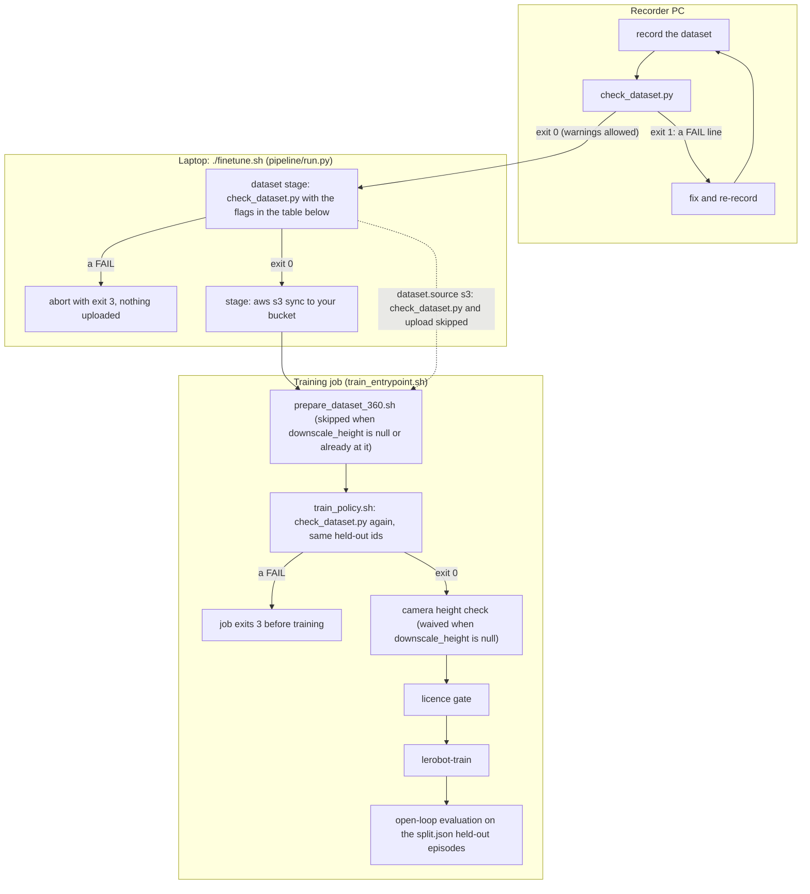

# Check a dataset on the day you record

Read this if you operate the robot PC that writes LeRobot datasets, or if you hand such datasets to the person who
runs `./finetune.sh`. Run `trainer/check_dataset.py` on the recorder the same day you record. It is one file and needs
only `pyarrow` and `numpy`. Each check comes from a defect seen in a real recording. The pipeline runs the same script
twice more: on the laptop before the upload, and inside the training job. A pass here is a pass there, provided you add
the flags the pipeline adds. Those are `--require-flat-names` when `groot` or `molmoact2` will train on this dataset (the
two policies whose `trainer/policies/<name>.yaml` sets `requires_flat_action_names: true`), and `--heldout` with the
episode ids you will put in `evaluation.heldout`. The table at the end lists the flags each stage adds.

## Install

| what | value |
|---|---|
| Python | 3.9 or newer for this one script (it has no dependencies beyond pyarrow and numpy); the pipeline itself needs 3.10 or newer |
| packages | `pip install pyarrow numpy` (no torch, no lerobot, no AWS SDK) |
| file to copy | `trainer/check_dataset.py`, nothing else from this repository |
| network | none; the script only reads the dataset folder |

## The three commands

```bash
python3 check_dataset.py datasets/my_task                        # report on stderr; exit 0 (ok or warnings) or 1 (a FAIL)
python3 check_dataset.py datasets/my_task --heldout "0 13 26"    # the same report with an explicit held-out set
python3 check_dataset.py datasets/my_task --emit-split > split.json   # what the trainer runs: report on stderr, split JSON on stdout
```

The folder you point at is the dataset root, exactly as LeRobot writes it. It holds `meta/info.json` (with
`codebase_version` v3.0), `meta/stats.json`, `meta/tasks.parquet`, `meta/episodes/`, `data/` and `videos/`. The full
tree, and the rule that the folder name is the dataset name in `project_config.json`, are in
[datasets/README.md](../datasets/README.md).

## Flags and exit codes

| flag | effect |
|---|---|
| `--heldout "0 13 26"` | held-out episode ids, separated by spaces or commas. Every other episode trains. Wins over `--episodes` when both are given |
| `--episodes "[1,2,3]"` | JSON list of training ids. The rest are held out |
| `--horizon-seconds 1.0` | changes only the horizon warning and the `chunk` shown in the summary line and the split JSON. The trainer's real chunk comes from the policy block of `project_config.json`: `chunk` if set, else `horizon_seconds` times fps, else the registry default |
| `--require-flat-names` | turn the `action.names` dict warning into a FAIL (the pipeline sets it when a policy that needs joint names trains on this dataset) |
| `--force-res` | drop the non-16:9 camera aspect warnings from the summary count (the lines still print) |
| `--force-action-eq-state` | turn the bit-exact `action == observation.state` FAIL into a warning |
| `--force-small` | allow the automatic split on fewer than 10 episodes (holds out episode 0) |
| `--emit-split` | print the split JSON on stdout. The report stays on stderr |

Exit 0 means no FAIL line (warnings allowed). Exit 1 means at least one FAIL. The last stderr line is always the summary,
`OK: 0 fail(s), N warning(s) for <root>` or `FAIL: ...`. Three early stops end the report at once instead:
`meta/info.json` missing, `total_episodes` or `fps` unusable, or `features` lacking `action` or `observation.state`.
On exit 1 nothing is printed on stdout, so a redirected split.json is empty. The report is on stderr.

Without `--heldout` or `--episodes` the split is automatic: about 10 % of the episodes, evenly spaced and starting at
episode 0 (80 episodes hold out 0, 10, 20, ... 70, and 12 episodes hold out 0). Fewer than 10 episodes need an explicit
split or `--force-small`.

## Reading the report

Every line starts with `FAIL`, `WARN` or `OK`. Fix every FAIL. Read every WARN and decide. The tables list each message
with its trigger, what to do on the recorder, and the flag that overrides it (blank = no override, fix the data).

### FAIL lines

| message (abridged) | trigger | what to do | override |
|---|---|---|---|
| `meta/info.json missing: not a LeRobot dataset root` | wrong folder | point at the folder that holds `meta/`, `data/`, `videos/` | |
| `codebase_version is 'v2.1'; this pipeline needs v3.0` | older LeRobot layout | convert with LeRobot's v2.1 to v3.0 converter on a machine that has lerobot 0.6.1, then re-run. Command and caveats: [datasets/README.md](../datasets/README.md), 'Older LeRobot exports'. Converter failure on per-episode H.264 videos: [docs/TRAPS.md](TRAPS.md) | |
| `total_episodes=... fps=... in info.json` | missing or non-positive values | the recording did not finish writing. Re-export | |
| `features must contain 'action' and 'observation.state'` | one key absent | fix the recorder's feature map | |
| `action float32[...] vs observation.state [...]: expected float32 and equal shapes` | dtype or shape differ | record action and state with the same dimension and float32 | |
| `action.names is a dict {'axes': [...]}` (FAIL form) | dict names with `--require-flat-names` | export `names` as a flat list of joint names | flat list, or drop the flag when neither `groot` nor `molmoact2` will train on this dataset (the only policies that need flat names) |
| `action.names has N entries but action has M dims` | list length differs from the action dimension | fix the names list | |
| `no camera feature (dtype video) in features` | no video or image feature | check the camera configuration | |
| `<camera> is dtype 'image' (PNG frames)` | frames stored as images | record video (mp4) | |
| `<camera>: cannot read height/width from shape` | shape is not `[h, w, 3]` or `[3, h, w]` | fix the camera feature shape | |
| `meta/tasks.parquet missing` or `meta/stats.json missing` | file absent | finish the export | |
| `meta/episodes/chunk-*/file-*.parquet missing` | v3.0 episode metadata absent | finish the export | |
| `no data/**/*.parquet files` | no frames written | the recording is empty | |
| `no mp4 under videos/<camera>/` | video encoding did not run or wrote elsewhere | re-encode, check the video path template | |
| `pyarrow and numpy are required` | missing packages | `pip install pyarrow numpy` | |
| `episodes metadata has N rows but info.json says total_episodes=M` | episode table and info disagree | re-export (a partial write) | |
| `<file>: action (...) vs state (...)` | per-file shape mismatch | re-export that chunk | |
| `<file>: action == observation.state bit-exactly in this whole file` | the action column is a copy of the state in every row of that one data file, whatever the other files hold | nothing to learn from that file. Check the recorder's action source, then re-record or re-export | `--force-action-eq-state` (turns into WARN) |
| `action == observation.state bit-exactly in every row` | the action column is a copy of the state in every row of every file | nothing to learn. Check the recorder's action source and re-record | `--force-action-eq-state` (turns into WARN) |
| `stats.json[...] lacks mean/std` | normalisation stats absent | recompute stats with the LeRobot tools | |
| `stats.json[...].mean has N entries, action dim is M` | stats for a different dimension | recompute stats | |
| `only N episodes: give --heldout/--episodes explicitly or --force-small` | fewer than 10 episodes, automatic split | record more, or name the held-out episode | `--heldout`, `--episodes`, `--force-small` |
| `episode ids out of range for N episodes` | an id in `--heldout`/`--episodes` does not exist | fix the ids | |
| `no training episodes left` | every episode held out | hold out fewer | |
| `held-out episodes also in the training list` | an id in both lists (cannot happen with the current flags, which derive one list from the other, so this is a safety check only) | fix the ids | |

### WARN lines

| message (abridged) | trigger | what it means | what to do | override |
|---|---|---|---|---|
| `action.names is a dict {'axes': [...]}, not a flat list; fine for ACT` | dict form | lerobot turns it into `['axes']`, so name-based policies misbehave silently | export a flat list before enabling `groot` or `molmoact2` (the flat-names policies named in the introduction) | |
| `action.names missing: joints are scored generically` | no names | the gripper check below (`max is far above q99`) is skipped, and name-based policies get no joint names. The open-loop evaluation is unaffected: it finds grippers by the 16-dim layout, not by names | add names | |
| `<camera> is 4:3; the in-job downscale keeps the aspect ratio ...` (or `is 1.500;` for other aspects) | aspect not 16:9 (tolerance 0.02) | the in-job downscale keeps the aspect ratio (a 4:3 camera becomes 360x480) and any width is accepted. The reference numbers in [docs/RESULTS.md](RESULTS.md) are per dataset | nothing, unless you want 16:9 | `--force-res` (see the flags table) |
| `horizon N s is outside the 0.5-2.0 s range` | `--horizon-seconds`, rounded to whole frames at the dataset fps, falls outside 0.5 to 2.0 s | chunks that short or long were not tried | pick a horizon in range | |
| `action == observation.state bit-exactly ... proceeding because --force-action-eq-state` | forced | you accepted a dataset with no command signal | drop `--force-action-eq-state` and fix the recorder's action source, unless you are deliberately testing the pipeline rather than training a usable policy. A policy trained on such data learns to hold still | none (this row is the override) |
| `action is an EXACT copy of state shifted by k frame(s)` | for some k in 1..10, action[t] == state[t+k] inside every episode | the action column is the state column shifted by k frames, so it was derived from the state, not logged from the controller | check what the recorder writes as action | |
| `stats.json has no entry for camera(s) [...]` | a camera listed in `info.json` has no entry in `meta/stats.json` (seen with third-party v2.1 to v3.0 converters) | `lerobot-train` reads `stats[<camera>]` and would stop with a KeyError. The job adds ImageNet-shaped placeholder entries to the copy of `stats.json` it trains from (`ensure_quantiles.py`) | nothing for this pipeline. Outside it, recompute the stats with LeRobot | |
| `stats.json[...] lacks q01/q99` | quantile stats absent | QUANTILES and MEAN_STD are lerobot normalisation modes: scale each dimension by its q01 and q99 quantiles, or by its mean and standard deviation. Policies that use QUANTILES cannot run without q01/q99. ACT uses MEAN_STD and is unaffected | recompute stats with a recent LeRobot | |
| `<gripper>: max is far above q99` | a dim whose name contains `gripper` or `finger` has `(max - q99) / (max - min) > 0.3` | under QUANTILES the open-gripper value lands far outside the -1 to 1 range that q01 to q99 maps onto. ACT (MEAN_STD) is unaffected | nothing for ACT | |
| `held-out set is all left-arm episodes` (or right) | 16-dim layout only (selected by dim count, not by names) | gripper-timing and idle-arm metrics are one-sided | pick held-out ids from both arms | `--heldout` |

### OK lines

| message | what it tells you |
|---|---|
| `camera <key>: HxW (16:9)` | one line per camera with the aspect tag; write these down |
| `N episodes, F frames, fps, dims; chunk C = S s` | the numbers the trainer will see, except `chunk`, which follows `--horizon-seconds` here and `project_config.json` in the job |
| `episodes metadata rows = N = total_episodes` | the episode table agrees with `info.json` |
| `scanned N data file(s), R rows; max \|action - state\| = D` | D is the largest difference over all files. A file that is entirely a copy gets its own FAIL line above this one. The whole-dataset FAIL needs D exactly 0. The print rounds to 5 decimals, so 0.00000 can hide a tiny difference: compare D with the joint motion you expect |
| `bimanual layout: L left-arm and R right-arm episodes (assumed 7+1+7+1 layout ...)` | 16-dim datasets only; which arm moves, from joint variance, assuming dims 0-7 are the left arm and 8-15 the right arm |
| `split: N training episodes, held-out [...]` | the split the trainer will use |

## Worked examples

The blocks below are real output of `trainer/check_dataset.py` on synthetic datasets from the test fixture generator
(`python3 tests/fixtures/make_mini_v3.py OUT_DIR --variant NAME`, and `--list-variants` prints the names). The generator
needs only `pyarrow` and `numpy`, so it also runs on the recorder. Its default dataset (variant `names_flat`) has 12
episodes of 24 to 40 frames (371 in all, random seed 0), three 720x1280 cameras and 16 action dims, with the moving arm
alternating per episode. The `few_episodes` variant has 4 episodes. The generator's identifiers are neutral by design
(robot type `synthetic_bimanual`, joints `left_joint_1` to `right_gripper`, cameras `observation.images.ego`,
`left_wrist`, `right_wrist`), so nothing was substituted. The dataset path was shortened to `datasets/my_task` and `...`
marks lines left out. The blocks come from the default build and the `few_episodes`, `exact_lag_copy`, `names_dict`,
`non_16_9` and `gripper_q99_outlier` variants. For the whole-dataset FAIL example we overwrote `action` with
`observation.state` in both data files of the default build after generating it. The generator's own `action_eq_state`
variant copies only the second file and produces the per-file FAIL shown after it.

A clean 16-dim dataset with an explicit held-out set:

```text
$ python3 check_dataset.py datasets/my_task --heldout "0 6" --emit-split > split.json
OK   camera observation.images.ego: 720x1280 (16:9)
OK   camera observation.images.left_wrist: 720x1280 (16:9)
OK   camera observation.images.right_wrist: 720x1280 (16:9)
OK   12 episodes, 371 frames, 25 fps, 16 action dims; chunk 25 = 1.00 s
OK   episodes metadata rows = 12 = total_episodes
OK   scanned 2 data file(s), 371 rows; max |action - state| = 1.02828
OK   bimanual layout: 6 left-arm and 6 right-arm episodes (assumed 7+1+7+1 layout for 16-dim actions: dims 0-7 left arm, 8-15 right arm, grippers 7 and 15)
WARN held-out set is all left-arm episodes; gripper-timing and idle-arm metrics will be one-sided
OK   split: 10 training episodes, held-out [0, 6]
OK: 0 fail(s), 1 warning(s) for datasets/my_task
```

`split.json` then holds `{"train": [1, 2, 3, 4, 5, 7, 8, 9, 10, 11], "held": [0, 6], "fps": 25, "action_dim": 16,
"n_episodes": 12, "names": [...], "ds_root": "<the dataset's absolute path>", "chunk": 25}`. The warning is real: in this
fixture even episodes move the left arm, so 0 and 6 are both left-arm episodes. `--heldout "0 7"` gives the same report
with 0 warnings.

Too few episodes for the automatic split (exit 1), and the same dataset with `--force-small` (exit 0):

```text
$ python3 check_dataset.py datasets/my_task
...
OK   4 episodes, 132 frames, 25 fps, 16 action dims; chunk 25 = 1.00 s
...
OK   bimanual layout: 2 left-arm and 2 right-arm episodes (assumed 7+1+7+1 layout for 16-dim actions: dims 0-7 left arm, 8-15 right arm, grippers 7 and 15)
FAIL only 4 episodes: give --heldout/--episodes explicitly or --force-small (holds out episode 0)
FAIL: 1 fail(s), 0 warning(s) for datasets/my_task
$ python3 check_dataset.py datasets/my_task --force-small
...
WARN held-out set is all left-arm episodes; gripper-timing and idle-arm metrics will be one-sided
OK   split: 3 training episodes, held-out [0]
OK: 0 fail(s), 1 warning(s) for datasets/my_task
```

`--force-small` holds out episode 0, as the hint and the second run's `split:` line both say. The FAIL line above is
quoted verbatim from the script (a repository test, `tests/test_doc_hints.py`, keeps the two in step).

A dataset whose action column is a copy of the state everywhere (a recording of nothing). Each data file fails on its
own, then the whole-dataset line, so the summary counts 3 fail(s):

```text
FAIL file-000.parquet: action == observation.state bit-exactly in this whole file
FAIL file-001.parquet: action == observation.state bit-exactly in this whole file
OK   scanned 2 data file(s), 371 rows; max |action - state| = 0.00000
FAIL action == observation.state bit-exactly in every row: nothing to learn beyond 'hold' (a common recorder/export defect); re-export the dataset or pass --force-action-eq-state
```

The same copy confined to one data file (the `action_eq_state` variant). The maximum over all files looks healthy, but
the file still fails and the run exits 1:

```text
FAIL file-001.parquet: action == observation.state bit-exactly in this whole file
OK   scanned 2 data file(s), 371 rows; max |action - state| = 1.02783
```

Four warnings you will meet on real recorders (the `exact_lag_copy`, `names_dict`, `non_16_9` and `gripper_q99_outlier`
variants). The camera and gripper warnings print once per camera and once per gripper. One of each is shown:

```text
WARN action is an EXACT copy of state shifted by 3 frame(s): a delayed copy is not a command signal
WARN action.names is a dict {'axes': [...]}, not a flat list; fine for ACT, breaks name-based policies (pi0.5, GR00T)
WARN observation.images.ego is 4:3; the in-job downscale keeps the aspect ratio (a 4:3 camera becomes 360x480) and widths other than 640 are fine; reference bands in pipeline/reference_results.json are per dataset
WARN left_gripper: max is far above q99 (5.1107 vs 1.0283); under QUANTILES normalisation the open gripper saturates. MEAN_STD (ACT default) is unaffected
```

Two details are easy to miss. `max |action - state|` is computed over all data files together, but the bit-exact check
also runs per file: a copy that fills one whole file is a FAIL even when the other files are healthy. A copy that covers
only part of a file is not caught, so still compare the number with the joint motion you expect. The lag check compares
`action[t]` with `state[t+k]` inside each episode for k from 1 to 10, and it fires only when the copy is exact.

## Day-of-recording checklist

1. Record at least 10 episodes, or decide now which episode is held out.
2. Run the report before the robot is powered down. Fix every FAIL while re-recording is still possible.
3. Confirm `max |action - state|` is well above 0 and no `EXACT copy` warning appears. If either fails, the action stream
   is not a command signal. Check the recorder before recording more.
4. Confirm `codebase_version` is v3.0 and both `meta/tasks.parquet` and `meta/stats.json` exist. A missing file means the
   export did not finish.
5. Write down the camera lines. Non-16:9 cameras train fine (the downscale keeps their aspect ratio). Compare numbers
   only with runs on the same dataset.
6. If any policy other than ACT may train later, make `action.names` a flat list with `gripper` or `finger` in the gripper
   names, and check that `stats.json` carries q01/q99.
7. For a 16-dim bimanual layout, pick held-out episodes from both arms (the `bimanual layout` line tells you the counts).
8. Check the exit code (`echo $?` right after the run). Exit 0, with the same `--heldout` ids and `--require-flat-names`
   the pipeline will add (table below), means the laptop and the job will pass this check too.

## What happens next in the pipeline

The same script gives the verdict in three places, and a FAIL stops the flow at whichever place first sees it:



| stage | who runs the script | flags added | on FAIL |
|---|---|---|---|
| laptop, `./finetune.sh` dataset stage (`pipeline/run.py`) | the pipeline, before any upload (skipped when `dataset.source` is `s3`, then only the job checks) | `--emit-split`. `--heldout` from `evaluation.heldout` in `project_config.json` unless it is `"auto"`. `--require-flat-names` when a policy that trains on this dataset declares `requires_flat_action_names` (a policy with its own `policies.<name>.dataset` block is checked against its own dataset, and `--policy` narrows the set) | abort with exit 3, nothing is uploaded |
| training job, `trainer/train_policy.sh` | the job, after the in-job downscale | `--emit-split` and the same held-out ids, plus `--force-res`, `--force-action-eq-state`, `--force-small` or `--require-flat-names` for each hyperparameter of the same name set to 1 (the mapping is in the hyperparameter table of [docs/ARCHITECTURE.md](ARCHITECTURE.md), 'Inside the job') | job exits 3 before training |

Of the `force_*` hyperparameters, `./finetune.sh` sets only `force_res`, and only when `dataset.downscale_height` is
null (no in-job downscale, so the job also waives its camera height check). It never sets `force_small` or
`force_action_eq_state`: a dataset that fails on the recorder has to be fixed, or its split given explicitly through
`evaluation.heldout`. `./finetune.sh --stop-after dataset` runs the check as the pipeline would and stops before any
AWS call (no stack needed). Inside the job the order is the one in the diagram above.
[docs/ARCHITECTURE.md](ARCHITECTURE.md) ('Step by step inside train_policy.sh', under 'Inside the job') lists every step,
including the two metadata-only copies of the dataset the job may build between the height check and the licence gate
(`select_camera.py` for a camera subset, `ensure_quantiles.py` to complete `stats.json`). [docs/TRAPS.md](TRAPS.md)
lists the recording defects this script catches.
