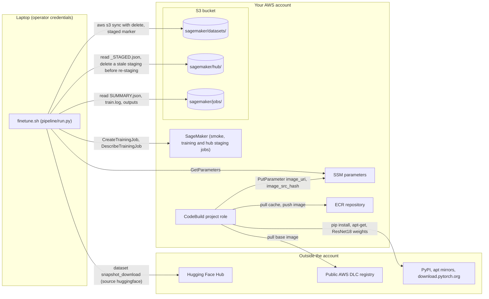
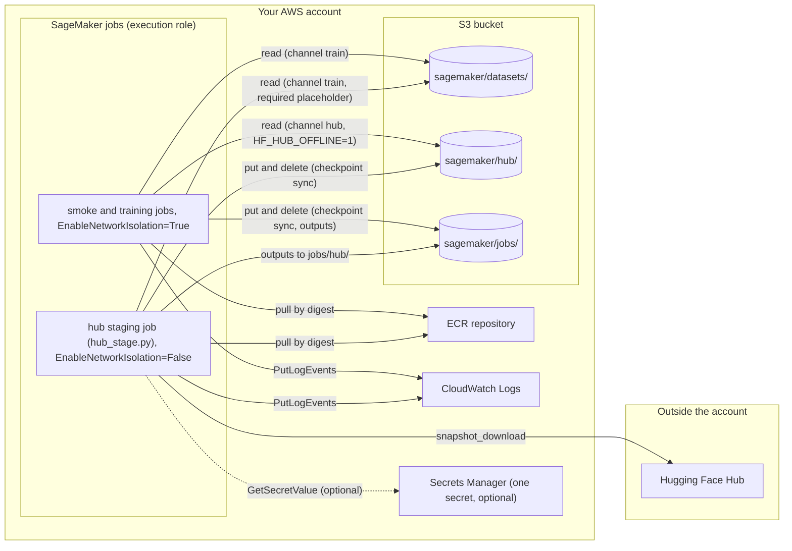

# Security notes

Read this before deploying outside a sandbox account. The stack is small on purpose. This page lists what it protects
and what it leaves to you, so you can decide what to add for your own baseline.

## What the stack creates and how it is scoped

| resource | hardening in place | left to you |
|---|---|---|
| S3 bucket | block all public access, S3-managed encryption (SSE-S3), a bucket policy that refuses non-TLS requests, emptied and deleted by `cdk destroy` unless deployed with `-c retainData=true`, abort of orphaned multipart uploads after 7 days, expiry of the smoke-job (14 days), build-context (30 days) and build-artifacts (90 days) prefixes | versioning, server access logging, a customer-managed KMS key |
| ECR repository | scan on push, lifecycle rules, emptied and deleted by `cdk destroy` unless deployed with `-c retainData=true`, jobs reference images **by digest** (SSM parameter `/<project>/image_uri`) | KMS encryption, immutable tags (the build cache needs a mutable tag) |
| SageMaker execution role | name generated by CDK (a fixed name would allow only one deployment per account), no AWS managed policies attached. The trust policy lets SageMaker assume the role only for a SageMaker resource of this account in the stack's region (`aws:SourceAccount` and `aws:SourceArn` conditions), so a job in another account cannot borrow it. Read on this bucket; put and delete only under `sagemaker/jobs/*` and `sagemaker/hub/*` (the prefixes the jobs write: checkpoint sync, outputs, the staging job's cache mirror; when the container deletes a checkpoint locally, the sync deletes the S3 copy). The dataset and build prefixes are read-only for the job identity. Pull on this repository only; CloudWatch Logs for training jobs; `cloudwatch:PutMetricData` restricted to the `/aws/sagemaker/TrainingJobs` namespace; optional read of one Secrets Manager secret | |
| CodeBuild project | privileged mode (Docker inside the build, needed to build an image) only for this repo's `trainer/` asset; pulls the base image from AWS's public Deep Learning Containers (DLC) registry and pushes to this stack's repository; 30-day log retention | |
| training jobs | `EnableNetworkIsolation=True` (no outbound network; nothing is downloaded during training), SageMaker profiler disabled, a runtime cap derived from the measured step rate, all inputs from your bucket | a VPC configuration if your baseline requires one; a Budgets alarm on SageMaker spend |

The job identity can therefore never delete a dataset or a build artefact (the files the image build writes under
`sagemaker/build-artifacts/`). The only process that deletes dataset objects is the laptop's `aws s3 sync --delete`,
under your own credentials. Checked on 2026-09-11: a 200-step smoke and a 100k-step ACT job ran under this policy with
no S3 access errors in the job logs ([docs/RESULTS.md](RESULTS.md)).

`cdk synth` runs the cdk-nag `AwsSolutions` rule pack. Every deliberate deviation is suppressed on the resource that
carries it, with the reason written next to it in `cdk/lerobot_finetune/stack.py`. `tests/test_cdk_template.py` fails on
any unsuppressed finding.

The first diagram shows the two identities that reach outside the account: your own credentials and the CodeBuild
project role. Your laptop reads the stack's SSM parameters (the bucket name, role ARN, repository URI and image digest).
It uploads the dataset, downloading it from the Hugging Face Hub first when `dataset.source` is `huggingface`. It submits
and polls jobs and reads their results. The image build pulls the DLC base image and the pinned packages, then writes the
image digest to SSM. Not drawn: the preflight's read-only calls (STS GetCallerIdentity, S3 GetBucketLocation, ECR
DescribeImages, Service Quotas) and the build's `sagemaker/build-context/` and `sagemaker/build-artifacts/` prefixes.

The second diagram shows what each kind of job may touch with the execution role. Solid edges are S3, ECR and
CloudWatch Logs. The dashed edge is the optional secret read described under Secrets and identifiers.

## Supply chain

- The image build ([docs/ARCHITECTURE.md](ARCHITECTURE.md), Image) gives three guarantees. The base image is pinned by
  digest. Every Python package is pinned by `constraints.txt` and the full `requirements.lock`, and any drift fails the
  build. Build-time asserts refuse an image in which torchcodec or decord can be imported, or in which a registry policy
  class cannot.
- No model weights are in this repository. ACT starts from torchvision's ImageNet ResNet18 weights, which are baked into
  the image.
- Other policies' base weights are downloaded by the staging job into your bucket at the `revision` the registry names.
  All 15 entries with `hub_artifacts` pin every artefact to a commit sha; none leaves `revision` null (a null would
  resolve the Hub default branch). `tests/test_registry.py` fails on an unpinned entry.
  The per-policy list is the `hub_artifacts` row of [trainer/policies/README.md](../trainer/policies/README.md).
  `_STAGED.json` records the requested revision and the resolved commit sha of every artefact (one Hugging Face
  repository the policy needs: base weights, a tokenizer or a processor), written by `trainer/hub_stage.py`.
- To fix a base in a fork, set `revision` to a commit sha in your copy of `trainer/policies/<name>.yaml` and re-run the
  staging job. `project_config.json` has no override for it. Licences: [docs/POLICIES.md](POLICIES.md).
- lerobot checkpoints are safetensors and JSON. Three staged inputs are not. torchvision's ResNet18 weights are a
  pickle-format `.pth` baked into the image and read by `torch.load`. The staging job keeps PyTorch `*.bin` weights when
  a repository ships no safetensors copy (and every file of GR00T, including `training_args.bin`). pi0_fast's action
  tokenizer is loaded by transformers with `trust_remote_code=True`, so Python from that pinned revision runs inside the
  job.
- Third-party components of the image are listed in `THIRD-PARTY-LICENSES`; the exact package set is
  `trainer/sagemaker/requirements.lock`. The image does not ship `pip-audit`. Audit the pinned set from any laptop with
  `python3 scripts/audit_image_lock.py` (standard library only; it asks the OSV database, a public index of known
  vulnerabilities, about every `name==version` pin). `pip-audit --no-deps -r trainer/sagemaker/requirements.lock` does
  the same but needs the image's Python 3.12 to resolve the pins. The state at release time is recorded in the next
  section.

## Dependencies: known advisories at release time (checked 2026-09-16 against OSV)

The training image is pinned exactly. It is rebuilt only when `trainer/` changes or when you start a build yourself, so
it carries whatever advisories were open on the day `requirements.lock` was generated. Re-run
`python3 scripts/audit_image_lock.py` before you rebuild. The table is what it reported for the shipped lock and how each
item is treated. The mitigations rest on the job design: training jobs run with `EnableNetworkIsolation=True`, read only
your dataset and base weights staged from pinned Hub revisions, and expose no service.

| package (pinned) | advisory | severity | fixed in | exposure in this pipeline |
|---|---|---|---|---|
| `transformers==5.5.4` | CVE-2026-9856 (GHSA-xrqw-3rrv-vx5w): `save_pretrained` path traversal through a chat template | high | 5.10.0 | affects a model whose staged checkpoint carries a malicious chat template. Bases are staged from the revisions the registry pins and the job has no network. If you add a policy whose base checkpoint comes from a repository you do not control, inspect its `chat_template` files at the pinned revision before staging it. lerobot 0.6.1 requires `transformers<5.6.0`, so the fix needs a newer lerobot release; the image cannot take 5.10 today |
| `accelerate==1.14.0` | CVE-2026-69112: path traversal via sharded-checkpoint `weight_map` entries | moderate | none published for the 1.x line at check time | same reasoning: only staged, pinned checkpoints are loaded |
| `torch==2.8.0` | CVE-2025-2999/3000/3001, CVE-2025-55551/55552/55554, CVE-2026-24747, CVE-2026-4538 (memory corruption via `torch.jit.script`, `unpack_sequence`, `lstm_cell`, ...) | low to moderate | 2.9.x-2.13 | these need attacker-supplied TorchScript or models to run; the job runs only the registry's lerobot recipes. torch comes from the SageMaker DLC base pinned by digest; moving it means a new DLC base and a full re-validation |
| `datasets==4.8.5` | CVE-2026-66007 | moderate | 5.0.1 | lerobot 0.6.1 requires `datasets<5.0.0`; the job reads only your own dataset files |
| `httpx2==2.9.1`, `httpcore2==2.9.1` | CVE-2026-84378..84382 (SOCKS/WebSocket TLS, decompression memory, header injection) | high (client-side) | 2.10-2.12 | transitive dependency; nothing in the training job opens a network connection (isolation on), and the hub staging job uses `huggingface_hub` |
| `tornado==6.5.7` | CVE-2026-82397, CVE-2026-91990/91991 (server request parsing) | high | 6.5.8 | a web-server library shipped by the DLC base; no server runs in the job |
| `sagemaker==2.257.5` | GHSA-5r2p-pjr8-7fh7 (`eval()` in JumpStart search) | high | 3.4.0 | the SageMaker Python SDK inside the image is not used by the trainer (the laptop side uses boto3 only) |
| `pip==26.1.2`, `setuptools==81.0.0` | CVE-2026-13346, CVE-2026-59890 | moderate | 26.2, 83.0.0 | build-time tools only; the image installs nothing at run time |

Path to a clean report: rebuild the image on a newer SageMaker DLC base once a lerobot release accepts
`transformers>=5.10`, then re-run the smokes recorded in [docs/RESULTS.md](RESULTS.md). The files on the ACT path are a
frozen set (`tests/test_frozen_set.py`); the CPU smoke (`scripts/smoke_aws.sh`) re-validates them. Until then, treat the
image as a fixed, audited build and keep network isolation on.

**Laptop side.** `requirements.txt` is lower-bounded, so `pip` resolves current releases. Python 3.9 is end-of-life. On
3.9, pip can only install versions with open advisories: botocore pins `urllib3<1.27` there, and the fixed `pyarrow`,
`filelock`, `click` and `pytest` releases need 3.10. That is why the supported floor is Python 3.10, with
`pyarrow>=23.0.1` and `pytest>=9.0.3` as minimums. `python3 scripts/audit_image_lock.py requirements.txt --resolved`
audits what your interpreter actually installed.

**Static analysis.** CI runs `bandit -ll` (Medium and High findings fail the build) and pyflakes (through
`tests/test_lint.py`, part of the `pytest` step). The remaining Low findings are `subprocess` calls with fixed argument
lists (in the laptop-side scripts, in `trainer/publish.py` inside the container and in the image's build-time checks),
one `try/except/pass` in `pipeline/run.py` and one `assert` in `trainer/sagemaker/image_asserts.py`.

**Scanner suppressions.** Every suppression is deliberate and its reason sits next to the code. An ASH
([AWS Automated Security Helper](https://github.com/awslabs/automated-security-helper)) run with bandit, checkov,
semgrep, detect-secrets and cdk-nag reports nothing beyond the items below. `.ash/.ash.yaml` lists the same
suppressions, so a re-scan shows them as reviewed, not open. CI runs `detect-secrets scan --baseline .secrets.baseline`
(detect-secrets 1.5.0) and fails when the baseline holds an entry that is not audited as a false positive.

| scanner | finding | where it is answered |
|---|---|---|
| detect-secrets | 40- and 64-character hex strings (Hugging Face commit shas, CDK asset content hashes), CDK logical ids and one repository id (`HuggingFaceTB/SmolVLM2-500M-Video-Instruct`) that the base64 detector flags, the AWS documentation example access key id (`AKIA...EXAMPLE`), and test fixtures (fake resource ids, a placeholder secret key) | `# pragma: allowlist secret` on the YAML lines that can carry a comment; `.secrets.baseline` for the JSON files, `scripts/scrub_allowlist.txt` and the test lines, every entry audited `is_secret: false`; `.ash/.ash.yaml` suppresses the same paths and, in addition, the secret name `<project>/hf_token` in `examples/*.json` and the DLC base digest in `trainer/sagemaker/Dockerfile`, which ASH's bundled detect-secrets build also reports |
| checkov (CloudFormation) | S3 access logging and versioning, ECR KMS and immutable tags, log-group KMS, VPC / DLQ / concurrency for the CDK-managed helper Lambda(s): the AwsCustomResource handler and, when `retainData` is unset, the S3 auto-delete provider | `checkov: skip` metadata on each resource in `cdk/lerobot_finetune/stack.py` (`_checkov_skips`), with the reasons given in the first table: KMS and access logging are left to you; versioning would keep every pruned 16-30 GB checkpoint; tags stay mutable for the build cache while jobs pin digests |
| checkov / semgrep (Dockerfile) | no `USER`, no `HEALTHCHECK` | a SageMaker training container is a batch job started as root by the runtime, like the DLC base; `checkov:skip` comments at the top of `trainer/sagemaker/Dockerfile` |
| semgrep | GitHub Actions referenced by mutable tags | fixed: `.github/workflows/ci.yml` pins every action to a commit sha |
| semgrep | `importlib.import_module` with a non-literal argument in `trainer/sagemaker/image_asserts.py` | the argument iterates a literal tuple; `# nosemgrep` with the reason on the two lines |
| semgrep / detect-secrets | `RegExp()` and a "secret keyword" inside the two vendored handler runtimes `cdk/template/assets/kickoff-handler/index.js` and `cdk/template/assets/s3-auto-delete-handler/index.js` | vendored, unmodified aws-cdk-lib output (see THIRD-PARTY-LICENSES); excluded via `.semgrepignore`, the `ignore_paths` entries in `.ash/.ash.yaml` and the `cdk/template/assets/.*` exclusion recorded in `.secrets.baseline`, which therefore carries no entry for them |
| bandit B310 / semgrep dynamic-urllib-use | `urllib.request.urlopen` in `scripts/audit_image_lock.py` | the URL is one of the two fixed https OSV endpoints; `# nosec B310 # nosemgrep` on the call |
| bandit B615 | `snapshot_download` without a literal revision in `trainer/hub_stage.py` and `pipeline/run.py` | the revision comes from the pinned registry entry (base weights) or from `dataset.hf_revision` in `project_config.json` (datasets); `# nosec B615` where it is called |
| bandit B615 | `snapshot_download` in `tests/test_eo1_pixel_budget_docker.py` | downloads processor JSON only, no weights; `# nosec B615` on the call and listed in `.ash/.ash.yaml` |
| bandit B324 / semgrep insecure-hash-algorithm-sha1 | `hashlib.sha1` in `tests/test_secrets_baseline.py` | reproduces the SHA-1 lookup key detect-secrets stores for each audited string, not a security hash; `usedforsecurity=False` (bandit then reports nothing) and `# nosemgrep` with the rule id on the line |
| bandit B101, B404, B603, B607, B105, B106 (low) | `assert` in tests; `subprocess` calls to the AWS CLI, `docker`, `git` and `cdk` with list arguments and no shell; placeholder strings such as `test-secret-not-a-real-key` in test fixtures | below the CI threshold (`bandit -ll` excludes tests); every subprocess call passes a fixed executable name and arguments the pipeline built itself (docs/THREAT_MODEL.md: T-07 covers the override flags appended to the lerobot-train command line, T-12 the `aws s3 sync --delete` arguments, T-19 the rendered command line in the logs, T-25 feature keys joined into paths, T-31 `check_dataset.py` run as a subprocess) |

## Secrets and identifiers

- A Hugging Face token, when needed for gated base weights, is read from AWS Secrets Manager by the staging job only;
  training jobs never see it. The token is stored once through a hidden prompt in `finetune.sh` (or, opt-in, in `cdk deploy -c hfTokenPrompt=true`)
  (`pipeline/hf_token.py`), checked against the Hub, and saved as the secret `<project>/hf_token` (or the name set in
  `secrets.hf_token` of `project_config.json`). The repository holds only the name. When the prompt runs and what happens
  without a terminal: [docs/ARCHITECTURE.md](ARCHITECTURE.md), Stages of `./finetune.sh`.
- The role's `secretsmanager:GetSecretValue` grant (`cdk/app.py` passes the name, `cdk/lerobot_finetune/stack.py` adds the
  statement) is on the ARN pattern `secret:<name>*`. The wildcard covers Secrets Manager's random 6-character ARN suffix;
  it would also match any other secret whose name starts with `<name>`. The grant is created at the first `cdk deploy`
  for whatever name `secrets.hf_token` held then (default `<project>/hf_token`), so storing the token later needs no
  redeploy. If you change `secrets.hf_token` to another name after deploying, run `cdk deploy` again (plain-template
  deployments: see the Limits section of [cdk/template/README.md](../cdk/template/README.md)) before the next staging
  job. The pipeline does not check the role's grant, so otherwise the staging job is submitted, billed, and fails with
  `AccessDeniedException`.
- Two constants leave with every deployment and API call: the solution id and version from the `solution` block of
  `project_config.json`, in the stack `Description` and in the SDK `User-Agent` suffix. They are the same for every user
  and say nothing about you or your account. [README, Anonymous usage metrics](../README.md#anonymous-usage-metrics)
  lists which calls carry them and how to opt out.
- Nothing account-specific is committed: the bucket name, role ARN, repository URI and image digest are read from the
  stack's SSM parameters (`/<project>/*`) at run time. `scripts/scrub_check.sh` fails on 12-digit account ids, access keys, Hugging Face tokens,
  private-key headers, RFC 1918 addresses, Amazon-internal hostnames and e-mail addresses, 17-digit EC2 ids and
  CDK-generated bucket names in tracked files, and on a tracked `local_folder/` (a git-ignored private folder for
  local notes); CI runs it. `scripts/scrub_check.py --history` applies the same patterns to every commit message and diff of
  every ref and rejects placeholder author identities; `scripts/verify_fresh_clone.sh` runs it on the clone before a release. Deny-listed names
  (`.scrub_denylist`, git-ignored) are checked only in local runs where that private file exists. No git hook
  is shipped; `printf '#!/bin/sh\nexec bash scripts/scrub_check.sh "$@"\n' > .git/hooks/pre-commit && chmod +x .git/hooks/pre-commit` installs one.

## Costs that keep running

While the stack exists, the bucket (datasets, checkpoints, published models), the ECR repository, the `<project>/hf_token`
secret (if you stored one) and the CloudWatch log group `/aws/sagemaker/TrainingJobs` keep costing after a run. With the
shipped default (`retainData` unset) `cdk destroy` removes the first three together with the stack; only
the log group stays, because every SageMaker job in the account writes to it (set a retention period on it with
`aws logs put-retention-policy`). With `-c retainData=true` the bucket, the repository and the secret survive
`cdk destroy`; run `scripts/destroy.sh` instead of `cdk destroy` to remove them (a custom-named `secrets.hf_token` is never
deleted by the stack). Both paths: [README.md, Teardown](../README.md#teardown).

## Threat model

The threat model in [THREAT_MODEL.md](THREAT_MODEL.md) follows STRIDE, a checklist of six threat types (spoofing,
tampering, repudiation, information disclosure, denial of service, elevation of privilege). It lists the components,
trust boundaries and assets, the threats per category with their existing mitigation and residual risk, and the ranked
recommendations.

## Reporting a vulnerability

See [CONTRIBUTING.md](../CONTRIBUTING.md#security-issue-notifications).
