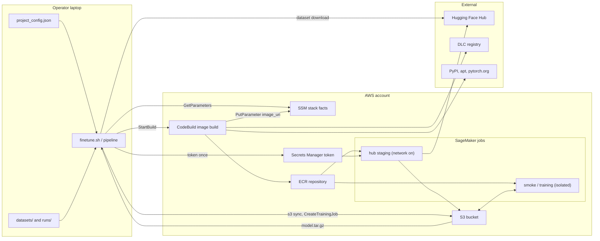

# Threat model

This document lists the ways the sample could be attacked or misused, what already defends against each one, and what
is left. It covers:

- the CDK stack (`cdk/lerobot_finetune/stack.py` and its exported template),
- the laptop-side pipeline (`finetune.sh`, `pipeline/*.py`, `scripts/destroy.sh`, `pipeline/build_image.py`),
- the SageMaker jobs the pipeline submits (the smoke job, the training job and the CPU hub-staging job, all built from
  `trainer/`),
- the files they exchange through S3, SSM Parameter Store and Secrets Manager.

Out of scope: the robot, the host that later loads a checkpoint, the Hugging Face Hub, PyPI and the AWS Deep Learning
Containers (DLC) registry as services, and the internals of the AWS services used (the SageMaker checkpoint sync agent,
CodeBuild, CloudFormation).

The method is STRIDE, applied to each component (laptop, stack, job). STRIDE is a checklist of six threat kinds:
spoofing, tampering, repudiation, information disclosure, denial of service and elevation of privilege. Every mitigation
names the file that implements it. A "documentation" mitigation is one that `docs/SECURITY.md` states but no code
enforces.

Companion documents: [SECURITY.md](SECURITY.md) lists what the stack hardens and what is left to the deploying account.
[ARCHITECTURE.md](ARCHITECTURE.md) explains the pipeline stages and exit codes. This document does not repeat them.

## System and trust boundaries

Components:

- **Operator laptop.** `finetune.sh` runs `pipeline/run.py` under the operator's own AWS credentials (`pipeline/aws.py`
  `session()`). It checks the dataset with `trainer/check_dataset.py` in a subprocess, copies it to the bucket with
  `aws s3 sync`, reads the stack facts from SSM (`resolve_stack()`), submits jobs (`pipeline/sm_jobs.py` `build_spec()`),
  waits, then downloads and unpacks the outputs (`download_outputs()`, `_safe_extract()`).
- **Stack** (`cdk/lerobot_finetune/stack.py`). One S3 bucket, one ECR repository, the SageMaker execution role, a
  CodeBuild project that builds the training image from `trainer/` and writes the image pointer to SSM, five SSM
  `StringParameter` stack facts, two log groups (image build, helper Lambdas), and two CDK-managed helper Lambdas (the
  build kickoff custom resource and, unless `retain_data` is true, the bucket auto-delete provider), plus two delete-time
  cleanup custom resources (the SSM image parameters; the default-named Hub token secret, kept with `RETAIN` when
  `retain_data` is true). What each resource hardens is in
  [docs/SECURITY.md](SECURITY.md).
- **Jobs.** Smoke and training jobs run the image pinned by digest (its sha256 content hash, not a tag) with
  `EnableNetworkIsolation` true, the default in `build_spec()`. So they have no network access at all. The hub-staging
  job (`pipeline/hub.py` `staging_spec()`, `trainer/hub_stage.py`) is a small CPU job that downloads base weights from
  the Hugging Face Hub into the bucket. It is the only job with network access and the only job that reads the Hugging
  Face token. The laptop also reads the token, under the operator's credentials, to check it (`pipeline/hf_token.py`
  `read_token()` / `status()`). The full token flow is in docs/SECURITY.md, "Secrets and identifiers".
- **Files exchanged.** The dataset mirror in S3, the staged base weights plus their `_STAGED.json` manifest,
  checkpoints, `SUMMARY.json`, `LICENCE_NOTICE.md`, `train.log`, CloudWatch log streams, and the laptop's `runs/` and
  `.finetune/` state. This document calls one downloaded set of Hub files an artefact, the name `_STAGED.json` uses.

Trust boundaries, in the order data crosses them:

1. Laptop to the AWS APIs, under the operator's credentials. Everything read back from SSM and S3 is trusted as
   configuration (`pipeline/aws.py`, `pipeline/preflight.py`, `pipeline/run.py`).
2. Laptop to the Hugging Face Hub: the dataset `snapshot_download` (`pipeline/run.py` `ensure_dataset()`) and the token
   check (`pipeline/hf_token.py` `whoami()`).
3. Untrusted local inputs the laptop parses: `datasets/<name>/`, `project_config.json`, `runs/*.json` and the
   `.finetune/` cache.
4. Deploy identity versus runtime identities. CloudFormation writes the stack facts and the IAM roles. The execution
   role, the CodeBuild role and the kickoff Lambda role run later. SSM Parameter Store is the one place the laptop trusts
   for stack facts. The CodeBuild role writes two of its parameters (the `PublishImageParams` statement in `stack.py`).
5. CodeBuild container (privileged, with internet access) to the outside sources it downloads from: the DLC registry,
   PyPI, apt mirrors and `download.pytorch.org` (`trainer/sagemaker/Dockerfile`).
6. Hub-staging job (network on) to the Hub and Secrets Manager. Third-party weights, and for some policies Python code,
   enter the account here. Training jobs later mount them read-only and offline. `trainer/sagemaker/train_entrypoint.sh`
   exports `HF_HUB_OFFLINE=1` and `TRANSFORMERS_OFFLINE=1` whenever the hub channel is mounted (a channel is a folder
   SageMaker copies from S3 into the container). That is the case for every staged artefact. Network isolation from
   `build_spec()` covers the rest.
7. Job container (running as root) to S3, through the SageMaker checkpoint and output sync. Everything under
   `/opt/ml/checkpoints` and `/opt/ml/model` becomes an S3 object the execution role is allowed to put.
8. Published `model.tar.gz` to the downstream consumer (`inference/predict.py` on a robot PC or EC2 host).

## Assets

| asset | where it lives | who can read and write |
|---|---|---|
| Operator AWS credentials | the laptop credential chain or a named profile (`pipeline/aws.py` `session()`) | the operator and anything running as the operator. The pipeline, `aws s3 sync` and `scripts/destroy.sh` use them as they are |
| Hugging Face token | the Secrets Manager secret named in `secrets.hf_token` (default `<project>/hf_token`). Also in laptop memory while `pipeline/hf_token.py` checks it (`status()` / `whoami()`) and during the prompt | written by the operator through `store_token()`. Read by the execution role inside the staging job (`trainer/hub_stage.py` `read_secret()`) and by any principal (IAM user or role) with `GetSecretValue` |
| Robot dataset | `datasets/<name>/` on the laptop. The mirror under the `sagemaker/datasets/` prefix and the `_staged/<name>.json` marker (`pipeline/run.py` `stage_dataset()`) | the operator's credentials read, write and delete. The execution role reads only (no put, no delete) |
| Staged base weights and `_STAGED.json` | `sagemaker/hub/<policy>/` in the bucket | written by the staging job, read by training jobs. `pipeline/hub.py` `manifest_matches()` trusts the manifest when it decides to skip re-staging |
| Checkpoints, `SUMMARY.json`, `LICENCE_NOTICE.md`, `train.log` | `sagemaker/jobs/<kind>/<job>/` in the bucket, downloaded to `runs/<name>/model/` | written by the job through the sync agent and `trainer/publish.py`. The execution role can put and delete under `jobs/*`. The operator reads |
| Training image | the ECR repository, referenced by digest in the SSM `image_uri` parameter | pushed by the CodeBuild role only (`repo.grant_pull_push(build)`). Pulled by the execution role (`repo.grant_pull(sm_role)`) |
| SSM stack facts | `/<project>/{project,region,bucket,sagemaker_role_arn,ecr_repo_uri}` plus `image_uri` and `image_src_hash`, plain `StringParameter` resources in `stack.py` | CloudFormation writes the five facts. The CodeBuild role writes the two image parameters. Any principal with `ssm:PutParameter` can overwrite any of them. The laptop reads them and caches them for 10 minutes (`resolve_stack()`) |
| Execution role credentials | inside every job | only `sagemaker.amazonaws.com` can assume the role. It can read the whole bucket, put and delete under `jobs/*` and `hub/*`, pull the repository, and call `GetSecretValue` on the token name pattern (`stack.py`) |
| CodeBuild role credentials | inside the privileged build container | push to the repository and describe its images (`DescribeImagesForCacheAndDigest`), `PutParameter` on the two image parameters, read `build-context/*`, put `build-artifacts/*`, read the trainer asset key and list the CDK assets bucket (`codebuild.Source.s3`), pull the DLC base (`stack.py`) |
| Build context | the trainer zip in the CDK assets bucket (deploy-time builds) or under `sagemaker/build-context/` (`pipeline/build_image.py` `zip_trainer()`) | written by the deployer or the operator, read by the CodeBuild role |
| Job specifications and hyperparameters | the `CreateTrainingJob` request. `hyperparameters.json` is echoed to CloudWatch (`pipeline/run.py` `job_spec()`, `trainer/sagemaker/train_entrypoint.sh`) | the operator writes. Anyone with `sagemaker:DescribeTrainingJob` or log access reads |
| Run state and run records | `runs/<name>.json`, `runs/<name>/MANIFEST.json` (`pipeline/report.py` `manifest()`) and the `.finetune/` cache | git-ignored local files (`.gitignore`). Anything running as the operator can edit them |
| Policy registry | `trainer/policies/<name>.yaml`, baked into the image | repository committers. A fork can change the licence class, the revisions and the forbidden flags |
| Licence audit trail | `SUMMARY.licence_status`, `LICENCE_NOTICE.md` and `approval_ref` (`trainer/licence.py`, `trainer/publish.py`) | written by the job from inputs the operator supplied. Readable with the outputs |

## Threats

Residual risk is the risk that remains after the mitigations that exist in the repository today. The ids are stable.
Where two or three per-component analyses described the same threat, the threat cell says which ones it merges.

### Spoofing

| id | threat | attack path | existing mitigation (file) | residual risk | recommendation |
|---|---|---|---|---|---|
| T-01 | The pipeline targets the wrong region or account (a stack with the same name elsewhere). It then uploads the dataset or runs jobs where the operator did not intend | `AWS_REGION` disagrees with the profile region. Or the active profile points at another account that also has a `<project>` stack | `pipeline/aws.py` `session()` requires an explicit region and pins it. `resolve_stack()` refuses when the SSM `region` value differs. `pipeline/preflight.py` `aws_checks()` fails when the bucket location or the image's ECR region differs, and prints the masked caller ARN (`_mask()`). `scripts/destroy.sh` refuses a bucket outside `--region`. Nothing checks the account | low | Accept. Optionally add an optional `expected_account_id (a new top-level setting)` setting to the schema (kept out of the shipped `project_config.json`) that preflight compares with the caller identity from STS |
| T-02 | A tampered helper Lambda handler (the two vendored aws-cdk-lib runtimes committed under `cdk/template/assets/`) runs at deploy or delete time as its Lambda role | On the plain-template path (deploying the exported CloudFormation template without the CDK, see `cdk/template/README.md`) the operator uploads the handler zip to their assets bucket. A contributor or a bucket writer replaces it. CloudFormation invokes it on create and update | `tests/test_cdk_template.py` `test_committed_handlers_match_synth` compares both committed handlers (the kickoff/cleanup runtime and the S3 auto-delete provider, which runs at delete time with `s3:DeleteObject*` on the bucket) byte for byte with a fresh synth (the output of `cdk synth`) of the pinned aws-cdk-lib (`cdk/requirements.txt`, `test_requirements_pins_match_the_export`). The Lambda role holds only basic execution plus `codebuild:StartBuild` on this project. `install_latest_aws_sdk=False` avoids a download at deploy time (`cdk/lerobot_finetune/stack.py`) | low | Accept. Optionally publish the sha256 of the handler zip in `cdk/template/assets.json` and have `cdk/template/README.md` tell the deployer to check it before upload |
| T-32 | SageMaker, acting for another account's resource, assumes this stack's execution role. This is the "confused deputy" pattern: a service is tricked into using this account's role for someone else's resource | Without conditions on the trust policy, a SageMaker resource in another account that names this role ARN would be accepted if the caller there holds `iam:PassRole` on it | The trust policy admits the service principal only with `aws:SourceAccount` equal to this account and `aws:SourceArn` matching `arn:<partition>:sagemaker:<region>:<account>:*` (`cdk/lerobot_finetune/stack.py` `SageMakerExecutionRole`; asserted in `tests/test_cdk_template.py` `test_sagemaker_role_trusts_only_this_accounts_sagemaker_resources`). `iam:PassRole` in this account is the second gate | low | Optional: a separate execution role for the hub staging job, so the training role needs neither the Secrets Manager read nor the `hub/*` write |

### Tampering

| id | threat | attack path | existing mitigation (file) | residual risk | recommendation |
|---|---|---|---|---|---|
| T-03 | A rewritten SSM stack fact (`image_uri`, `bucket`, `sagemaker_role_arn`) makes the operator's credentials run a different image, upload the dataset to a different bucket, or pass a different role to `CreateTrainingJob`. Merges the laptop, stack image-pointer and stack-fact findings | Any principal with `ssm:PutParameter` on `/<project>/*` rewrites a value. The parameters are plain `StringParameter` resources with no parameter policy, and the CodeBuild role legitimately holds that permission for the two image parameters. `resolve_stack()` trusts what `GetParameters` returns and caches it for 10 minutes. `run.py` passes the role as `RoleArn` (the operator's `iam:PassRole` makes it effective), `stage_dataset()` syncs into the bucket and `job_spec()` uses the image | `pipeline/aws.py` `resolve_stack()` refuses a region mismatch. `pipeline/preflight.py` `aws_checks()` fails on a bucket or image region mismatch, on an image not pinned by digest and on a digest absent from ECR. It only warns when the digest lives in another repository. `pipeline/sm_jobs.py` `build_spec()` rejects images not pinned by digest. The execution role may pull from the stack's repository only (`repo.grant_pull(sm_role)` in `cdk/lerobot_finetune/stack.py`), so an image in another private repository fails at pull time unless that repository's policy grants the role. Nothing checks that the role or bucket belongs to this stack or account | medium | Repo: in preflight, compare the SSM values with the CloudFormation outputs or `describe-stack-resources` of `<project>-infra` and fail on mismatch. Pass `ExpectedBucketOwner` on S3 calls. Turn the "not in this stack's ECR repo" warning into a failure unless `--image` was given. Print the digest in the single confirmation prompt. Operator: restrict `ssm:PutParameter` on `/<project>/*` to the deploy identity and the CodeBuild role, and alert on it in CloudTrail (the AWS API audit log) |
| T-04 | A compromised or re-tagged Hugging Face dataset repository delivers different data than the operator checked. The shipped pin is a tag, which can be moved, and the recorded fingerprint does not hash file contents | The shipped `project_config.json` pins the default dataset at `hf_revision` `v3.0`, a tag. `pipeline/project_config.schema.json` accepts any string. `ensure_dataset()` downloads that revision, and the data is uploaded and trained on | `pipeline/run.py` `dataset_fingerprint()` records the sha256 of the `meta/info.json` bytes plus the relative path and size of every file. It stores that in `runs/<name>.json`, `MANIFEST.json` (`pipeline/report.py`) and the job's `dataset_fingerprint` hyperparameter. `trainer/check_dataset.py` checks the structure. A swap that keeps every file's size is invisible and skips re-upload through the `_staged` marker. No resolved dataset commit sha is recorded | medium | Ship the default `hf_revision` as a 40-hex commit sha, and add a schema pattern or a preflight WARN for revisions that are not a sha. Record the resolved commit in `runs/<name>.json` and `MANIFEST.json`. Include a content hash of `meta/*.parquet` and `meta/*.json` in `dataset_fingerprint()`. A pin does not vouch for the demonstrations themselves (see Assumptions), so evaluate on held-out episodes (episodes kept out of training) with `trainer/eval_openloop.py` before deploying |
| T-05 | Every registry entry pins its `hub_artifacts` to a commit sha, but the staged copy is trusted afterwards without a content check: no code compares the resolved sha in `_STAGED.json` with the requested one beyond the request match | The publisher force-pushes, or a hijacked account replaces the default branch. A pinned sha is immune to that at the next re-stage; a fork that unpins an entry is not. Training jobs mount the staged copy offline while `LICENCE_NOTICE.md` still names the same repo id | `trainer/hub_stage.py` `stage()` records `requested_revision` and `resolved_sha` per artefact in `_STAGED.json`. `pipeline/hub.py` `stage_hub()` logs repo and revision before submitting. `tests/test_registry.py` fails on a `revision: null` entry that is not on its documented allowlist. `docs/SECURITY.md` states that no entry is unpinned and tells forks to keep it that way | low | Have `trainer/summary.py` copy the resolved shas from `_STAGED.json` into `SUMMARY.json` |
| T-06 | Pickled files (`*.bin`, `training_args.bin`, `*.pt`) are staged from the Hub and can be unpickled by transformers or lerobot loaders inside the job. A Python pickle runs code when it is loaded. Only this pipeline's own checkpoints are guaranteed safetensors. `docs/SECURITY.md` (Supply chain) names the staged inputs that are not | A repo without safetensors, a repo whose file listing failed (`download_patterns()` keeps `*.bin` when the listing is unavailable), or an entry with `ignore_patterns: []` (`trainer/policies/groot.yaml` stages every file) is staged. A malicious pickle in a later commit (see T-05) runs on load | `trainer/hub_stage.py` `IGNORE_ALWAYS` drops ONNX, CoreML and OpenVINO exports and msgpack, h5, ot and gguf files. `TORCH_BIN_PATTERNS` drops `*.bin` only when a safetensors file is listed. Tokenizer-only roles get `TOKENIZER_PATTERNS`. The pipeline's own checkpoints are safetensors (`trainer/publish.py` `newest_checkpoint()` requires `*.safetensors`). Nothing sets torch `weights_only` or forbids `.bin` loads | medium | Add `*.bin`, `*.pt`, `*.pth`, `*.pkl` and `*.ckpt` to `IGNORE_ALWAYS` and require an explicit `allow_patterns` on the registry entry to stage them. Set `TORCH_FORCE_WEIGHTS_ONLY_LOAD=1` in `trainer/sagemaker/Dockerfile` |
| T-07 | `policies.<name>.overrides` in `project_config.json` append arbitrary lerobot-train flags. A flag that names a path or repo id (for example `--policy.action_tokenizer_name=/opt/ml/input/data/train/x`) changes what the job loads, and for `trust_remote_code` loaders, what code it runs | A contributor to a shared fork, a pull request, or a compromised laptop edits `project_config.json`. `pipeline/run.py` `policy_hps()` ships the overrides as they are. `trainer/render_flags.py` `render()` appends them after the registry's command line. A dataset upload can carry a directory of Python files, because the whole dataset root is synced | `pipeline/project_config.schema.json` restricts each override to a flag pattern. `pipeline/config.py` refuses `OWNED_FLAGS` and `FORBIDDEN_FLAGS` on the laptop. In the job, `render_flags.py` `check_forbidden()` refuses the registry's `forbidden_flags`. That list is per policy and short: `trainer/policies/pi0_fast.yaml` forbids `--policy.path` but not the tokenizer name flags. `shlex.split` prevents shell interpretation. `OWNED_FLAGS` are refused only on the laptop | medium | Move `OWNED_FLAGS` into `check_forbidden()` so the job enforces them too. Add a generic in-job rule that refuses any override whose key ends in `_name`, `_path`, `path`, `root` or `repo_id`, or whose value starts with `/` or contains `://`, unless the registry entry allow-lists it. Add tests in `tests/test_registry.py` |
| T-08 | A tampered checkpoint directory (`model.tar.gz` or the S3 checkpoint mirror) is loaded by `inference/predict.py` or `trainer/reload_check.py` without an integrity check. For VLA (vision-language-action) policies its `config.json` selects tokenizer and processor directories that load with remote code, so a modified checkpoint becomes code execution on the robot PC | Anyone with `s3:PutObject` on the bucket (including any job running under the execution role, see T-28) replaces `pretrained_model/config.json` or `SUMMARY.json` under the job's output prefix. The operator downloads it. `inference/predict.py` reads the policy type from `SUMMARY.json` and calls `from_pretrained` on the directory | `trainer/summary.py` records `model_sha256` of the safetensors weights only. `trainer/reload_check.py` checks inside the job, before the files leave it, that the published checkpoint reproduces the eval prediction. Weights are safetensors (`trainer/publish.py`). Bucket hardening and `versioned=False` are in `cdk/lerobot_finetune/stack.py`. Nothing hashes `config.json`, `train_config.json`, the processor files or `SUMMARY.json`, and `inference/predict.py` checks nothing | medium | Have `trainer/summary.py` write a sha256 manifest of every file under `pretrained_model/` into `SUMMARY.json`. Have `inference/predict.py` and the laptop-side download refuse a mismatch. Document that a checkpoint from an untrusted bucket must not be loaded. Consider versioning or S3 Object Lock (which blocks deletion for a set time) on the training output prefix |
| T-09 | The image build trusts unauthenticated internet sources for everything except the DLC base. PyPI wheels are pinned by version only, apt packages are unpinned, and the ResNet18 weights (a torch pickle later loaded by ACT) are checked by byte size only. Merges the stack supply-chain and job ResNet18 findings ("supply chain" means the third-party code and packages the build downloads) | CodeBuild runs with unrestricted internet access (no VPC in `stack.py`). `docker build` fetches from PyPI, apt mirrors and `download.pytorch.org`. A substituted package with the same version string, or a substituted ResNet18 file with the same size, passes, is pushed and is published | `trainer/sagemaker/Dockerfile` pins the DLC base by sha256 digest, and the `DlcBaseImagePull` statement in `cdk/lerobot_finetune/stack.py` limits base pulls to the DLC registry account in the build region. pip installs against `constraints.txt` plus `requirements.lock`, and `LOCK_MODE=enforce` diffs `pip freeze` against the lock. `trainer/sagemaker/image_asserts.py` checks that the expected classes import. `docs/SECURITY.md` records the OSV audit of the lock. This is version pinning, not hash pinning. The weights are fetched with `curl` over HTTPS and checked with a `stat` size test | medium | Generate the lock with hashes and install with `--require-hashes`. Replace the ResNet18 size test with a `sha256sum -c` check (the published hash prefix is in the filename) and assert it again in `image_asserts.py`. State in `docs/SECURITY.md` that apt packages are unpinned |
| T-10 | The layer cache uses a mutable tag (a tag that can be moved to another image), and the `src-<hash>` re-tag shortcut skips the build. Anyone who can push to the repository can therefore substitute the image that the next deploy build publishes, without a build running | An attacker with `ecr:PutImage` pushes an image tagged `src-<content hash of the current trainer tree>`. The re-tag branch of the build script (the CodeBuild buildspec) promotes it to the release tag and publishes its digest to SSM. Or a pushed image is picked as the `auto` cache source and poisons layers of a real build | Push is granted only to the CodeBuild role (`repo.grant_pull_push(build)` in `cdk/lerobot_finetune/stack.py`). Scan-on-push is enabled. Consumers pin digests, so the substitution shows up as a digest change. Mutable tags are a documented deviation (`docs/SECURITY.md`) | low | Accept for an account where only the build role can push. Skip the `src-` re-tag path when `PUBLISH_SSM=1`, so release builds always build. Or check the candidate image's revision label before re-tagging |
| T-11 | A malicious `model.tar.gz` or `output.tar.gz`, replaced in the bucket, writes outside `runs/<name>/` or exhausts laptop memory when `run.py` downloads and unpacks it | Anyone who can write under the job output prefix (the execution role can put under `jobs/*`) replaces the archive. The new archive contains `../` members, absolute paths, symlinks or a multi-GB body. `download_outputs()` reads the whole object into memory and unpacks it | `pipeline/run.py` `_safe_extract()` uses `tarfile.extractall(dest, filter="data")`. On interpreters without filter support it rejects link, device and out-of-tree members. Only `SUMMARY.json` is parsed on the laptop (`pipeline/run.py` `download_outputs()` and `download_summary_only()`). The pipeline never loads the checkpoint. Gaps: the archive is buffered in memory, a refused member in `output.tar.gz` is swallowed silently, no test exercises `_safe_extract()`, and the tarball is not checked against `SUMMARY.model_sha256` | low | Add a unit test that feeds `_safe_extract()` traversal, symlink and absolute-path members. Stream the object to a temporary file. Log the swallowed exception. Check the unpacked checkpoint against `SUMMARY.model_sha256` before reporting |
| T-12 | The dataset upload's `aws s3 sync --delete` removes objects under a colliding prefix when two datasets share a name in a shared bucket | Two operators or two projects use the same `dataset.name`. The second sync deletes every object under the prefix that has no local counterpart, under the operator's credentials | `pipeline/run.py` `_stale_remote()` lists the keys the mirror would delete, and `confirm()` states the count before the sync. The `_staged` marker skips the sync when the fingerprint matches. The execution role cannot delete datasets (`cdk/lerobot_finetune/stack.py` grants delete only under `jobs/*` and `hub/*`). Versioning is left to the deploying account (`docs/SECURITY.md`). Under `--yes`, and therefore in every child of `_run_parallel()` (`_child_argv()` appends `--yes`), `confirm()` is skipped. Only the `will upload ... the mirror deletes N stale object(s)` log line precedes the deletion | low | Accept. Operators who share a bucket should enable versioning or give each dataset a unique name (a fingerprint-suffixed name would make collisions impossible). Refuse `--delete` when `_stale_remote()` is non-empty and `--yes` was given, unless a `--force-delete-stale` flag is present, since the parent confirmed only the plan |
| T-13 | Locally writable state is trusted. A tampered `runs/<name>.json` skips the smoke gate (the short 200-step job that must pass before training), and a tampered `.finetune/` cache redirects bucket and role without any SSM call | Malware or a careless edit writes `smoke_passed=true` with matching `smoke_hps`, so `pipeline/run.py` `_passed_smoke()` reuses it. Or it writes a cache file with a foreign bucket and role that `resolve_stack()` returns for 10 minutes | `pipeline/aws.py` `resolve_stack()` enforces a 600 s cache lifetime, requires all `STACK_KEYS` and never caches an unpublished image. `--image` disables the cache. Both directories are git-ignored (`.gitignore`). Smoke reuse can be disabled with `smoke.reuse=false`. The attacker already runs as the operator, so nothing beyond T-16 is gained | low | Accept |
| T-33 | A compromised or look-alike release of a laptop-side dependency runs with the operator's AWS credentials (look-alike, or "typosquatted": a package whose name is one letter away from the real one) | `requirements.txt` sets lower bounds only, by design (its header says so). So `pip install -r requirements.txt` resolves whatever PyPI currently serves for boto3, botocore, huggingface_hub, pyarrow, PyYAML, numpy and jsonschema. `finetune.sh` checks only that the imports work. `pipeline/run.py` then calls S3, SSM, SageMaker and Secrets Manager under `pipeline/aws.py` `session()`, with everything T-16 lists at stake | `requirements.txt` lower bounds. `scripts/audit_image_lock.py requirements.txt --resolved` (an advisory audit, not an integrity check). `.github/workflows/ci.yml` installs from `requirements-dev.txt`. Nothing pins or hashes the laptop set | medium | Ship a hash-pinned `requirements-lock.txt` for `pip install --require-hashes`. Tell operators in `README.md` to use a fresh venv. Have `finetune.sh` warn when the installed set differs from the lock |

### Repudiation

| id | threat | attack path | existing mitigation (file) | residual risk | recommendation |
|---|---|---|---|---|---|
| T-14 | Nothing the pipeline or the stack produces records which human submitted, resubmitted or stopped a job, moved the image pointer, pushed an image or deleted objects. In a shared account these actions cannot be traced to a person from the repo's files alone. Merges the laptop and stack repudiation findings | Several operators share the account and bucket. Jobs are tagged only `{project, policy, kind}` plus optional `extra_job_tags` (`pipeline/run.py` `job_spec()`, `pipeline/hub.py` `staging_spec()`, `pipeline/sm_jobs.py` `build_spec()`). `MANIFEST.json` records what and when, but not who, and it is a local editable file. The stack configures no S3 access logging and no CloudTrail | `pipeline/report.py` `manifest()` records the job name, status, instance, image digest, hyperparameters, dataset fingerprint, model sha and repo git sha. `pipeline/wait.py` `stopped_reason()` points the operator to CloudTrail for `StopTrainingJob`. Build logs are kept 30 days (`ImageBuildLogs` in `cdk/lerobot_finetune/stack.py`). Access logging is declined with a documented reason (`AwsSolutions-S1` suppression and `CKV_AWS_18` skip in `cdk/lerobot_finetune/stack.py`, listed as left to the account in `docs/SECURITY.md`). Attribution therefore rests on the account's CloudTrail, outside this repo | medium | Repo: add a `submitted_by` tag (the caller ARN that preflight already fetches, account id masked) and the repo git sha to every job spec, and upload `MANIFEST.json` next to the job outputs. Operator: confirm CloudTrail management events are on in the deployment region, and enable S3 data events or access logging when the datasets are sensitive. State in `docs/SECURITY.md` that CloudTrail is the attribution source |
| T-15 | The licence gate and its audit trail rest on inputs the operator controls. `accept_licence` and any free-text `approval_ref` pass the gate, and a fork can edit the registry class. So `SUMMARY.licence_status` and `LICENCE_NOTICE.md` record intent, not an authorisation | An operator sets `accept_licence: true` and an arbitrary `approval_ref` for a terms or research-only policy. `trainer/licence.py` `gate()` returns ok, and `trainer/publish.py` stamps "accepted" into `SUMMARY.json` and the notice | `gate()` refuses class `blocked` unconditionally, and unknown classes. It requires acceptance, and a non-empty `approval_ref` when the class requires approval. It runs before training (`trainer/train_policy.sh`) and again at publish. The outcome and the `accepted_by` text are recorded with the dataset fingerprint and image digest. `trainer/policies/smolvla.yaml` and `pi0_fast.yaml` forbid `--policy.path`, so an override cannot swap in a base with a different licence | low | Accept as designed (the gate prevents accidental use). Record the sha256 of the registry YAML used from the image in `SUMMARY.json`, and check `approval_ref` against a configurable pattern |

### Information disclosure

| id | threat | attack path | existing mitigation (file) | residual risk | recommendation |
|---|---|---|---|---|---|
| T-16 | A stolen or over-privileged laptop credential exposes the dataset and the Hugging Face token secret, and lets the thief start GPU jobs and delete the bucket. The pipeline runs on whatever credential chain is present, and the repo ships no least-privilege operator policy and no credential guidance | Malware or a lost laptop yields the credentials. `pipeline/aws.py` `session()` and the CLI calls in `pipeline/run.py` and `scripts/destroy.sh` use them as they are. The thief reads the dataset prefix. Or calls `GetSecretValue` on the token (the same permission `pipeline/hf_token.py` `read_token()` needs). Or submits `CreateTrainingJob` with the stack's role through `iam:PassRole`. Or submits a job with a custom `ContainerEntrypoint` and isolation off, as `pipeline/hub.py` `staging_spec()` legitimately does, and so gets a network-connected shell as the execution role inside the stack's own image (the only one the role can pull, `repo.grant_pull(sm_role)`), with put under `jobs/*` and `hub/*` and `GetSecretValue` on the token. Or runs `destroy.sh --yes` | None in code for the credential itself. `README.md` and `docs/SECURITY.md` contain no operator IAM policy and no MFA or SSO guidance. Limits exist on the job side only: the execution role can be assumed by SageMaker alone and cannot delete datasets (`cdk/lerobot_finetune/stack.py`). `pipeline/preflight.py` prints the masked caller ARN, so the operator sees which identity is in use | high | Add an operator IAM policy to `docs/SECURITY.md` (or `cdk/`) scoped to the stack's bucket, role (`iam:PassRole` with a condition on `iam:PassedToService`), repository, `/<project>/*` parameters, the one secret and the SageMaker job actions. Recommend IAM Identity Center short-lived credentials and an AWS Budgets alarm on SageMaker spend. Once T-28 splits the roles, the operator policy should allow `iam:PassRole` only for the staging-only role |
| T-17 | The Hugging Face token leaks while it passes through the laptop, or a compromised hub-staging job (the only job with network access) sends it out. Or the token is asked for again and overwritten when the operator merely lacks read permission. Merges the laptop, stack and job token findings | The operator types the token. `whoami()` sends it to the Hub over HTTPS. `store_token()` writes it to Secrets Manager. Inside the staging job `trainer/hub_stage.py` `read_secret()` fetches it with the execution role, and malicious code in that job (from the image supply chain or a hostile repo listed as an artefact) posts it out. `read_token()` maps `AccessDeniedException` to "missing", so an operator without `GetSecretValue` is prompted to store a new token over the team's | `pipeline/hf_token.py`: hidden `getpass` prompt, HTTPS with certificate verification, the token is never printed, and prompting is disabled under CI or `HF_TOKEN_PROMPT=0` (`interactive()`). The job spec carries only the secret name (`pipeline/hub.py` `staging_spec()`, asserted absent when unset in `tests/test_hub.py`). `pipeline/sm_jobs.py` `build_spec()` sets no token in `Environment`. Training jobs run isolated, so they cannot reach Secrets Manager. The IAM grant covers one name pattern (`HubTokenSecret` in `cdk/lerobot_finetune/stack.py`). `docs/SECURITY.md` explains that its trailing wildcard also matches other secrets whose name starts with `<name>`. With the default `retain_data` false, `cdk destroy` deletes the default-named secret (`Custom::HubTokenSecretCleanup`); `scripts/destroy.sh --delete-secret` does it for retained stacks | low | Distinguish `AccessDeniedException` from `ResourceNotFoundException` in `read_token()` and fail with a permissions message instead of prompting. Rotate the token at huggingface.co after a suspected leak. Tighten the ARN pattern so sibling names do not match. Operator: use a fine-grained read-only Hub token and revoke it after staging |
| T-18 | The hub-staging job, the only job with internet access, mounts the operator's possibly proprietary dataset as its placeholder input channel. A compromised dependency in that job could therefore send the dataset out | `pipeline/hub.py` `staging_spec()` passes the dataset prefix as the required `train` channel of the network-on job. A supply-chain compromise of huggingface_hub, requests or boto3 inside the image, or remote code reachable from `snapshot_download`, reads `/opt/ml/input/data/train` and posts it out | None specific. `pipeline/hub.py` notes that SageMaker needs at least one channel and that the staged dataset prefix is the cheapest existing one. `trainer/hub_stage.py` itself never opens the dataset. The image package set is pinned by `trainer/sagemaker/requirements.lock` | medium | Point the placeholder channel at an empty dedicated prefix (for example `sagemaker/hub/_placeholder/` with one zero-byte object). Add an assertion in `tests/test_hub.py` that the staging spec never references the datasets prefix |
| T-19 | Operator-supplied strings (overrides, `approval_ref`, repo ids, held-out episode ids) and the full rendered command line are written to CloudWatch and to `train.log` inside `output.tar.gz`. Anything put there by mistake (a legal ticket id, a credential in an override) persists in two more places | `trainer/sagemaker/train_entrypoint.sh` echoes the whole `hyperparameters.json`. `trainer/train_policy.sh` runs under `set -x` and tees to `train.log`. `trainer/publish.py` copies `train.log` to the output. `trainer/licence.py` `notice_text()` embeds `approval_ref` in `LICENCE_NOTICE.md` | None beyond the design. No secrets are supposed to be in hyperparameters (the token path is separate, T-17), and the outputs stay in the private bucket and the account's log group. `SUMMARY.json` (`trainer/summary.py`) contains metrics, versions and fingerprints but no credentials | low | Accept. Add one sentence to `docs/SECURITY.md` that overrides and `approval_ref` appear as typed in CloudWatch Logs, `train.log` and `LICENCE_NOTICE.md`. Optionally set a retention period on `/aws/sagemaker/TrainingJobs` |
| T-20 | Cross-account or public exposure of the bucket, the repository or the parameters | An external principal tries anonymous or cross-account access to datasets or checkpoints, or pulls the image. Or a future edit adds a permissive statement | `cdk/lerobot_finetune/stack.py`: `BlockPublicAccess.BLOCK_ALL`, `enforce_ssl=True` (a TLS-only deny policy), SSE-S3, and no cross-account principals anywhere in `cdk/template/lerobot-finetune-infra.template.json`. The repository has no repository policy, and pull is granted only to the execution role. The parameters hold non-secret facts. `tests/test_cdk_template.py` `test_bucket_hardening_and_retention` asserts the public access block, and the cdk-nag rule checker runs on every synth | low | Accept. As a second layer, add a bucket-policy Deny for principals outside the stack account (`aws:PrincipalAccount` or `aws:PrincipalOrgID`), so a later cross-account grant needs a deliberate edit |
| T-34 | Teardown leaves sensitive leftovers behind: dataset-derived logs, the Hub token, the trainer source zip and local checkpoint copies | With the default `retain_data` false, `cdk destroy` deletes the bucket contents, the images, the `/<project>/*` parameters (the two the build wrote through `Custom::ImageParamsCleanup`), the Hub token secret (`Custom::HubTokenSecretCleanup`, forced delete without recovery window) and both helper Lambdas' logs (a stack-managed log group); `scripts/destroy.sh` does the same for a stack deployed with `retain_data` true. Both skip `/aws/sagemaker/TrainingJobs`, which has no retention and holds the echoed `hyperparameters.json` and the `set -x` command line from T-19. The CDK bootstrap assets bucket keeps the `trainer/` zip and the two handler zips (`s3_assets.Asset` `TrainerBuildContext` in `cdk/lerobot_finetune/stack.py`). The laptop keeps `datasets/<name>/`, `runs/<name>/model/` and `.finetune/`. All of these are outside both teardown paths | `README.md` Teardown names the shared log group and the CDK bootstrap stack as the only leftovers and gives the `put-retention-policy` command. `docs/SECURITY.md` "Costs that keep running" says the same. Both log groups (`ImageBuildLogs`, `CustomResourceLogs`) are `RemovalPolicy.DESTROY`. `scripts/destroy.sh` prints a leftovers checklist and has `--delete-secret` | low | Accept. Remaining: the bootstrap assets prefix and the local copies are the operator's to remove |

### Denial of service

| id | threat | attack path | existing mitigation (file) | residual risk | recommendation |
|---|---|---|---|---|---|
| T-21 | `scripts/destroy.sh` empties and deletes whichever bucket the `/<project>/bucket` parameter names. A tampered or stale parameter therefore destroys data that does not belong to this stack | A stale parameter from a previous deployment, or a rewritten value, points at another bucket in the same region. The operator runs `destroy.sh`. It runs the recursive remove and the bucket delete under the operator's credentials. `--yes` skips the typed-name confirmation | `scripts/destroy.sh` checks that the stack exists in `--region`, refuses a bucket whose location is not `--region`, prints sizes, has `--dry-run` and, when interactive, requires typing the bucket name. It never checks that the bucket is a resource of the stack, and `--yes` removes the only human check | medium | Resolve the bucket and repository from `cloudformation describe-stack-resources` (physical ids) and refuse to proceed, even with `--yes`, when they differ from the SSM values. Keep SSM only as a fallback when the stack is already gone. Require the project name to be typed as well |
| T-22 | Irreversible bulk deletion of base weights and checkpoints. There is no versioning and no Object Lock, the execution role may delete under `hub/*` and `jobs/*`, and the teardown paths empty the bucket without a recovery window | A rogue or buggy job (execution role) issues `DeleteObject` on `jobs/*` and `hub/*`, wiping every run's checkpoints. Or an operator tears down the wrong project or region with `retain_data` false or `destroy.sh --yes` | The default (`retain_data` false) deletes bucket and repository with the stack, at the user's request, so `cdk destroy` is the irreversible step: `README.md` Teardown says so in its first sentence and tells the operator to copy anything irreplaceable out first. `cdk deploy -c retainData=true` switches bucket, repository and secret to `RemovalPolicy.RETAIN`; `tests/test_cdk_template.py` `test_retain_data_true_keeps_bucket_repository_and_secret` covers that mode and `test_cdk_destroy_leaves_nothing_of_its_own_behind` the default. Datasets are excluded from the role's delete grant. Lifecycle rules (rules that delete objects after a set time) expire only smoke jobs, build contexts, build artefacts and unfinished multipart uploads. Versioning is declined on purpose: checkpoint pruning deletes 16-30 GB objects | medium | Repo: scope `grant_delete` to the checkpoint prefixes the sync agent actually rewrites rather than all of `jobs/*`, so the job identity cannot delete published outputs and `SUMMARY.json`. Operator: copy irreplaceable datasets to a second bucket, or enable versioning with a short expiry for old (non-current) versions |
| T-23 | Runaway GPU spend from a misconfigured `project_config.json`, a parallel multi-policy run, or a stolen credential replaying the pipeline | Large `steps`, an expensive instance type and several fallback types across many enabled policies, passed with `--yes` (children of `pipeline/run.py` `_run_parallel()` always run with `--yes`). Or a thief submits jobs (T-16) | `pipeline/sm_jobs.py` `max_runtime_seconds()` derives every `StoppingCondition` from the measured step rate. `pipeline/plan.py` prints the estimated hours and dollars, and `run.py` asks one confirmation before any AWS write. The 200-step smoke gate runs before training. `pipeline/preflight.py` fails on a zero quota. Fallback instance types are tried only on `ResourceLimitExceeded`. The Budgets alarm is listed as left to the operator in `docs/SECURITY.md` | medium | Operator: create an AWS Budgets alarm on SageMaker spend before the first run. Repo: add an optional `compute.max_total_hours` guard that refuses a plan whose summed estimate exceeds it, even with `--yes` |
| T-24 | ECR lifecycle rules and mutable tags can expire the exact digest that the SSM `image_uri` pins. The pipeline then points at a missing image, and a recorded result cannot be reproduced | A release digest is referenced only by the mutable release tag and a `src-` tag. Later builds move the tag and push more than 20 `src-` tags. The digest becomes untagged, and the untagged-expiry rule deletes it | Lifecycle rules keep the last 20 `src-` tags and expire `dev-` and untagged images (`cdk/lerobot_finetune/stack.py`). `pipeline/preflight.py` fails early when the pinned digest is absent. With the default `retain_data` false, `cdk destroy` also deletes every image (`EmptyOnDelete`); only a deploy with `-c retainData=true` keeps the repository. Nothing protects the digest that SSM currently references | low | Accept for a sample. If reproducibility matters, tag released digests with a prefix no rule expires, or raise the `src-` count |
| T-25 | A crafted or defective dataset crashes the validator, the downscale step or the dataloader after compute has been billed. Feature keys from `info.json` are used in paths without sanitising | A Hub-downloaded or badly exported dataset carries shapes without two spatial dims, camera keys containing `/` or `..`, or an mp4 that triggers an ffmpeg decoder bug. `trainer/sagemaker/train_entrypoint.sh` `is_height()`, `trainer/select_camera.py` and `trainer/ensure_quantiles.py` join feature keys into paths. `trainer/prepare_dataset_360.sh` runs ffmpeg on every file | `trainer/check_dataset.py` stops on any version, feature, shape, stats or episode-id problem, and reads parquet with fixed column lists. `prepare_dataset_360.sh` uses `-nostdin`, `find -print0` and quoted paths. The container filesystem is discarded. `pipeline/sm_jobs.py` `max_runtime_seconds()` bounds a hang. The impact is limited to the operator's own job and bill | low | Accept. Optionally have `check_dataset.py` reject camera keys outside `[A-Za-z0-9_.]+` and shapes without exactly two spatial dims, since the laptop runs the same validator before any upload |
| T-26 | The SIGTERM path (SIGTERM is the stop signal SageMaker sends) and the checkpoint pruner could lose the only usable checkpoint. A Spot interruption (AWS reclaiming the Spot instance) or `StopTrainingJob` then wastes the run | SageMaker sends SIGTERM while lerobot is mid-save. Or `trainer/prune_checkpoints.py` runs at the same time as a save. Or a wrong `keep_checkpoints` deletes checkpoints whose S3 mirror the sync agent then deletes too | `trainer/sagemaker/train_entrypoint.sh` `on_term` traps TERM and INT, waits, then runs `trainer/publish.py --status interrupted`, which ships the newest complete checkpoint (`newest_checkpoint()` requires safetensors plus `train_config.json`). `prune()` touches only complete numbered directories, never the newest K nor the `last` target. `trainer/train_policy.sh` resumes from the newest complete checkpoint. `tests/test_entrypoint_sigterm.py` and `tests/test_prune_checkpoints.py` cover both | low | Accept. The "complete" rule covers the remaining race, so only the Budgets alarm from T-23 is worth adding |

### Elevation of privilege

| id | threat | attack path | existing mitigation (file) | residual risk | recommendation |
|---|---|---|---|---|---|
| T-27 | Whoever can start the image build controls the trusted training image. `codebuild:StartBuild` accepts source, environment and buildspec overrides, `pipeline/build_image.py` publishes from an uncommitted working tree, and `trainer/` runs as privileged, network-connected code under the CodeBuild role at every deploy. Merges the laptop publish-path, stack StartBuild and stack trainer-as-build-code findings | An operator or malware edits `trainer/` locally and runs `build_image.py --publish-ssm`. `zip_trainer()` uploads the tree under `build-context/`, `start_build()` passes a source override and `PUBLISH_SSM=1`, and `image_uri` moves to the new digest. Or a principal with `StartBuild` passes a `buildspecOverride`. Or a fork or bucket writer on the plain-template path changes the asset zip. The re-tag branch of the buildspec ignores `put-image` failures (`\|\| true`) and then publishes whatever digest `$IMAGE_TAG` currently points at, together with the new `DOCKER_SRC_HASH`. So `image_uri` and `image_src_hash` can describe different images | `pipeline/build_image.py` refuses `--publish-ssm` for `dev-` tags and records `DOCKER_SRC_HASH` in `image_src_hash`. The buildspec is defined in the project (`BuildSpec.from_object` in `cdk/lerobot_finetune/stack.py`), not read from the source tree. The build role can push only to this repository, write only the two image parameters, read `build-context/*` and the exact asset key, and cannot assume the execution role. `PrivilegedMode` is required and asserted (`tests/test_cdk_template.py` `test_codebuild_uses_dockerfile_path_and_privileged`). `cdk/template/README.md` states that the CodeBuild role can read only the one trainer asset key (plus list names on the bucket) and calls a fresh bucket the simplest choice, but nothing requires it. Gaps: no link between `image_src_hash` and a git commit, no clean-tree requirement, and preflight does not compare the published hash with the checkout | medium | Repo: require a clean git tree for `--publish-ssm` and record the commit sha next to `image_src_hash`. WARN in preflight when `image_src_hash` differs from `zip_trainer()`'s hash of the current checkout. Consider removing `PUBLISH_SSM` from the developer path, so only the deploy-time kickoff writes the pointer. Make the re-tag step stop on error (drop `\|\| true`, or check after `put-image` that `$IMAGE_TAG` resolves to the `src-` digest before publishing) and check the `org.opencontainers.image.revision` label on the candidate. Operator: grant `codebuild:StartBuild` on the project and `s3:PutObject` under `build-context/` only to release identities. State in `docs/SECURITY.md` that `trainer/` is release code with the build role's privileges |
| T-28 | Code running in any job (remote code from T-29, a crafted checkpoint, or the network-connected staging job) tries to overwrite datasets, poison another policy's staged base weights or `_STAGED.json`, rewrite other runs' `SUMMARY.json`, or plant a build-context zip through the execution role. Merges the stack and job findings | A malicious dataset or checkpoint triggers code execution in a job; the job calls S3 with the execution role | The role has `s3:PutObject` and delete only under `sagemaker/jobs/*` and `sagemaker/hub/*` and read-only access to the rest of the bucket (`cdk/lerobot_finetune/stack.py`, `bucket.grant_put` with prefixes), so `datasets/`, `build-context/` and `build-artifacts/` cannot be written from a job. Within `hub/*` one policy's staging job can still write another policy's prefix | low | Accept, or give the staging job its own role limited to `hub/<policy>/*` if several untrusted base repositories are staged |
| T-29 | A malicious or compromised Hub artefact that lerobot loads with `trust_remote_code=True` (the FAST action tokenizer for `pi0_fast`, and the same mechanism that `wall_x` and `gaussian_actor` describe) runs arbitrary Python as root inside the training job | The publisher's account, or a hijacked one, pushes a new commit. A fork or a maintainer edit sets the entry's revision to null or to that commit. `trainer/hub_stage.py` `stage()` downloads it, `trainer/local_repo_args.py` passes the snapshot directory as the tokenizer flag, and the module runs when the policy is constructed | `trainer/policies/pi0_fast.yaml` pins the tokenizer and both other artefacts to commit shas. `stage()` records `requested_revision` and `resolved_sha` in `_STAGED.json`. `pipeline/hub.py` `manifest_matches()` re-stages when the request differs. Training jobs run with network isolation (`pipeline/sm_jobs.py`), and `trainer/sagemaker/train_entrypoint.sh` exports `HF_HUB_OFFLINE=1` and `TRANSFORMERS_OFFLINE=1` whenever the hub channel is mounted (the case for every staged artefact), so the code cannot send data out. The code is not vendored, reviewed or content-hashed, and the training job never reads `_STAGED.json` | medium | Vendor the FAST tokenizer code (Apache-2.0, byte-identical to the upstream release per the YAML) or load it with `trust_remote_code=False`. Until then, write a sha256 per staged file into `_STAGED.json` and have `trainer/train_policy.sh` check the manifest against the mounted hub channel before exporting `HF_HOME` |
| T-30 | The container runs as root (no `USER` instruction). Any code execution inside the job therefore has full control of the container filesystem, including the paths mirrored to S3 | Remote code, or a loader selected by an override, rewrites the checkpoint, `SUMMARY.json` or `LICENCE_NOTICE.md` before `trainer/publish.py` copies them. Or it plants files under `/opt/ml/checkpoints` for the sync agent to upload | Documented and accepted: the `checkov:skip` comment in `trainer/sagemaker/Dockerfile` and `docs/SECURITY.md` state that the SageMaker runtime starts the container as root, like the DLC base. Network isolation removes outbound access. The role's delete scope keeps datasets undeletable (`cdk/lerobot_finetune/stack.py`) | low | Accept for training jobs (isolation and the file manifest from T-08 bound the impact). Test a non-root `USER` with a writable `/opt/ml` for the hub-staging job, the one job with network access |
| T-31 | A crafted local or Hub-downloaded dataset exploits the laptop-side parsers (pyarrow, json) that run before any upload | The operator copies a third-party dataset into `datasets/<name>/`. `pipeline/run.py` `check_dataset()` runs `trainer/check_dataset.py` as a subprocess, which parses the meta JSON and the parquet files with pyarrow. `pipeline/compat.py` and `run.py` also parse `meta/info.json`. A file that targets a pyarrow bug runs code as the operator | `requirements.txt` lower-bounds `pyarrow` at the version that fixes PYSEC-2026-113, and `finetune.sh` warns below Python 3.10. Parsing happens in a child process. Videos are only globbed, never decoded on the laptop. `scripts/audit_image_lock.py requirements.txt --resolved` audits the installed set (`docs/SECURITY.md`) | low | Accept. Keep the pyarrow lower bound current, and say in `datasets/README.md` that untrusted datasets should be checked in a disposable environment |

## Residual risks and recommendations

Ranked by residual risk, highest first. "Repo" items are changes to this repository. "Operator" items are actions for
the deploying account.

1. **T-16 (high), operator credential.** Operator: run the pipeline under IAM Identity Center short-lived credentials
   with a least-privilege policy, and set an AWS Budgets alarm on SageMaker spend. Repo: ship that policy document in
   `docs/SECURITY.md` or `cdk/`.
2. **T-28 (now low), execution role write scope.** Done in this revision: `bucket.grant_put` in
   `cdk/lerobot_finetune/stack.py` is limited to the `jobs/*` and `hub/*` prefixes, which removes the dataset- and
   build-poisoning path behind T-04, T-05, T-08 and T-11. Remaining option: a separate role for the staging job so one
   policy's staging cannot touch another policy's `hub/<policy>/` prefix.
3. **T-03 and T-21 (medium), SSM as the trusted source and teardown.** Repo: compare the SSM facts with CloudFormation
   in `pipeline/preflight.py` and `scripts/destroy.sh`, pass `ExpectedBucketOwner`, make the foreign-repository warning
   a failure. Operator: restrict `ssm:PutParameter` on `/<project>/*` and alert on it.
4. **T-27 (medium), image publishing power.** Repo: clean-tree requirement and commit sha for `--publish-ssm`,
   preflight WARN on an `image_src_hash` that does not match the checkout. Operator: grant `codebuild:StartBuild` only
   to release identities.
5. **T-29, T-05 and T-06 (medium), third-party code and weights from the Hub.** Repo: vendor or disable remote code for
   the FAST tokenizer, pin every `hub_artifacts` revision with a registry test, content-hash the staged prefix in
   `_STAGED.json` and check it in `trainer/train_policy.sh`, exclude pickled formats by default in
   `trainer/hub_stage.py`.
6. **T-09 and T-33 (medium), build and laptop supply chain.** Repo: hash-pinned `requirements.lock` with
   `--require-hashes`, sha256 check on the ResNet18 weights in `trainer/sagemaker/Dockerfile`, a hash-pinned
   `requirements-lock.txt` for the laptop set with a `finetune.sh` warning when the installed set differs.
7. **T-07 and T-08 (medium), overrides and checkpoint integrity.** Repo: enforce `OWNED_FLAGS` and path-shaped
   overrides inside the job (`trainer/render_flags.py`), per-file sha256 manifest in `SUMMARY.json` checked by
   `inference/predict.py`.
8. **T-04 (medium), dataset pin.** Repo: commit-sha default for `hf_revision`, resolved sha and content hash in the
   fingerprint.
9. **T-18 (medium), staging job mounts the dataset.** Repo: empty placeholder channel in `pipeline/hub.py`, with a
   test.
10. **T-14 (medium), attribution.** Repo: `submitted_by` tag and `MANIFEST.json` upload. Operator: CloudTrail on, S3
    data events when datasets are sensitive.
11. **T-22 and T-23 (medium), bulk deletion and spend.** Repo: narrower `grant_delete`, optional
    `compute.max_total_hours`. Operator: a second copy of irreplaceable datasets, a Budgets alarm.
12. **Low residual (T-01, T-02, T-10 to T-13, T-15, T-17, T-19, T-20, T-24 to T-26, T-30 to T-32, T-34).** Accepted
    for a sample account. The per-row recommendations are cheap hardening (a `_safe_extract()` test, `read_token()`
    error handling, a bucket-policy account Deny, an `aws:SourceAccount` condition on the execution role's trust
    policy). They are worth taking when the repository
    is forked for production use.

## Assumptions

- Single-tenant account. The stack, bucket and parameters belong to one team. Nobody outside that team holds
  `ssm:PutParameter`, `ecr:PutImage`, `codebuild:StartBuild` or S3 write on the bucket. Several of the medium risks
  above (T-03, T-14, T-21, T-27) become high in a shared account.
- Trusted operator. The person running `finetune.sh` may read the dataset, spend on GPUs and delete the bucket. The
  pipeline does not defend against its own operator, only against mistakes (confirmation prompts, region checks, smoke
  gate, licence gate).
- No untrusted users of the pipeline. `project_config.json`, `runs/`, `.finetune/` and the laptop credential chain are
  as trusted as the operator. There is no multi-user or service deployment of `pipeline/run.py`.
- Public datasets and base weights are the user's licence decision. The registry classes and `trainer/licence.py`
  prevent accidental use of terms-bound or blocked weights. They do not check an approval, and the shipped dataset pin
  is documented as a public Apache-2.0 set the user may replace. Dataset content is also the user's decision. The
  shipped default is a third-party Hub repository (`project_config.json` `dataset.hf_repo_id`).
  `trainer/check_dataset.py` checks structure, not behaviour, and a public dataset with poisoned demonstrations
  produces a policy that reproduces them. The resulting robot behaviour is out of scope (see System and trust
  boundaries). The mitigation is the user's own held-out evaluation (`trainer/eval_openloop.py`) and a dataset they
  recorded or audited themselves.
- AWS service behaviour is taken as documented. A job with `EnableNetworkIsolation` true cannot reach Secrets Manager
  or any other endpoint, which is why the shared role's token grant is in practice staging-only. The checkpoint sync
  agent mirrors only `/opt/ml/checkpoints` and the output paths.
- Nothing here was checked against a live account. The model is a static read of the repository at the release
  candidate.

## How this document is kept current

- Before an image rebuild or a release, re-run the dependency audit (`scripts/audit_image_lock.py`) and the ASH scan
  (`.ash/.ash.yaml`) as described in [docs/SECURITY.md](SECURITY.md), and record the date and outcome there.
- Update this document whenever these change: `cdk/lerobot_finetune/stack.py` (roles, grants, parameters, lifecycle),
  `trainer/hub_stage.py` (download patterns, manifest, secret handling), `pipeline/sm_jobs.py` (network isolation,
  environment, runtime caps) or `trainer/sagemaker/Dockerfile` (base image, lock mode, fetched weights). Each threat
  row names the function or resource it depends on, so the affected rows can be found with `grep`.
- When a recommendation is implemented, lower that row's residual risk and replace the recommendation with the file
  that now holds the control. When one is rejected, say so in the row rather than deleting it.
- `tests/test_doc_tables.py` checks every table row's cell count, and `tests/test_doc_citations.py` rejects stale
  `file:line` citations. That is why this document names functions and resources instead of line numbers. Both tests
  enumerate tracked markdown (`git ls-files`), so they guard this document, and the controls it names in
  `.ash/.ash.yaml` and `scripts/audit_image_lock.py`, only once those files are committed.
