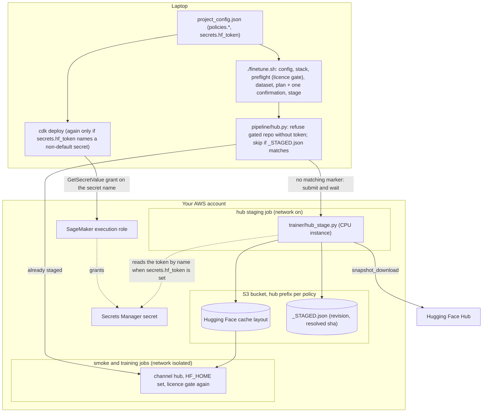

# Why ACT is the default and vision-language-action policies are opt-in

Read this before you set `accept_licence: true` for a vision-language-action (VLA) policy, before you request an 80 GB
GPU quota for one, or when you need to explain why this sample defaults to ACT, a 51.6 M-parameter model trained from
scratch. The question is whether a pretrained VLA beats a from-scratch ACT on a single-task dataset of about 80 episodes.
In the one direct comparison we have (two runs made before this repository existed, on a private dataset not distributed with this repository;
`docs/RESULTS.md` records only the ACT run), the pretrained VLA lost. ACT's held-out joint error is 16 % lower than the
best X-VLA checkpoint. It has 17x fewer parameters, costs a fraction as much, and, unlike X-VLA, carries no upstream
weights to license. VLAs remain available as opt-in policies: the situations where they should win are real, but a
single-task, single-scene dataset does not contain them. Their quality on the shipped public dataset has since been
measured: full fine-tunes of SmolVLA, X-VLA, pi0 and pi0.5 on the same `ml.g6e.4xlarge` as ACT (2026-09-11 rows of
`docs/RESULTS.md`, held-out joint error 0.35-0.46 x hold, 6/6 dims each). Those ratios are not comparable with ACT's 0.424
on that dataset (the chunk lengths differ, a chunk being the number of future actions a policy predicts at once;
`docs/RESULTS.md` explains), so the head-to-head below stays the reference-dataset one.

## The measurement

One dataset, one held-out split, one evaluation harness. The dataset is the private reference recording described in
`docs/RESULTS.md` (80 episodes, one task). 8 episodes (2,059 frames, 8.72 %) were held out of training; 72 episodes with
21,557 frames trained. 4 of the held-out episodes move the left arm and 4 the right (the metadata does not say which arm
moves, so this was read from how much each arm's joints vary per episode). Every held-out frame was scored, not a
subsample. The score is the mean absolute error (MAE) between predicted and recorded actions, compared with the same
"hold" baseline, a policy that keeps the arm where it is: 0.06367 rad on joints, 0.00393 rad on grippers. "x hold" is a
policy's error divided by that baseline (`docs/RESULTS.md` defines the metric).

| | ACT (51.6 M parameters) | X-VLA (879.7 M parameters) |
|---|---|---|
| data budget | 800,000 samples = 37.11 epochs (100,000 steps x batch 8) | 800,000 samples = 37.11 epochs (50,000 steps x batch 16) |
| held-out joints MAE | 0.04323 rad (0.679x hold) | 0.05137 rad (0.807x hold) |
| held-out grippers MAE | 0.00158 rad (0.404x hold) | 0.00149 rad (0.380x hold) |
| gripper timing within 0.5 s | 16/16 | 16/16 |
| dims beating hold | 14 of 16 | 10 of 16 |
| joints worse than hold | 2 of 14 | 6 of 14 (ACT's 2 are among them) |
| wall clock | 2 h 37 m | 4 h 00 m |
| GPU cost (EC2 on-demand, different GPUs) | $9.83 | $35.84 |

Same seed (1000), same chunk (24 steps), same held-out episodes, same hold baseline. ACT's joint error is 16 % lower.
X-VLA wins the grippers by 6 %. Both get the gripper timing right. X-VLA's 0.807x aggregate hides a split: the
high-motion joints carry the average, and on 6 of its 14 joints it is worse than predicting no motion at all. The verdict
of those runs was to ship ACT. X-VLA learned the task, but on this data it is worse on joints, no better on grippers per
dim, 17x larger, 3.6x more expensive, and it carries a licence exposure ACT does not (see below).

The comparison has limits, and the source states them itself:

| caveat | what it means for the numbers |
|---|---|
| batch 8 vs batch 16 | samples and epochs are matched, optimizer steps are not (100k vs 50k); read it as equal epochs, not equal steps |
| open-loop MAE only | open-loop MAE scores predicted actions against the recorded ones without running the robot. It shows whether the policy learned anything from the data; it is not a task success rate. No closed-loop rollout was run, and MAE slightly penalises a policy whose output is random (stochastic) |
| 8 held-out episodes | a small test set, 4 per arm; treat differences under about 5 % as noise |
| best-of-sweep vs last | X-VLA's number is its best of ten checkpoints (30,000 steps), picked on the same held-out episodes it is reported on; ACT's is its final checkpoint. This favours X-VLA slightly. Only a separate validation split (train / validation / test) would remove the bias |
| different GPUs | ACT ran on an EC2 L40S; X-VLA on a 96 GB RTX PRO 6000 Blackwell at $8.9589/h on-demand. The 3.6x cost ratio is a mixed-hardware number; no equal-hardware run exists on this dataset (on the public dataset both ran on `ml.g6e.4xlarge`; `docs/RESULTS.md`) |
| base revision | the X-VLA base revision was not pinned in that run. In this repository most `hub_artifacts` (the base-weight repositories listed in a policy's registry file, `trainer/policies/<name>.yaml`) pin a commit sha; the per-entry list is the `hub_artifacts` row of `trainer/policies/README.md`. The staging job (`trainer/hub_stage.py`) writes the requested revision and the resolved commit of every downloaded repository to `_STAGED.json`, so the exact snapshot is always known |

Why the pretrained prior bought so little here:

- The action head starts from scratch. The released X-VLA base ships the slot a new robot trains untrained, so about
  128 K action-head parameters are learned from zero. "Pretrained VLA" means a pretrained vision-language trunk plus a
  fresh action head. That head has no more prior knowledge than ACT's.
- The language branch is a constant. Every sample carries the same task string, so the text input becomes a fixed offset
  that tells the policy nothing. The VLA's headline strength is never used.
- Fixed cameras and one scene give the trunk's visual prior little to generalise over. Fitting each 16:9 frame into a
  224x224 square (letterboxing) also discards about 44 % of the pixels.
- Joint accuracy stopped improving after about 4 epochs: 0.05271 rad at 5,000 steps against 0.05226 rad at 50,000 in a
  coarse sweep that scored every fifth held-out frame with 4 samples each (hold 0.06344 on that subsample; scoring every
  frame gives 0.05240 for the 50,000 checkpoint). About 30,000 steps would have given a marginally better policy for
  60 % of the cost. Those are intermediate checkpoints of one 50k-step run with a cosine learning-rate schedule, so this
  answers "which checkpoint" exactly and "what step count" only approximately.
- 23.6 K frames is far below the amount of data the X-VLA paper fine-tunes on.

## What the VLA path costs

The ACT and X-VLA columns are measured (reference run); the last column comes from the publishers' documentation, not
from a run made here. The equal-hardware runs of SmolVLA, X-VLA, pi0 and pi0.5 on the public dataset are in
`docs/RESULTS.md` (Full fine-tunes on the public dataset) and are not copied into the table below.

| requirement | ACT | X-VLA (measured in the reference run before this repository) | SmolVLA, pi0.5, GR00T (documented, not measured here; their status is in `docs/POLICIES.md`) |
|---|---|---|---|
| GPU memory | 4.3 GB at batch 8 | 24.1 GB peak at batch 8, 34.6 GiB at batch 16 (chunk 24, three 360x640 cameras, weights in fp32 with the forward pass in bf16; both figures are in `trainer/policies/xvla.yaml`, `docs/POLICIES.md` shows the batch-8 one). A 48 GB L40S fits batch 16 with about 10 GB to spare; a 24 GB A10G does not fit batch 8 | pi0.5 full fine-tune is documented as "sized for a single 80 GB GPU"; GR00T N1.7 needs 40-48 GB+ per GPU and is 3.4x larger than X-VLA |
| base weights | none; the torchvision ResNet18 ImageNet init is pre-staged in the image | 879,687,256 parameters in a 3.52 GB safetensors file, plus the `facebook/bart-large` tokenizer fetched by name at run time; the registry entry lists both as `hub_artifacts`, so the staging job fetches them once (`tests/test_hub.py` stages exactly this pair) | pi0 family: gated `google/paligemma-3b-pt-224` tokenizer; GR00T N1.7: gated `nvidia/Cosmos-Reason2-2B` processor; SmolVLA: the Apache-2.0 SmolVLM2 backbone only |
| checkpoint size | small | about 11 GB per save (3.5 GB weights + 7.0 GB fp32 optimizer state). With `compute.volume_gb: null` the job volume is derived: (`keep_checkpoints` + 1) x `hardware.checkpoint_gb` plus `hardware.hub_gb` from the registry entry, so no manual value is needed; a value you set applies to every enabled policy in the run (there is no per-policy volume field) | comparable or larger |
| precision | fp32 | weights kept in fp32, forward pass in bf16 (autocast), through a custom driver (`trainer/amp_driver.py`, which `trainer/train_policy.sh` launches instead of `lerobot-train` whenever the registry entry's `precision` is `fp32_masters_bf16_autocast`). `--policy.dtype=bfloat16` is a forbidden flag: it hard-casts the weights to bf16, so AdamW updates smaller than half a bf16 step (the unit of least precision, ULP) are silently lost | pi0 family: same hard-cast trap (`--policy.dtype=bfloat16` leaves bf16 master weights); GR00T: also launched through `trainer/amp_driver.py` (`precision: fp32_masters_bf16_autocast` in `trainer/policies/groot.yaml`), its own `--policy.use_bf16=true` and `--policy.model_params_fp32=true` are passed explicitly, and `--policy.dtype` is forbidden because GrootConfig has no such field; SmolVLA: same driver (`precision: fp32_masters_bf16_autocast` in `trainer/policies/smolvla.yaml`), its config has no `dtype` field, the argv also sets `--policy.use_amp=true`, and the frozen VLM stays bf16 |
| language prompt | none | required; one string means a constant token sequence | required |
| dataset flags | none | `--policy.input_features=null` to rebuild camera slots; STATE and ACTION normalisation overridden to MEAN_STD; 16-dim actions zero-padded to 20; only camera slot 0 is language-grounded | policy-specific; see the registry entry |
| network | nothing is downloaded during training | a CPU staging job (network on) fetches the `hub_artifacts` into the bucket and records the resolved sha; training runs isolated | same; gated repositories (pi0 family, GR00T) also need a Hugging Face token stored in AWS Secrets Manager under `<project>/hf_token` (or the name set in `secrets.hf_token`) |
| licence class | `clean` | `terms`: Apache-2.0 tag, but the pretraining corpus includes AgiBot World (CC BY-NC-SA 4.0) | `terms` (pi0 family: Gemma Terms; GR00T N1.7: its two licence documents contradict each other, `requires_approval`); SmolVLA: `clean`, because the entry trains the expert from scratch on the Apache-2.0 SmolVLM2 backbone and forbids `--policy.path` (a fine-tune of `lerobot/smolvla_base`, which carries an Apache-2.0 Hub tag but no licence text, would be class `unknown`, unresolved); see `docs/POLICIES.md` |
| deliverable | yes | no | no |

The costs this document quotes are ACT's: about $17 for 100k steps on `ml.g6e.4xlarge` on the reference dataset (11471 s
billable, `docs/RESULTS.md`), about $10 on the shipped public dataset (`../README.md`, What a run costs), and under $1 for
a 200-step smoke (a short test job). The complete X-VLA run analysed above ran on the Blackwell card, not on the L40S the
pipeline defaults to, and the 80 GB GPU instance types need quotas that default to 0 in new accounts. Measured
equal-hardware costs on the public dataset, all on one `ml.g6e.4xlarge`, are in `../README.md` (What a run costs) and
`docs/RESULTS.md`. X-VLA's 0.44 s/step there compares with 0.360 s/step at batch 8 in the reference run on the same GPU
class and 0.184 s/step on the Blackwell card. Estimates for GR00T are unverified and not printed here.

## When a VLA is the right call

| your situation | why a VLA may help | evidence status in this repository |
|---|---|---|
| several task strings or object variants in one policy | language conditioning carries information | not measured (see "The language branch is a constant" above) |
| changing scenes or camera placements | the trunk's visual prior has something to generalise over | not measured |
| the robot (embodiment) matches the pretraining corpus | the action projection is not starting from scratch | SmolVLA's reported +26.6 % pretraining uplift was measured on SO-100, its own pretraining embodiment; for a 16-dim bimanual robot, dims 6-31 of its action and state projections never saw real data; the `smolvla` entry here does not load that base |
| instruction following at deployment | ACT has no language input | the string must be byte-identical to the training task string (lerobot issue #4548, cited in the `smolvla` entry's serving notes) |
| a later cross-embodiment story | shared trunk across robots | not exercised by an 80-episode single-task set |

The rule is short: reach for a VLA when the dataset has more than one task string, scene or robot, and start with ACT
otherwise. Every property that justifies a 3 B VLA (language conditioning, multi-task, open-world generalisation) is
absent from an 80-episode single-task dataset. Before spending VLA money, two cheaper experiments on the ACT side are
worth running: a data-scaling curve (train on 40, 60 and 80 episodes with the same split; it tells you whether data or
model is the bottleneck) and a chunk and augmentation sweep. Record more episodes and variants first.

## How to turn one on

1. Find the entry in `docs/POLICIES.md` and read its `status`, `tier` and `licence.class`. The status is one of `stub`,
   `smoke-tested`, `trained`, `validated` (defined in `docs/POLICIES.md`, which is the current source; this document does
   not restate per-policy status). Preflight refuses a `stub` unless you pass `./finetune.sh --allow-stubs` (the flag
   exists so a maintainer can run the 200-step smoke that moves a new entry from `stub` to `smoke-tested`). The licence
   gate runs twice, on the laptop and in the job (`docs/POLICIES.md`).
2. Read the linked terms. A `blocked` class cannot be accepted from this repository.
3. In the policy's existing `policies.<name>` block of `project_config.json` (the shipped file has one for every offered
   policy) set `enabled: true` and `accept_licence: true`. Set `approval_ref` when the entry has `requires_approval` or
   its `licence.class` is `research_only` (eo1, molmoact2). Optionally set a per-policy `instance_type` or `spot`. The key
   matches a `trainer/policies/<name>.yaml`. Leave `compute.volume_gb` at `null` unless you have a reason: the derived
   size covers the dataset copies, the staged base weights and (`keep_checkpoints` + 1) checkpoints of the registry's
   `hardware.checkpoint_gb`.
4. Gated bases (pi0 family, GR00T) need a Hugging Face token in AWS Secrets Manager. `./finetune.sh` prompts for it right
   before the staging job and stores it; a non-interactive run exits 4 there instead, so create the secret first for
   scripted runs. How-to: `../README.md`, "Fine-tune other policies". A custom secret name needs a redeploy first:
   `docs/SECURITY.md`, "Secrets and identifiers".
5. `./finetune.sh --dry-run` shows the plan, including the CPU staging job for entries with `hub_artifacts`. How base
   weights are staged: `../README.md`, "Fine-tune other policies", and `docs/ARCHITECTURE.md`; the dry-run output line by
   line: `docs/TESTING.md`, "Several policies in one run".

The same sequence, as the code runs it:

There is no CLI flag that accepts a licence. The acceptance lives in `project_config.json`, travels to the job as the
`accept_licence` and `approval_ref` hyperparameters, and is recorded as `licence_status` (`accepted` or `refused`; a
`clean` entry also records `accepted`, since the gate passed it) in the job's `SUMMARY.json` and in `MANIFEST.json`. The
laptop-side report step writes `MANIFEST.json` and copies the job's hyperparameters into it. `LICENCE_NOTICE.md`, written
next to the published weights, states the entry's licence class, tier and deliverable flag; it does not record who
accepted. `python3 -m pipeline.report --compare runs/*.json` prints `licence` and `deliv` columns across runs, both read
from each job's `SUMMARY.json`; the per-run report printed by `./finetune.sh` does not, so read `SUMMARY.json` for a
single job. Accepting grants nothing the publisher has not granted; the gate only prevents accidental use of a restricted
base and leaves an audit trail.

Tiers, status values, licence classes and the per-policy matrix (tier, status, class, base, GPU memory) are defined once,
in `docs/POLICIES.md` (generated from the registry); this document uses them without restating them.

Three licence facts worth knowing before you accept; the full notices are in `docs/POLICIES.md`:

- X-VLA (`terms`): Apache-2.0 at every hop of the weights chain, but the pretraining corpus includes AgiBot World
  (CC BY-NC-SA 4.0). Whether NonCommercial and ShareAlike flow into derived weights and your fine-tune is an open legal
  question.
- GR00T N1.7 (`terms`, `requires_approval`): the model card's NVIDIA Open Model License ("ready for
  commercial/non-commercial use") contradicts the in-repo LICENSE file, which limits use to non-commercial research and
  evaluation, so the gate also demands an `approval_ref`. The pretraining mix likely includes AgiBot World too (the
  dataset list is unpublished).
- pi0 family (`terms`): a fine-tune is a Gemma "Model Derivative" with pass-through, notice and deletion obligations. The
  gated `google/paligemma-3b-pt-224` tokenizer makes a stored Hugging Face token mandatory (Secrets Manager secret
  `<project>/hf_token`, or the name in `secrets.hf_token`; the account must have accepted the Gemma terms).

## What this repository does not claim

- No closed-loop or task-success numbers for any policy.
- No multi-task or language ablation. Evaluating a trained VLA once with the dataset's task string and once with a
  neutral string, and reporting the difference, was proposed but is not implemented.
- No equal-hardware VLA cost on the reference dataset: the 3.6x ratio compares two GPUs. The public-dataset runs are
  equal-hardware (`docs/RESULTS.md`), but their x-hold ratios are not comparable across policies (see the introduction).
- No VLA quality claim follows from a status value. The values are defined in `docs/POLICIES.md`, and which entry holds
  which is read there and in `docs/RESULTS.md`, not here.
- `LICENCE_NOTICE.md` does not record who accepted the licence; the audit trail is `project_config.json` plus the run's
  `MANIFEST.json`.

## See also

- `docs/POLICIES.md`: tiers, licence classes and per-policy flags.
- `docs/RESULTS.md`: the reference numbers and the validation ledger.
- `docs/TRAPS.md`: the bf16 cast and the other traps the registry engineers around.
- `../README.md`: costs and quotas.
