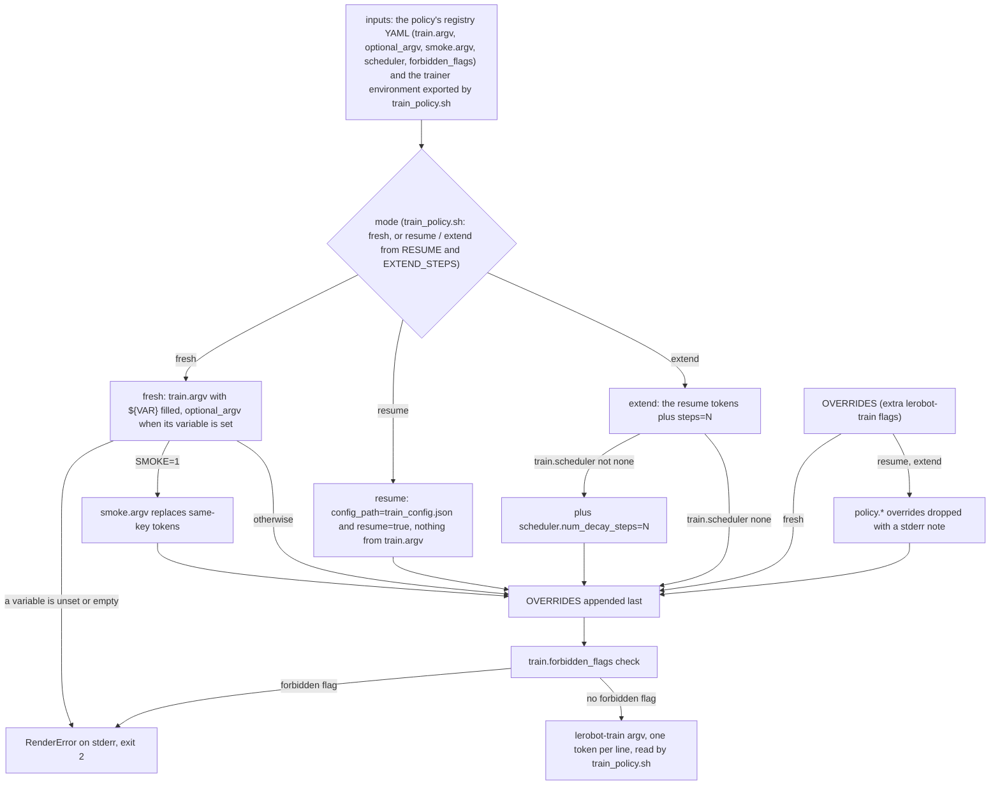

# trainer/policies/: the policy registry

One YAML file per recipe (20 today for the 19 lerobot 0.6.1 policy types: `fastwam` has a second recipe, `fastwam_lora`). These files are maintained with the repository, not edited per
project. Each holds, for one policy, the `lerobot-train` flags, the tier and status, the hardware it needs and the licence
class of its base weights. Users choose and configure policies in the repo-root `project_config.json`.

Which entries are offered and their status: [README.md](../../README.md), section "What this asset supports" (checked by
`tests/test_readme_policies.py`). The full per-entry view is [docs/POLICIES.md](../../docs/POLICIES.md), generated from these
files by `python3 -m pipeline.policies_doc`, which also rewrites the four marked blocks of the README (disclaimer, capability matrix, scenario table, instance fallback tables). Three entries (gaussian_actor, vla_jepa, wall_x) carry `out_of_scope: true` and
`status: stub`. The `out_of_scope` and `stub_reason` rows below say what the code does with them; README.md says why they are
not offered.

The table below lists every top-level key of a registry file and names the code that reads it. A few keys are annotations
only, and the table says so.

| field | meaning |
|---|---|
| `name` / `display_name` / `lerobot_type` | `name` is the file stem and the key under `policies` in project_config.json. `lerobot_type` is the `--policy.type` value; it is also passed to `eval_openloop.py`, `reload_check.py` and `smoke_checks.py`. `display_name` heads the LICENCE_NOTICE.md every job publishes |
| `status` | one of `validated`, `trained`, `smoke-tested`, `stub` (definitions: the top of docs/POLICIES.md). Only the first three are runnable (`pipeline/compat.py` RUNNABLE). Preflight fails a `stub` entry and prints its `stub_reason`; with `--allow-stubs` this becomes a warning |
| `tier` / `deliverable` | `tier` is 0, 1 or 2. It says how the policy is offered (from scratch, research opt-in, large-GPU opt-in), not how far it has been tested: a tier-2 entry can hold status `trained`. Definitions: docs/POLICIES.md. `deliverable: true` is set only on tier-0 imitation recipes (today act, diffusion, vqbet); tdmpc and gaussian_actor are tier 0 but need a reward signal, so they are not deliverable. `deliverable` is copied into SUMMARY.json (`trainer/summary.py`) and LICENCE_NOTICE.md |
| `out_of_scope` | `true` marks an entry that is registered but not offered. `pipeline/compat.py` lists it as "out of scope" in the `--compat` table and leaves it out of the count. Preflight refuses these entries through their `status: stub` (gaussian_actor, vla_jepa, wall_x) |
| `stub_reason` / `smoke_candidate` | `stub_reason` is the message preflight prints when it refuses a `stub` entry (`pipeline/preflight.py`); it is also the notes column of docs/POLICIES.md. `smoke_candidate: true` marks an entry worth a 200-step smoke test; the YAML comment on the same line records when it ran and the result. docs/POLICIES.md shows "(smoke planned)" for a stub that sets it |
| `precision` | `fp32` (everything in 32-bit floats) or `fp32_masters_bf16_autocast` (weights and optimizer state stay 32-bit; the forward and backward passes run in bfloat16 through torch.autocast, because a plain bfloat16 cast would lose small AdamW updates). Read by `train_policy.sh`: the second value makes it start `amp_driver.py` instead of `lerobot-train`. The argv (`--policy.dtype=float32`) and `train.forbidden_flags` keep the weights from being hard-cast. Also rendered into docs/POLICIES.md |
| `base_checkpoint` | the Hub repo the recipe starts from (`null` = from scratch). Read by `patch_base_config.py` (which staged snapshot to patch), `licence.py` (the notice) and `train_policy.sh` (`--peft-base` for adapter checkpoints) |
| `hub_artifacts` | the base weights the hub job copies to S3 before training, one entry per Hub repo: `repo`, `revision`, `role`, `gated`. Training then runs with network isolation. `revision` is pinned on every entry (all 15 policies with `hub_artifacts`, 30 artefacts): smolvla, xvla, pi0 and pi05 to the commit of their full fine-tunes (docs/RESULTS.md), pi0_fast, evo1, lingbot_va, molmoact2 and multi_task_dit to the commit of their 200-step smoke tests, and eo1, fastwam, fastwam_lora, groot, vla_jepa and wall_x to the Hub default-branch commit current when they were pinned. `tests/test_registry.py` fails on a `null` revision unless the entry is on its documented allowlist. `_STAGED.json` records the resolved sha; a prefix staged before a pin was added is kept when its resolved sha equals the pin. Changing a repo or revision makes the hub job stage again (the `_STAGED.json` request must match). An entry may also set `allow_patterns` / `ignore_patterns` (which files `snapshot_download` fetches; groot and lingbot_va set `ignore_patterns`) and `repo_type` (default `model`); `trainer/hub_stage.py` reads all three and records the patterns in `_STAGED.json`. `gated: true` makes the pipeline require a Hugging Face token in Secrets Manager (`pipeline/preflight.py`, `pipeline/run.py`, `pipeline/hub.py`), which `hub_stage.py` passes to the download |
| `requires_flat_action_names`, `requires_language`, `requires_reward`, `requires_quantile_stats`, `single_camera_required`, `square_images`, `max_action_dim`, `camera_count_divides` | dataset compatibility requirements read by `pipeline/compat.py` (`./finetune.sh --compat` and the dataset step at the start of a run). `requires_flat_action_names`: action and state names must be a flat list; `pipeline/run.py` also forwards this one to the job. `requires_language`: the policy uses the task string (0 tasks = blocked, 1 task = constant language). `requires_reward`: the dataset must have `next.reward`. `requires_quantile_stats`: the policy normalises with 1st/99th-percentile statistics (`q01`/`q99` in `meta/stats.json`); when they are missing the training job computes them, so their absence is only a note printed by `pipeline/run.py`, not a blocker. `single_camera_required`: one camera only (`select_camera.py` picks it). `square_images`: that camera must be square. `max_action_dim`: actions wider than the policy's padding cannot be fine-tuned. `camera_count_divides`: the camera count must divide this width (FastWAM: 448) |
| `camera_mapping_required` | annotation, not read by code: whether the base checkpoint's camera keys have to be mapped onto the dataset's. The comment on each entry says how that policy resolves camera keys |
| `base_config_patch` / `base_patches` | `patch_base_config.py` applies both to every staged snapshot of `base_checkpoint`: `base_config_patch` is JSON-merged into `config.json`; `base_patches` is a list of `{file, merge}` or `{file, replace_text}` edits, with `${HUB:repo}` expanding to that repo's staged snapshot directory. `train_policy.sh` runs `patch_base_config.py` when the entry has a non-null `base_config_patch` or a non-empty `base_patches` (pi0_fast relies on the latter) |
| PEFT entries (`--peft.*` in `train.argv`) | `--peft.full_training_modules` becomes PEFT `modules_to_save` (suffix match on module names). List LEAF modules, never a whole expert: lerobot's FastWAM reaches its experts through unregistered aliases, so a copy PEFT installs one level up in the registered tree is never used by the forward pass and never trains (fastwam_lora, found 2026-09-22; docs/TRAPS.md) |
| `train.argv` | the `lerobot-train` tokens; `render_flags.py` fills each `${VAR}` from the trainer environment |
| `train.optional_argv` | `{when, arg, after}` entries. `arg` is added only when the environment variable `when` is set and not empty. It goes right after the first token whose flag name (the part before `=`) equals `after`; when nothing matches, or `after` is omitted, it is appended at the end (`render_flags.py`) |
| `train.local_repo_args` | `{flag, repo}` entries turned into `--policy.<field>=<staged snapshot dir>` by `local_repo_args.py` (called from `train_policy.sh`). Some Hugging Face loaders cannot find a repository by name when the job runs offline (`HF_HUB_OFFLINE=1`, the normal state of a training job), so the job passes the folder of the staged copy instead |
| `train.scheduler` | `none` or the lerobot scheduler name. Decides whether `extend` mode adds `--scheduler.num_decay_steps` |
| `train.forbidden_flags` | flags `render_flags.py` refuses wherever they come from (the YAML argv or `OVERRIDES`). Each one broke a run once; the reason is in the YAML comment beside it or in docs/TRAPS.md |
| `defaults` | `steps`, `batch_size`, `chunk`, `save_freq`, `log_freq`, `seed`. `pipeline/run.py` uses them when `policies.NAME` in project_config.json does not set them. `chunk` precedence: `policies.NAME.chunk`, else `horizon_seconds` times the dataset fps, else `defaults.chunk`. The plan's time and cost estimate uses `defaults.steps` |
| `smoke` | the 200-step smoke job. `steps` and `log_freq` (`pipeline/run.py`); `argv` tokens that replace same-key training tokens when `SMOKE=1` (`render_flags.py`); `max_minutes`, the longest runtime the smoke job is allowed (default 60); `checks_device`, set to `cpu` when rebuilding the policy on the GPU after training would not fit (`smoke_checks.py --device`) |
| `eval` | how `eval_openloop.py` and `reload_check.py` are called after training (`train_policy.sh`, `train_entrypoint.sh`). `n_samples`: how many predictions the evaluation averages per frame for policies whose output is random (flow-matching heads such as pi0 or SmolVLA); 1 for deterministic policies. `stochastic: true` marks a policy whose draw no seed fixes: `reload_check.py` then runs with `--stochastic` even at `n_samples` 1, compares shapes and reports the diff only (no shipped recipe needs it; the FastWAM LoRA spread of 2026-09-21 was the alias defect below, not sampling). `no_history`, `history_via_queues`, `chunk_first`, `queue_image_key`, `tolerance_s` and `reset_per_call` become flags. `policy_arg` and `history_frames` are documentation rendered into docs/POLICIES.md |
| `hardware.min_gpu_memory_gb` | the plan (`pipeline/plan.py`) marks an instance TOO SMALL and blocks the run when its GPU has less. docs/POLICIES.md shows it when `vram_gb` is absent |
| `hardware.vram_gb` | peak GPU memory at `defaults`, measured or estimated (the YAML comment says which). It is the GPU memory column of docs/POLICIES.md; the pipeline does not read it |
| `hardware.checkpoint_gb` / `hardware.hub_gb` | `checkpoint_gb`: the size of one checkpoint (weights plus optimizer state). `hub_gb`: the size of the base weights the staging job copied into the bucket, which the training job mounts as the SageMaker input channel `hub`. `pipeline/run.py` feeds both into `sm_jobs.volume_gb`, which sizes the disk (EBS volume) attached to the training job |
| `hardware.instance_types` | the instance types the entry was sized for, rendered into docs/POLICIES.md. The job's instance comes from project_config.json (`compute.instance_type`, `policies.NAME.instance_type`, `compute.fallback_instance_types`). Its GPU needs a `step_rate` entry only when no smoke measures the rate (`--skip-smoke`); a fallback type is skipped at submit time when its GPU has none |
| `hardware.step_rate` | steps per second per GPU family at `defaults.batch_size`: the rate the 200-step smoke test measured. Where a full fine-tune exists, the YAML comment on the same line records its steady-state rate, which is a few percent lower. Used for the runtime cap and for dry-run planning until a smoke has measured the rate on your dataset. `pipeline/instance_table.py` maps the instance type to its GPU family |
| `licence.class` | `clean`, `terms` (accept upstream terms), `research_only`, `non_commercial`, `none` (publisher declared nothing), `unknown`, `blocked` |
| `licence.requires_accept` / `requires_approval` | `requires_accept`: the entry needs `accept_licence: true` in project_config.json before a job is submitted. `requires_approval`: it also needs an `approval_ref` (your ticket or reference). The gate in `trainer/licence.py` enforces both, on your laptop during preflight and again inside the job; it never accepts `blocked`. The plan table (`pipeline/plan.py`) also demands an `approval_ref` for every `research_only` entry. The full rule and its flowchart: docs/POLICIES.md, the paragraph "How the gate decides" |
| `licence.spdx` / `url` / `commercial_use` / `verified_on` / `notice` | written into the LICENCE_NOTICE.md every job publishes (`trainer/licence.py`) and rendered into docs/POLICIES.md. `notice` is the human-readable finding; `verified_on` is the date the class was checked. `licence.gated` and `weights_fetched_by` are annotations, not read by code |
| `serving` | `frames_per_camera`, `action_space`, `control_rate`, `notes`: what a deployer has to feed the trained policy. Rendered into docs/POLICIES.md; the pipeline does not read it |
| `publish` | `merge_adapter: true` makes `trainer/publish.py` merge a PEFT adapter checkpoint into its `base_checkpoint` and save the result next to it as `pretrained_model_merged/` (servable config: no PEFT, training device, checkpointing off); `summary.py` records `merged_checkpoint` or `merge_error`, `reload_check.py` prefers the merged copy. Hand-submitted jobs can request the same with the `merge_adapter=1` hyperparameter |

How `render_flags.py` turns a registry entry, the trainer environment and `OVERRIDES` into the `lerobot-train` argv in each
of its three modes. `OVERRIDES` holds the extra `lerobot-train` flags from `policies.NAME.overrides` in project_config.json;
the job receives them as the `overrides` hyperparameter. Only the paths `train_policy.sh` reaches are drawn:

Running it by hand: `python3 render_flags.py --policy act --mode fresh` prints one token per line once the `${VAR}`
placeholders of the argv are exported (REPO_ID, DS_ROOT, TRAIN_EPS, CHUNK, DEVICE, BATCH, STEPS, SAVE_FREQ, LOG_FREQ,
NUM_WORKERS, SEED, LR_OUT, JOB_NAME; VIDEO_BACKEND is optional). A missing one exits 2 with its name.
`python3 render_flags.py --policy act --mode resume --config-path <ckpt>/pretrained_model/train_config.json` and
`--mode extend --config-path ... --steps N` render the resume and extend paths of the diagram. The rules the diagram shows
are tested in `tests/test_registry.py`, which also carries a complete example environment.
Licence gate: `python3 licence.py act [--accept] [--approval-ref REF]` exits 0 or 3 with the reason.
